# 과제 1-1 — 리눅스 커널 기반 개발 워크스테이션 구축

> 모든 수행 결과는 본 문서(README.md)에서 확인할 수 있다.
> 실행 로그·스크린샷은 "명령어 입력 + 출력 결과"를 함께 포함한다.
> 민감정보(토큰/비밀번호/인증코드 등)는 모두 마스킹한다.

## 목차
1. [프로젝트 개요](#1-프로젝트-개요)
2. [실행 환경](#2-실행-환경)
3. [수행 체크리스트](#3-수행-체크리스트)
4. [터미널 조작 명령어](#4-터미널-조작-명령어)
5. [파일 권한 실습](#5-파일-권한-실습)
6. [Docker 기본 운영 명령](#6-docker-기본-운영-명령)
7. [컨테이너 실행 실습](#7-컨테이너-실행-실습)
8. [Dockerfile 커스텀 이미지](#8-Dockerfile-커스텀-이미지)
9. [포트 매핑 접속 증거](#9-포트-매핑-접속-증거)
10. [바인드 마운트 반영](#10-바인드-마운트-반영)
11. [볼륨 영속성 검증](#11-볼륨-영속성-검증)
12. [Git 설정 및 GitHub 연동](#12-git-설정-및-github-연동)
13. [트러블슈팅](#13-트러블슈팅)
14. [재현환경 및 실행 시 주의사항](#14-재현환경-및-실행-시-주의사항)
15. [보안 및 개인정보 보호](#15-보안-및-개인정보-보호)

---

## 1. 프로젝트 개요
- 리눅스 커널 기반(우분투 컨테이너) 개발 워크스테이션을 구축하고,
  터미널·권한·Docker·포트·마운트·볼륨·Git/GitHub 전 과정을 수행·검증한다.
---
**GitHub 저장소:** https://github.com/L011235/Mission-1-1-Codyssey-all-in-one
- **제출 문서:** [README.md](./README.md)
- **프로젝트 파일:** [Dockerfile](./Dockerfile) / [nginx.conf](./nginx.conf) / [index.html](./index.html)
- **실습 증거:** [images 폴더](./images/)

```text
Mission-1-1-Codyssey-all-in-one/
│
├── README.md
├── Dockerfile
├── nginx.conf
├── index.html
│
└── images/
    └── 실습 스크린샷들

```
- [Dockerfile](./Dockerfile)
- [nginx.conf](./nginx.conf)
- [index.html](./index.html)
- [실습 스크린샷](./images/)


## 2. 실행 환경
- OS: Windows 11 pro 버전 26H2 (OS 빌드 26300.9711 ) / Ubuntu 26.04.1 LTS (Resolute Raccoon)
- Shell: Git Bash
- Docker: version 29.9.2, build a82e528
- Git: version 2.56.0.windows.4

```text
$ docker --version
Docker version 29.9.2, build a82e528

$ git --version
git version 2.56.0.windows.4


$ docker run -it ubuntu bash
root@3453497ada18:/# cat /etc/os-release
PRETTY_NAME="Ubuntu 26.04.1 LTS"
NAME="Ubuntu"
VERSION_ID="26.04"
VERSION="26.04.1 LTS (Resolute Raccoon)"
VERSION_CODENAME=resolute
ID=ubuntu
ID_LIKE=debian
HOME_URL="https://www.ubuntu.com/"
SUPPORT_URL="https://help.ubuntu.com/"
BUG_REPORT_URL="https://bugs.launchpad.net/ubuntu/"
PRIVACY_POLICY_URL="https://www.ubuntu.com/legal/terms-and-policies/privacy-policy"
UBUNTU_CODENAME=resolute
LOGO=ubuntu-logo
root@3453497ada18:/# exit
exit

$ winver
# GUI 창으로 OS 버전 표시 (스크린샷 참고)
```

### 2-1. Docker 실행환경 체크
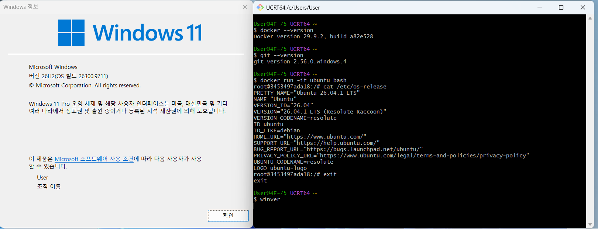


```bash
if docker info >/dev/null 2>&1; then
  echo "Docker daemon: active"
  docker info --format '=== Docker 이미지 및 컨테이너 개수 ===
Containers: {{.Containers}}
 Running: {{.ContainersRunning}}
 Paused: {{.ContainersPaused}}
 Stopped: {{.ContainersStopped}}
Images: {{.Images}}'
else
  echo "Docker daemon: inactive"
fi
```

```text
Docker daemon: active
=== Docker 이미지 및 컨테이너 개수 ===
Containers: 2
 Running: 1
 Paused: 0
 Stopped: 1
Images: 1
```

### 2-2. docker info
```bash
$ docker --version
$ docker info
```


```text
User@4F-75 UCRT64 ~
$ docker --version
Docker version 29.9.2, build a82e528

User@4F-75 UCRT64 ~
$ docker -v
Docker version 29.9.2, build a82e528

User@4F-75 UCRT64 ~
$ docker info
Client:
 Version:    29.9.2
 Context:    desktop-linux
 Debug Mode: false
 Plugins:
  agent: Docker AI Agent Runner (Docker Inc.)
    Version:  v1.152.0
    Path:     C:\Users\User\.docker\cli-plugins\docker-agent.exe
  ai: Docker AI Agent - Ask Gordon (Docker Inc.)
    Version:  v1.33.0
    Path:     C:\Users\User\.docker\cli-plugins\docker-ai.exe
  buildx: Docker Buildx (Docker Inc.)
    Version:  v0.38.1
    Path:     C:\Users\User\.docker\cli-plugins\docker-buildx.exe
  compose: Docker Compose (Docker Inc.)
    Version:  v5.6.1
    Path:     C:\Users\User\.docker\cli-plugins\docker-compose.exe
  debug: Get a shell into any image or container (Docker Inc.)
    Version:  0.49.0
    Path:     C:\Users\User\.docker\cli-plugins\docker-debug.exe
  desktop: Docker Desktop commands (Docker Inc.)
    Version:  4.97.0
    Path:     C:\Users\User\.docker\cli-plugins\docker-desktop.exe
  dhi: CLI for managing Docker Hardened Images (Docker Inc.)
    Version:  v0.0.9
    Path:     C:\Users\User\.docker\cli-plugins\docker-dhi.exe
  extension: Manages Docker extensions (Docker Inc.)
    Version:  v0.2.32
    Path:     C:\Users\User\.docker\cli-plugins\docker-extension.exe
  init: Creates Docker-related starter files for your project (Docker Inc.)
    Version:  v1.4.1
    Path:     C:\Users\User\.docker\cli-plugins\docker-init.exe
  mcp: Docker MCP Plugin (Docker Inc.)
    Version:  v0.44.2
    Path:     C:\Users\User\.docker\cli-plugins\docker-mcp.exe
  model: Docker Model Runner (Docker Inc.)
    Version:  v1.2.9
    Path:     C:\Users\User\.docker\cli-plugins\docker-model.exe
  offload: Docker Offload (Docker Inc.)
    Version:  v0.7.21
    Path:     C:\Users\User\.docker\cli-plugins\docker-offload.exe
  pass: Docker Pass Secrets Manager Plugin (beta) (Docker Inc.)
    Version:  v0.3.2
    Path:     C:\Users\User\.docker\cli-plugins\docker-pass.exe
  sandbox: "docker sandbox" is deprecated, use Docker Sandboxes instead (Docker Inc.)
    Version:  v0.13.0
    Path:     C:\Users\User\.docker\cli-plugins\docker-sandbox.exe
  scout: Docker Scout (Docker Inc.)
    Version:  v1.27.0
    Path:     C:\Users\User\.docker\cli-plugins\docker-scout.exe

Server:
 Containers: 20
  Running: 3
  Paused: 0
  Stopped: 17
 Images: 5
 Server Version: 29.9.2
 Storage Driver: overlayfs
  driver-type: io.containerd.snapshotter.v1
 Logging Driver: local
 Cgroup Driver: cgroupfs
 Cgroup Version: 2
 Plugins:
  Volume: local
  Network: bridge host ipvlan macvlan null overlay
  Log: awslogs fluentd gcplogs gelf journald json-file local splunk syslog
 CDI spec directories:
  /etc/cdi
  /var/run/cdi
 Discovered Devices:
  cdi: docker.com/gpu=webgpu
 Swarm: inactive
 Runtimes: io.containerd.runc.v2 nvidia runc
 Default Runtime: runc
 Init Binary: docker-init
 containerd version: b7a25261e029d68978bbf290df0a62fc819b3c51
 runc version: v1.5.2-0-g29dd3dc2
 init version: de40ad0
 Security Options:
  seccomp
   Profile: builtin
  cgroupns
 Kernel Version: 6.18.54.1-microsoft-standard-WSL2
 Operating System: Docker Desktop
 OSType: linux
 Architecture: x86_64
 CPUs: 8
 Total Memory: 7.605GiB
 Name: docker-desktop
 ID: 5a52089e-1d18-4ba6-9f4b-ae3202c985f0
 Docker Root Dir: /var/lib/docker
 Debug Mode: false
 HTTP Proxy: http.docker.internal:3128
 HTTPS Proxy: http.docker.internal:3128
 No Proxy: hubproxy.docker.internal
 Labels:
  com.docker.desktop.address=npipe://\\.\pipe\docker_cli
 Experimental: false
 Insecure Registries:
  hubproxy.docker.internal:5555
  127.0.0.0/8
  ::1/128
 Live Restore Enabled: false
 Firewall Backend: iptables
```

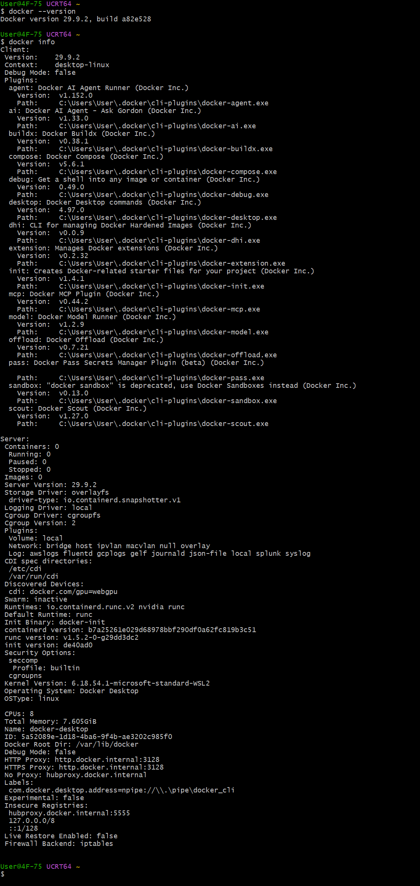

### 2-3. Docker info 정보추출
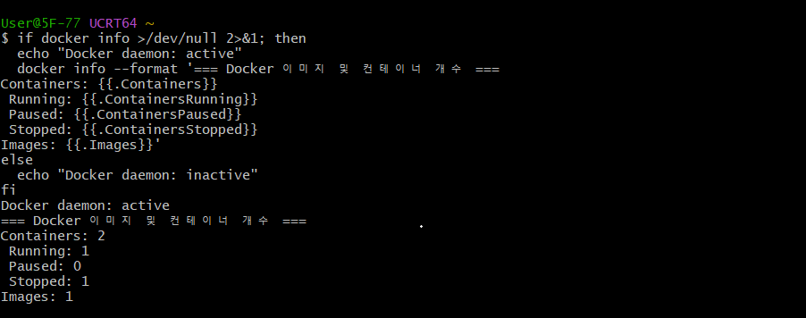
---

## 3. 수행 체크리스트

> 번호는 과제 「4. 기능 요구 사항」의 1~11과 1:1로 대응한다.
> (바인드 마운트는 요구사항 9번(볼륨 영속성)에 포함하여 함께 검증한다.)

### 1. 제출 저장소 및 기술 문서
- [x] 1-1. GitHub 저장소 링크로 제출 + 개요/환경/체크리스트/검증방법 포함
- [x] 1-2. 프로젝트 개요 및 재현성 → [1. 프로젝트 개요](#1-프로젝트-개요) / [14. 재현환경 및 실행 시 주의사항](#14-재현환경-및-실행-시-주의사항)

### 2. 터미널 조작 명령어
- [x] 2-1. pwd / ls -la(숨김 포함) / mkdir / cp / mv / 이름변경 / rm / cat / touch 수행
- [x] 2-2. 터미널 조작 → [4. 터미널 조작 명령어](#4-터미널-조작-명령어)

### 3. 권한 실습 및 증거 기록
- [x] 3-1. 파일 1개 + 디렉터리 1개 권한 변경 전/후 비교
- [x] 3-2. 파일 권한 실습 → [5. 파일 권한 실습](#5-파일-권한-실습)

### 4. Docker 설치 및 기본 점검
- [x] 4-1. docker --version / docker info(또는 동등 점검) 확인
- [x] 4-2. Docker 설치 및 점검 → [2. 실행 환경](#2-실행-환경)

### 5. Docker 기본 운영 명령 수행
- [x] 5-1. docker images / ps / ps -a / logs / stats 실행
- [x] 5-2. 실행결과 → [6. Docker 기본 운영 명령](#6-docker-기본-운영-명령)

### 6. 컨테이너 실행 실습
- [x] 6-1. hello-world 성공 + ubuntu 진입 후 ls/echo + docker run -it/docker exec -it 차이 관찰
- [x] 6-2. 실행결과 → [7. 컨테이너 실행 실습](#7-컨테이너-실행-실습)

### 7. 기존 Dockerfile 기반 커스텀 이미지 제작
- [x] 7-1. 베이스 선택(A/B) + 커스텀 포인트 목적 + 빌드·실행 성공
- [x] 7-2. 실행결과 → [8. Dockerfile 커스텀 이미지](#8-dockerfile-커스텀-이미지)

### 8. 포트 매핑 및 접속 증거
- [x] 8-1. -p <host>:<container> 실행 + 브라우저(주소창+포트) 또는 curl 응답 확인
- [x] 8-2. 포트 매핑 → [9. 포트 매핑 접속 증거](#9-포트-매핑-접속-증거)

### 9. Docker 볼륨 영속성 검증 (+ 바인드 마운트)
- [x] 9-1. (바인드) 호스트 변경 → 컨테이너 반영 전/후 비교
- [x] 9-2. 바인드 실행결과 → [10. 바인드 마운트 반영](#10-바인드-마운트-반영)
- [x] 9-3. (볼륨) 생성/연결 후 컨테이너 삭제 전/후 데이터 유지 증명
- [x] 9-4. 볼륨 실행결과 → [11. 볼륨 영속성 검증](#11-볼륨-영속성-검증)

### 10. Git 설정 및 GitHub 연동
- [x] 10-1. git config --list + GitHub 로그인·VSCode 저장소 연동 완료
- [x] 10-2. 실행결과 → [12. Git 설정 및 GitHub 연동](#12-git-설정-및-github-연동)

### 11. 보안 및 개인정보 보호
- [x] 11-1. 토큰/이메일/비밀번호/인증코드 마스킹 확인
- [x] 11-2. 실행 결과 → [15. 보안 및 개인정보 보호](#15-보안-및-개인정보-보호)

---

## 4. 터미널 조작 명령어
> 작업: 현재 위치 / 목록(숨김 포함) / 폴더 이동 / 폴더 생성 / 파일 복사 / 이동·이름변경 / 삭제 / 내용 확인 / 빈 파일 생성

```bash
#git bash에서 ubuntu 터미널을 띄운 후 입력
$ pwd    
$ ls -la
$ mkdir practice && cd practice
$ touch a.txt
$ cp a.txt b.txt
$ mv b.txt c.txt
$ cat c.txt
$ rm c.txt
```

### 1~4 출력결과 [pwd(위치확인), ls(목록 확인), ls -la, mkdir(폴더생성), cd(폴더이동)]
```text
# 1. pwd (현재 위치 확인)
root@cb89cdd469fc:/# pwd
/

# 2. ls -la (목록(숨김 포함))
root@cb89cdd469fc:/# ls -la
total 60
drwxr-xr-x   1 root root 4096 Oct 31 07:52 .
drwxr-xr-x   1 root root 4096 Oct 31 07:52 ..
-rwxr-xr-x   1 root root    0 Oct 31 07:52 .dockerenv
drwxr-xr-x   2 root root 4096 Oct 25 10:26 .rock
lrwxrwxrwx   1 root root    7 Apr 20  2026 bin -> usr/bin
drwxr-xr-x   2 root root 4096 Apr 20  2026 boot
drwxr-xr-x   5 root root  360 Oct 31 07:52 dev
drwxr-xr-x   1 root root 4096 Oct 31 07:52 etc
drwxr-xr-x   3 root root 4096 Oct 25 10:26 home
lrwxrwxrwx   1 root root    7 Apr 20  2026 lib -> usr/lib
lrwxrwxrwx   1 root root    9 Apr 20  2026 lib64 -> usr/lib64
drwxr-xr-x   2 root root 4096 Oct 25 10:25 media
drwxr-xr-x   2 root root 4096 Oct 25 10:25 mnt
drwxr-xr-x   2 root root 4096 Oct 25 10:25 opt
dr-xr-xr-x 176 root root    0 Oct 31 07:52 proc
drwx------   2 root root 4096 Oct 25 10:26 root
drwxr-xr-x   4 root root 4096 Oct 25 10:26 run
lrwxrwxrwx   1 root root    8 Apr 20  2026 sbin -> usr/sbin
drwxr-xr-x   2 root root 4096 Oct 25 10:25 srv
dr-xr-xr-x  12 root root    0 Oct 31 07:34 sys
drwxrwxrwt   2 root root 4096 Oct 25 10:25 tmp
root@cb89cdd469fc:/# ls
bin   dev  home  lib64  mnt  proc  run   srv  tmp  var
boot  etc  lib   media  opt  root  sbin  sys  usr


# 3. mkdir (폴더 생성)
# 현재 폴더 상황 확인 (하위폴더 중 practice 폴더 없음)
root@cb89cdd469fc:/# ls   
bin   dev  home  lib64  mnt  proc  run   srv  tmp  var
boot  etc  lib   media  opt  root  sbin  sys  usr

root@cb89cdd469fc:/# mkdir practice #폴더 생성

#하위에 practice폴더가 생성된 것을 확인
root@cb89cdd469fc:/# ls 
bin   dev  home  lib64  mnt  practice  root  sbin  sys  usr
boot  etc  lib   media  opt  proc      run   srv   tmp  var

# 4. cd (폴더 이동)
root@cb89cdd469fc:/# pwd  #현위치 확인
/

root@cb89cdd469fc:/# cd practice  # 폴더 이동

root@cb89cdd469fc:/practice# pwd  #현위치 변동 확인
/practice
```

### 1~4. 스크린샷 [pwd(위치확인), ls(목록 확인), ls -la(숨긴목록), mkdir(폴더생성), cd(폴더이동)]
.png)

### 5-1. touch(빈파일 생성) 실행 결과
```text
# 5. touch (빈 파일 생성)
root@cb89cdd469fc:/practice# ls  #현폴더에 파일이 없음을 확인
root@cb89cdd469fc:/practice# touch file1.txt file2.txt  #텍스트파일 2개 생성
root@cb89cdd469fc:/practice# ls  #현폴더에 파일이 2개 생성된 것을 확인
file1.txt  file2.txt
```

### 5-2. touch(빈파일 생성) 스크린샷 
.png)

### 6-1. echo(문자열 생성), > (출력 리다이렉션), cat(문자열 출력) 실행결과
```text
# 6. echo (문자열 생성)
# 문자열 Hello Linux 생성 후 file1.txt에 써넣기 
root@cb89cdd469fc:/practice# echo "Hello Linux" > file1.txt
# 문자열 backup file 생성 후 file2.txt에 써넣기
root@cb89cdd469fc:/practice# echo "Backup file" > file2.txt

# 6. cat (문자열 출력)
# file1.txt의 내용을 출력 
root@cb89cdd469fc:/practice# cat file1.txt
Hello Linux
# file2.txt의 내용을 출력
root@cb89cdd469fc:/practice# cat file2.txt
Backup file
```

### 6-2. echo(문자열 생성), > (출력 리다이렉션), cat(문자열 출력) 스크린샷
.png)

### 7-1. cp (파일 복사) 실행결과
```text
# 7. cp (복사)

root@cb89cdd469fc:/practice# ls  # 현폴더 목록 확인. text파일 2개.
file1.txt  file2.txt

#file1.txt의 내용을 file1_backup.txt에 복사
root@cb89cdd469fc:/practice# cp file1.txt file1_backup.txt

root@cb89cdd469fc:/practice# ls #현폴더 목록 변경 확인. text파일 3개
file1.txt  file1_backup.txt  file2.txt

root@cb89cdd469fc:/practice# cat file1.txt #복사 원본 file1.txt의 내용확인
Hello Linux

#복사된 파일 file1_backup.txt이 동일함을 확인
root@cb89cdd469fc:/practice# cat file1_backup.txt 
Hello Linux

```

### 7-2. cp (파일 복사) 스크린샷
.png)

### 8-1. mv (파일명 변경) 실행결과
```text
# 8. mv (파일명 변경)
# 파일명 변경 후보 file1_backup.txt의 내용 확인
root@bfe91c61e6ed:/practice# cat file1_backup.txt
Hello Linux

# 현폴더 목록 확인 3개 파일 (file1_backup.txt 포함)
root@bfe91c61e6ed:/practice# ls
file1.txt  file1_backup.txt  file2.txt

# file1_backup.txt를 backup.txt로 파일이름 변경
root@bfe91c61e6ed:/practice# mv file1_backup.txt backup.txt

# 현폴더 목록 변경 확인 (3개 파일 중 file1_backup.txt는 없어지고 backup.txt가 생김)
root@bfe91c61e6ed:/practice# ls
backup.txt  file1.txt  file2.txt

#backup.txt의 내용이 file1_backup.txt와 동일함을 확인
root@bfe91c61e6ed:/practice# cat backup.txt 
Hello Linux
```

### 8-2. mv (파일명 변경) 스크린샷
.png)

### 9-1. rm (파일 삭제) 실행결과
```text
# 9. rm (파일 삭제)
root@bfe91c61e6ed:/practice# ls  #현폴더 목록 확인. 텍스트 파일 3개
backup.txt  file1.txt  file2.txt
root@bfe91c61e6ed:/practice# rm file2.txt # 파일 하나 삭제
root@bfe91c61e6ed:/practice# ls  #현폴더 목록 확인. 텍스트 파일 2개
backup.txt  file1.txt             
```

#### 9-2. rm (파일 삭제)
.png)

### 10-1. cd .. (상위폴더로 이동) 실행결과
```text
# 10. cd .. (상위 디렉토리로 이동)
root@bfe91c61e6ed:/practice# pwd  #현위치 확인. 기준폴더 아래의 practice폴더
/practice
root@bfe91c61e6ed:/practice# cd ..  #상위 폴더로 이동
root@bfe91c61e6ed:/# pwd            #현위치 폴더. 기준폴더로 이동했음을 확인
/
```

### 10-2. cd .. (상위폴더로 이동) 스크린샷
.png)

### 11-1. rm -r (파일 있는 폴더도 삭제) 실행결과
```text
# 11. rm -r (폴더 삭제)
root@bfe91c61e6ed:/# ls  #현폴더 목록확인
bin  boot  dev  etc  home  lib  lib64  media  mnt  opt  practice  proc  root  run  sbin  srv  sys  tmp  usr  var
root@bfe91c61e6ed:/# rm -r practice  #현폴더의 하위폴더 중 하나인 practice폴더를 삭제
root@bfe91c61e6ed:/# ls  #현폴더 목록확인. pracitce폴더가 없어진 것을 확인
bin  boot  dev  etc  home  lib  lib64  media  mnt  opt  proc  root  run  sbin  srv  sys  tmp  usr  var
root@bfe91c61e6ed:/#
```

### 11-2. rm -r (파일 있는 폴더도 삭제) 스크린샷
.png)

---

## 5. 파일 권한 실습
> 파일 1개 + 디렉터리 1개에 대해 권한 변경 전/후 비교

```bash
$ ls -l a.txt          # 변경 전
$ chmod 640 a.txt      # 보안상 기타 인원의 권한을 없앰
$ ls -l a.txt          # 변경 후

$ ls -ld practice      # 변경 전
$ chmod 750 practice   # 보안상 기타 인원의 권한을 없앰
$ ls -ld practice      # 변경 후
```
```text
### 1. 디렉터리 권한 변경 (755-->750)
root@bfe91c61e6ed:/# mkdir practice
#변경 전
root@bfe91c61e6ed:/# ls -ld practice
drwxr-xr-x 2 root root 4096 Oct 31 10:11 practice
root@bfe91c61e6ed:/# chmod 750 practice
#변경 후
root@bfe91c61e6ed:/# ls -ld practice
drwxr-x--- 2 root root 4096 Oct 31 10:11 practice


### 2. 파일 권한 변경 (644-->640)
root@bfe91c61e6ed:/# cd practice
root@bfe91c61e6ed:/practice# touch a.txt
root@bfe91c61e6ed:/practice# ls
a.txt
# 변경 전
root@bfe91c61e6ed:/practice# ls -l a.txt
-rw-r--r-- 1 root root 0 Oct 31 10:12 a.txt
root@bfe91c61e6ed:/practice# chmod 640 a.txt
# 변경 후
root@bfe91c61e6ed:/practice# ls -l a.txt
-rw-r----- 1 root root 0 Oct 31 10:12 a.txt

```
### 5-1 실행 결과 해석
#### 5-1-1. 디렉터리 권한 변경 (755 → 750)

| 구분 | 변경 전 | 변경 후 | 의미 |
|---|---|---|---|
| 소유자(Owner) | `rwx(7)` | `rwx(7)` | 읽기, 쓰기, 진입 가능 |
| 그룹(Group) | `r-x(5)` | `r-x(5)` | 읽기, 진입 가능 |
| 기타(Other) | `r-x(5)` | `---(0)` | 모든 권한 제거 |

- 변경 이유: 소유자와 그룹 구성원 외 사용자의 접근 권한 제거
- 디렉터리 `r`: 내부 파일 및 디렉터리 목록 확인
- 디렉터리 `w`: 파일 생성, 삭제, 이름 변경 (일반적으로 `x` 권한도 필요)
- 디렉터리 `x`: 디렉터리 진입 및 내부 항목 접근

**참고:** 디렉터리의 `x`는 프로그램 실행이 아닌 진입 및 탐색 권한을 의미함. `x`가 포함된 권한 숫자는 홀수(1, 3, 5, 7).

#### 5-1-2. 파일 권한 변경 (644 → 640)

| 구분 | 변경 전 | 변경 후 | 의미 |
|---|---|---|---|
| 소유자(Owner) | `rw-(6)` | `rw-(6)` | 읽기, 쓰기 가능 |
| 그룹(Group) | `r--(4)` | `r--(4)` | 읽기 가능 |
| 기타(Other) | `r--(4)` | `---(0)` | 모든 권한 제거 |

- 변경 이유: 소유자와 그룹 구성원 외 사용자의 파일 읽기 권한 제거
- 파일 `r`: 파일 내용 읽기
- 파일 `w`: 파일 내용 수정
- 파일 `x`: 실행 가능한 파일 실행

#### 5-1-3. 권한 숫자 계산 원리

| 권한 | 의미 | 2진수 | 숫자값 |
|---|---|---|---|
| `r` | 읽기(Read) | `100` | 4 |
| `w` | 쓰기(Write) | `010` | 2 |
| `x` | 실행(Execute) | `001` | 1 |
| `---` | 권한 없음 | `000` | 0 |

| 숫자 | 2진수 | 권한 |
|---|---|---|
| 7 | `111` | `rwx` |
| 6 | `110` | `rw-` |
| 5 | `101` | `r-x` |
| 4 | `100` | `r--` |
| 0 | `000` | `---` |

**권한 계산 예시**

- `755` = 소유자 `rwx(7)` / 그룹 `r-x(5)` / 기타 `r-x(5)`
- `750` = 소유자 `rwx(7)` / 그룹 `r-x(5)` / 기타 `---(0)`
- `644` = 소유자 `rw-(6)` / 그룹 `r--(4)` / 기타 `r--(4)`
- `640` = 소유자 `rw-(6)` / 그룹 `r--(4)` / 기타 `---(0)`

#### 5-1-4. 일반적인 기본 권한

일반적으로 `umask 022` 환경에서 디렉터리는 `755`, 일반 파일은 `644` 권한으로 생성됨.

| 구분 | 기본 생성 권한 | umask | 최종 권한 |
|---|---|---|---|
| 디렉터리 | 777 | 022 | 755 |
| 일반 파일 | 666 | 022 | 644 |

- 디렉터리: `777`에 umask `022` 적용 → `755`
- 일반 파일: `666`에 umask `022` 적용 → `644`
- 일반 파일은 기본적으로 실행 권한(`x`)이 부여되지 않음.
- `umask` 명령어로 현재 설정 확인 가능

**참고:** 실제 생성 권한은 사용자별 `umask` 설정에 따라 달라짐.

#### 5-1-5. 실습 시 주의 사항

현재 실습은 `root` 계정으로 실행했으므로 일반 사용자와 권한 제한 결과가 다를 수 있음.

- `root`: 일반적인 파일 권한 검사를 우회할 수 있는 관리자 권한 보유
- 일반 사용자: 설정된 파일 및 디렉터리 권한에 따라 접근 제한 적용

실제 접근 제한 여부는 일반 사용자 계정으로 별도 테스트 필요.

**최종 정리**

- `755 → 750`: 디렉터리의 기타 사용자 접근 권한 제거
- `644 → 640`: 파일의 기타 사용자 읽기 권한 제거
- 디렉터리의 `x`: 진입 및 내부 항목 접근 권한
- 파일의 `x`: 실행 권한
- 일반적인 기본 권한: 디렉터리 `755`, 일반 파일 `644` (umask `022` 기준)

---

#### 5-2. 리눅스 파일 권한 비트 구조 (Permission Bits)

리눅스 파일 권한은 **일반 권한 9비트 + 특수 권한 3비트 = 총 12비트**로 구성됨.

#### 5-2-1. 권한 비트 구성

1. 일반 권한: 9비트 (소유자·그룹·기타 사용자 각각 `rwx` 3비트)
2. 특수 권한: 3비트 (SUID·SGID·Sticky Bit 각각 1비트)
3. 전체 권한 필드: 12비트

#### 5-2-2. 권한 표기법

일반 권한은 3자리 숫자로 표기하며, 특수 권한을 포함하면 앞에 숫자 한 자리를 추가하여 4자리로 표기함.

| 표기 | 의미 |
|---|---|
| `644` | 일반 권한 644 |
| `0644` | 특수 비트 없음 + 일반 권한 644 |
| `4755` | SUID(4) + 일반 권한 755 |
| `2755` | SGID(2) + 일반 권한 755 |
| `1777` | Sticky Bit(1) + 일반 권한 777 |

#### 5-2-3. 특수 권한의 숫자값

| 특수 권한 | 숫자값 | 기능 |
|---|---|---|
| SUID | 4 | 실행 파일을 파일 소유자의 권한으로 실행 |
| SGID | 2 | 실행 파일은 소유 그룹 권한으로 실행, 디렉터리는 생성되는 파일에 그룹 상속 |
| Sticky Bit | 1 | 공용 디렉터리에서 파일 소유자·디렉터리 소유자·root 외 사용자의 파일 삭제 및 이름 변경 제한 |

**참고**

- 일반 문서 파일은 보통 `644`로 설정함.
- 특수 권한이 없는 경우 앞자리 `0` 생략 가능 (`0644` = `644`).
- SUID·SGID는 주로 실행 파일에, Sticky Bit는 공용 디렉터리에 사용함.
- `/tmp` 디렉터리는 대표적으로 `1777` 권한 사용.
---

---

## 6. Docker 기본 운영 명령
```bash
$ docker images
$ docker ps
$ docker ps -a
$ docker logs <container>
$ docker stats --no-stream
```
### 6-1. 이미지 다운로드/목록 확인
```bash
User@4F-75 UCRT64 ~/practice
$ docker images  #다운로드 되어있는 이미지 목록 표시 (없음)
                                                                                         i Info →   U  In Use
IMAGE   ID             DISK USAGE   CONTENT SIZE   EXTRA

User@4F-75 UCRT64 ~/practice
$ docker pull hello-world  #hello-world 이미지를 다운로드
Using default tag: latest
latest: Pulling from library/hello-world
4f55086f7dd0: Pull complete
d5e71e642bf5: Download complete
Digest: sha256:c567b231f65614688711a75f31518a064258a51d442117a3e771a3a8fdba78ef
Status: Downloaded newer image for hello-world:latest
docker.io/library/hello-world:latest

User@4F-75 UCRT64 ~/practice # 다운로드 되어있는 이미지 목록 표시 (hello-world이미지가 latest 태그가 붙은채로 다운로드됨)
$ docker images
                                                                                         i Info →   U  In Use
IMAGE                ID             DISK USAGE   CONTENT SIZE   EXTRA
hello-world:latest   c567b231f656       25.9kB         9.49kB
```

### 6-2.컨테이너 실행/중지/목록확인
```bash
User@4F-75 UCRT64 ~/practice
$ docker run -d --name test_nginx nginx     #run nginx 백그라운드, 컨테이너이름:test_nginx
Unable to find image 'nginx:latest' locally
latest: Pulling from library/nginx
a670537bed70: Pull complete
a071113ac575: Pull complete
6fc242d221a6: Pull complete
6e2ab1f3ef4e: Pull complete
c139fe92686d: Pull complete
d322f1bf41d8: Pull complete
9f604dae09b2: Pull complete
ca81da665177: Download complete
05a7d8870b4b: Download complete
Digest: sha256:5ab5b0b01097420873a3f3330f44248e34a3c2a3e8d5ee30658aeae8cb7435da
Status: Downloaded newer image for nginx:latest
a1961e48957b48e3181cf598a08fcbc696a064d60e64525be3a523324424639f

User@4F-75 UCRT64 ~/practice
$ docker ps     #실행 중인 컨테이너 목록 표시
CONTAINER ID   IMAGE     COMMAND                   CREATED          STATUS          PORTS     NAMES
a1961e48957b   nginx     "/docker-entrypoint.…"   48 seconds ago   Up 47 seconds   80/tcp    test_nginx

User@4F-75 UCRT64 ~/practice
$ docker ps -a  # 실행중이거나 중지된 컨테이너 목록 표시
CONTAINER ID   IMAGE     COMMAND                   CREATED          STATUS          PORTS     NAMES
a1961e48957b   nginx     "/docker-entrypoint.…"   59 seconds ago   Up 58 seconds   80/tcp    test_nginx

User@4F-75 UCRT64 ~/practice
$ docker stop test_nginx  # 컨테이너 test_nginx 중지
test_nginx

User@4F-75 UCRT64 ~/practice
$ docker ps        # 실행 중인 컨테이너 목록 표시 (test_ngnix는 중지하였으므로 사라짐)
CONTAINER ID   IMAGE     COMMAND   CREATED   STATUS    PORTS     NAMES

User@4F-75 UCRT64 ~/practice
$ docker ps -a    # 실행 중이거나 중지된 컨테이너 목록 표시 (test_ngnix가 표시되는데 14초 전에 exited 되었다고 STATUS에 표시됨)
CONTAINER ID   IMAGE     COMMAND                   CREATED              STATUS                      PORTS     NAMES
a1961e48957b   nginx     "/docker-entrypoint.…"   About a minute ago   Exited (0) 14 seconds ago             test_nginx

User@4F-75 UCRT64 ~/practice
$

```
### 6-3.운영 / 로그 확인 / 리소스 확인 
```bash
$ docker run -d --name nginx_log_test nginx
$ docker ps
$ docker logs nginx_log_test
$ docker stats --no-stream nginx_log_test
```
#### 실행결과
```text
user@DESKTOP-KTF7H73 UCRT64 ~/practice
$ docker run -d --name nginx_log_test nginx
Unable to find image 'nginx:latest' locally
latest: Pulling from library/nginx
6d2e43921e9e: Pull complete
bbb080c71d50: Pull complete
7cb4701ce7cd: Pull complete
37fb86c2a767: Pull complete
1962e1ff75b4: Pull complete
512ac5e7ce8e: Pull complete
1724c05f72c6: Pull complete
d2c7e31f04a3: Download complete
4582dace95e2: Download complete
Digest: sha256:165ddde8751e75a1c907d24ef10d9f6deb08b57e0fe56caf67512486aff76d82
Status: Downloaded newer image for nginx:latest
c9c6156cd85102ba619faf835ecdd2cd5732345e8502707f2a39b64425bf2270

user@DESKTOP-KTF7H73 UCRT64 ~/practice
$ docker ps
CONTAINER ID   IMAGE     COMMAND                   CREATED          STATUS         PORTS     NAMES
c9c6156cd851   nginx     "/docker-entrypoint.…"   10 seconds ago   Up 5 seconds   80/tcp    nginx_log_test

user@DESKTOP-KTF7H73 UCRT64 ~/practice
$ docker logs nginx_log_test
/docker-entrypoint.sh: /docker-entrypoint.d/ is not empty, will attempt to perform configuration
/docker-entrypoint.sh: Looking for shell scripts in /docker-entrypoint.d/
/docker-entrypoint.sh: Launching /docker-entrypoint.d/10-listen-on-ipv6-by-default.sh
10-listen-on-ipv6-by-default.sh: info: Getting the checksum of /etc/nginx/conf.d/default.conf
10-listen-on-ipv6-by-default.sh: info: Enabled listen on IPv6 in /etc/nginx/conf.d/default.conf
/docker-entrypoint.sh: Sourcing /docker-entrypoint.d/15-local-resolvers.envsh
/docker-entrypoint.sh: Launching /docker-entrypoint.d/20-envsubst-on-templates.sh
/docker-entrypoint.sh: Launching /docker-entrypoint.d/30-tune-worker-processes.sh
/docker-entrypoint.sh: Configuration complete; ready for start up
2026/11/06 22:57:59 [notice] 1#1: using the "epoll" event method
2026/11/06 22:57:59 [notice] 1#1: nginx/1.31.8
2026/11/06 22:57:59 [notice] 1#1: built by gcc 14.2.0 (Debian 14.2.0-19)
2026/11/06 22:57:59 [notice] 1#1: OS: Linux 6.18.54.1-microsoft-standard-WSL2
2026/11/06 22:57:59 [notice] 1#1: getrlimit(RLIMIT_NOFILE): 1048576:1048576
2026/11/06 22:57:59 [notice] 1#1: start worker processes
2026/11/06 22:57:59 [notice] 1#1: start worker process 29
2026/11/06 22:57:59 [notice] 1#1: start worker process 30
2026/11/06 22:57:59 [notice] 1#1: start worker process 31
2026/11/06 22:57:59 [notice] 1#1: start worker process 32
2026/11/06 22:57:59 [notice] 1#1: start worker process 33
2026/11/06 22:57:59 [notice] 1#1: start worker process 34
2026/11/06 22:57:59 [notice] 1#1: start worker process 35
2026/11/06 22:57:59 [notice] 1#1: start worker process 36
2026/11/06 22:57:59 [notice] 1#1: start worker process 37
2026/11/06 22:57:59 [notice] 1#1: start worker process 38
2026/11/06 22:57:59 [notice] 1#1: start worker process 39
2026/11/06 22:57:59 [notice] 1#1: start worker process 40
2026/11/06 22:57:59 [notice] 1#1: start worker process 41
2026/11/06 22:57:59 [notice] 1#1: start worker process 42
2026/11/06 22:57:59 [notice] 1#1: start worker process 43
2026/11/06 22:57:59 [notice] 1#1: start worker process 44
2026/11/06 22:57:59 [notice] 1#1: start worker process 45
2026/11/06 22:57:59 [notice] 1#1: start worker process 46
2026/11/06 22:57:59 [notice] 1#1: start worker process 47
2026/11/06 22:57:59 [notice] 1#1: start worker process 48

user@DESKTOP-KTF7H73 UCRT64 ~/practice
$ docker stats --no-stream nginx_log_test
CONTAINER ID   NAME             CPU %     MEM USAGE / LIMIT     MEM %     NET I/O         BLOCK I/O     PIDS
c9c6156cd851   nginx_log_test   0.00%     17.77MiB / 15.52GiB   0.11%     1.17kB / 126B   0B / 12.3kB   21

```
#### 스크린샷
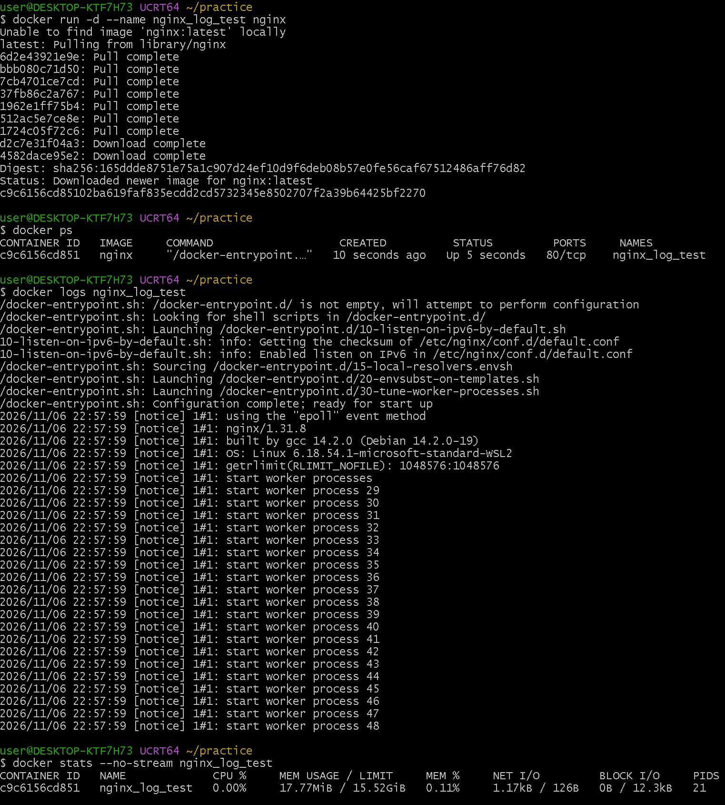
---

## 7. 컨테이너 실행 실습 
```bash
$ docker run hello-world
$ docker run -it ubuntu bash
#(컨테이너 내부)
root@xxxx:/# ls
root@xxxx:/# echo "hello from ubuntu"
```
### 7-1. Hello world 실행결과
```text
# hello-world 이미지를 test_hollo라는 이름의 컨테이너로 실행
User@4F-75 UCRT64 ~/practice
$ docker run --name test_hollo hello-world
Unable to find image 'hello-world:latest' locally
latest: Pulling from library/hello-world
4f55086f7dd0: Pull complete
d5e71e642bf5: Download complete
Digest: sha256:c567b231f65614688711a75f31518a064258a51d442117a3e771a3a8fdba78ef
Status: Downloaded newer image for hello-world:latest

Hello from Docker!
This message shows that your installation appears to be working correctly.

To generate this message, Docker took the following steps:
 1. The Docker client contacted the Docker daemon.
 2. The Docker daemon pulled the "hello-world" image from the Docker Hub.
    (amd64)
 3. The Docker daemon created a new container from that image which runs the
    executable that produces the output you are currently reading.
 4. The Docker daemon streamed that output to the Docker client, which sent it
    to your terminal.

To try something more ambitious, you can run an Ubuntu container with:
 $ docker run -it ubuntu bash

Share images, automate workflows, and more with a free Docker ID:
 https://hub.docker.com/

For more examples and ideas, visit:
 https://docs.docker.com/get-started/
```
### 7-1 Hello world 스크린샷
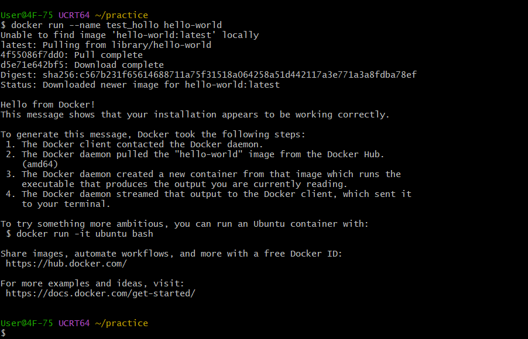

### 7-2 생명주기에 따른 이미지와 컨테이너의 차이
#아래 명령어들을 Git Bash에 차례대로 입력하며 정적인 '이미지'와 동적인 '컨테이너'의 차이를 직접 검증할 수 있습니다.

#### 7-2-1. 원본 이미지 준비 및 확인 (정적 상태)
```bash
# 공식 우분투(Ubuntu) 이미지 다운로드 (생명주기: Stored)
docker pull ubuntu:latest

# 다운로드된 이미지 목록 확인 (자체 실행 불가한 템플릿 상태)
docker images
```
##### 실행결과
```text
user@DESKTOP-KTF7H73 UCRT64 ~/practice
$ docker pull ubuntu:latest
latest: Pulling from library/ubuntu
f3f25b84a7d7: Pull complete
edafa32f5d9e: Pull complete
21594acc2d8b: Download complete
Digest: sha256:6a06111c3b0a8600feadb270aec771dc239bf407b25625f93f44ab00e11f4d3c
Status: Downloaded newer image for ubuntu:latest
docker.io/library/ubuntu:latest

user@DESKTOP-KTF7H73 UCRT64 ~/practice
$ docker images
                                                                               i Info →   U  In Use
IMAGE           ID             DISK USAGE   CONTENT SIZE   EXTRA
ubuntu:latest   6a06111c3b0a        163MB         45.9MB
```
##### 스크린샷
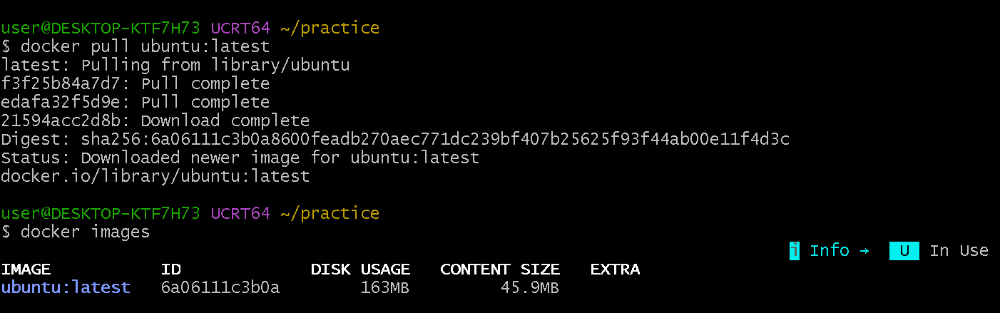

#### 7-2-2. 컨테이너 생성 및 실행 (실체화 및 상태 변화)
```bash
# 이미지를 기반으로 'my_container'라는 이름의 가동 중인 컨테이너 생성
# (생명주기: Created -> Running)
docker run -dit --name my_container ubuntu:latest

# 현재 실행 중인 컨테이너 프로세스 상태 확인
docker ps
```
##### 실행결과
```text
user@DESKTOP-KTF7H73 UCRT64 ~/practice
$ docker run -dit --name my_container ubuntu:latest
d7a7b8974b4abb6db9264ca28754d303ae2f1466e7e2406400c2f7f5c6c6d7d0

user@DESKTOP-KTF7H73 UCRT64 ~/practice
$ docker ps
CONTAINER ID   IMAGE           COMMAND       CREATED          STATUS          PORTS     NAMES
d7a7b8974b4a   ubuntu:latest   "/bin/bash"   41 seconds ago   Up 37 seconds             my_container
```
##### 스크린샷
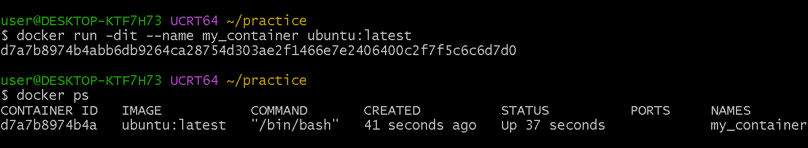


#### 7-2-3. 컨테이너 내부 변경 (쓰기 가능한 레이어 검증)
```bash
# 실행 중인 컨테이너 내부의 Bash 셸로 접속
docker exec -it my_container bash

# [컨테이너 내부셸] 내부에서 새로운 파일 생성 (가변성 확인)
echo "Hello Docker" > /hello.txt
cat /hello.txt

# [컨테이너 내부셸] exit 입력하여 호스트(Git Bash)로 복귀
exit
```
##### 실행결과
```text
# 실행 중인 컨테이너 내부의 Bash 셸로 접속
user@DESKTOP-KTF7H73 UCRT64 ~/practice
$ docker exec -it my_container bash
# [컨테이너 내부셸] 내부에서 새로운 파일 생성 (가변성 확인)
root@a9484c76d213:/# echo "Hello Docker" > /hello.txt
root@a9484c76d213:/# cat /hello.txt
Hello Docker
root@a9484c76d213:/# ls
bin   dev  hello.txt  lib    media  opt   root  sbin  sys  usr
boot  etc  home       lib64  mnt    proc  run   srv   tmp  var
# [컨테이너 내부셸] exit 입력하여 호스트(Git Bash)로 복귀
root@a9484c76d213:/# exit
exit
```
##### 스크린샷
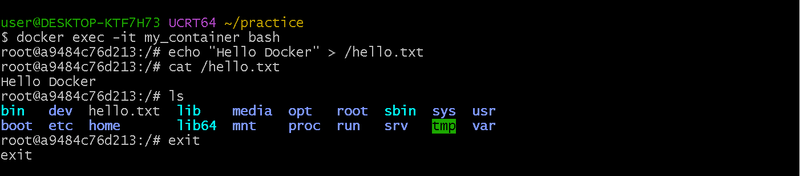

#### 7-2-4. 이미지의 불변성 확인 (원본은 변하지 않음)
```bash
# Git Bash(MSYS)의 경로 자동 변환을 방지한다.
export MSYS_NO_PATHCONV=1
# 동일한 원본 이미지로 새로운 두 번째 컨테이너 실행
docker run -it --name new_container ubuntu:latest cat /hello.txt
# ❌ 결과: "No such file or directory" 에러 발생 
# 원본 이미지(설계도)는 전혀 수정되지 않았음을 증명 (불변성)
```
##### 실행결과
```text
user@DESKTOP-KTF7H73 UCRT64 ~/practice
$ export MSYS_NO_PATHCONV=1

user@DESKTOP-KTF7H73 UCRT64 ~/practice
$ docker run -it --name new_container ubuntu:latest cat /hello.txt
cat: /hello.txt: No such file or directory
# 위 에러 문구가 원본 이미지(설계도)는 전혀 수정되지 않았음을 증명 (불변성)
```
##### 스크린샷
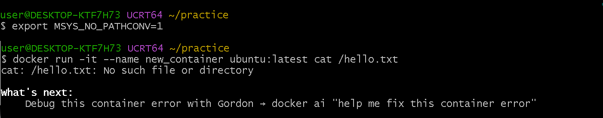


#### 7-2-5. 컨테이너 삭제 및 데이터 소멸 확인 (생명주기 종료)
```bash
# Git Bash(MSYS)의 경로 자동 변환을 방지한다.
$ export MSYS_NO_PATHCONV=1
# 첫 번째 컨테이너 정지 및 삭제 (Running -> Stopped -> Deleted)
docker stop my_container
docker rm my_container

# 동일한 이름으로 다시 컨테이너를 만들어 파일이 남아있는지 확인
docker run -it --name my_container ubuntu:latest cat /hello.txt
# ❌ 결과: "No such file or directory" 에러 발생
# 쓰기 가능 레이어에 적힌 데이터는 컨테이너 삭제 시 함께 소멸됨을 증명


#### (마무리) 실습 환경 정리

# 검증용으로 재생성된 컨테이너와 4단계의 new_container 모두 삭제
docker rm my_container new_container

# 원본 이미지까지 삭제하여 완전 초기화
docker rmi ubuntu:latest
```
##### 실행결과
```text
user@DESKTOP-KTF7H73 UCRT64 ~/practice
$ docker stop my_container
my_container

user@DESKTOP-KTF7H73 UCRT64 ~/practice
$ docker rm my_container new_container
my_container
new_container

user@DESKTOP-KTF7H73 UCRT64 ~/practice
$ docker run -it --name my_container ubuntu:latest cat /hello.txt
cat: /hello.txt: No such file or directory

What's next:
    Debug this container error with Gordon → docker ai "help me fix this container error"

user@DESKTOP-KTF7H73 UCRT64 ~/practice
$ docker rm my_container
my_container

user@DESKTOP-KTF7H73 UCRT64 ~/practice
$ docker rmi ubuntu:latest
Untagged: ubuntu:latest
Deleted: sha256:6a06111c3b0a8600feadb270aec771dc239bf407b25625f93f44ab00e11f4d3c


```

```text
user@DESKTOP-KTF7H73 UCRT64 ~/practice
$ export MSYS_NO_PATHCONV=1

user@DESKTOP-KTF7H73 UCRT64 ~/practice
$ docker stop my_container
my_container

user@DESKTOP-KTF7H73 UCRT64 ~/practice
$ docker rm my_container
my_container

user@DESKTOP-KTF7H73 UCRT64 ~/practice
$ docker run -it --name new_container ubuntu:latest cat /Hello.txt
cat: /Hello.txt: No such file or directory

```
##### 스크린샷
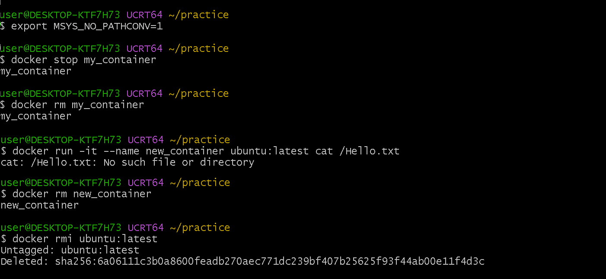

#### 7-2-6 재시작한 컨테이너의 보존성
```bash
$ export MSYS_NO_PATHCONV=1  # Git Bash(MSYS)의 경로 자동 변환을 방지한다.
$ docker run -dit --name reactivated_container ubuntu:latest  # 우분투 이미지를 백그라운드로 실행
$ docker exec reactivated_container sh -c 'echo "hello again" > /again.txt'  #컨테이너 내부 루트폴더에 again.txt 생성
$ docker exec -it reactivated_container cat /again.txt                   #컨테이너 내부 파일 안의 문자를 읽어서 출력
$ docker stop reactivated_container                                      #컨테이너를 중지시킨다.
$ docker start reactivated_container                                     #그 컨테이너를 재시작한다.
$ docker exec -it reactivated_container cat /again.txt                                         #중지되기 전에 존재했던 파일에 대해서 읽기 시도를 한다.
```

##### 실행결과
```text
user@DESKTOP-KTF7H73 UCRT64 ~/practice
$ export MSYS_NO_PATHCONV=1

user@DESKTOP-KTF7H73 UCRT64 ~/practice
$ docker run -dit --name reactivated_container ubuntu:latest
Unable to find image 'ubuntu:latest' locally
latest: Pulling from library/ubuntu
f3f25b84a7d7: Pull complete
edafa32f5d9e: Pull complete
21594acc2d8b: Download complete
Digest: sha256:6a06111c3b0a8600feadb270aec771dc239bf407b25625f93f44ab00e11f4d3c
Status: Downloaded newer image for ubuntu:latest
08c0132e410e688afbab25cc09c47eeeaba959ffe299b9ab3a2d2a93c4337e74

user@DESKTOP-KTF7H73 UCRT64 ~/practice
$ docker exec reactivated_container sh -c 'echo "hello again" > /again.txt'

user@DESKTOP-KTF7H73 UCRT64 ~/practice
$ docker exec reactivated_container cat /again.txt
hello again

user@DESKTOP-KTF7H73 UCRT64 ~/practice
$ docker stop reactivated_container
reactivated_container

user@DESKTOP-KTF7H73 UCRT64 ~/practice
$ docker start reactivated_container
reactivated_container

user@DESKTOP-KTF7H73 UCRT64 ~/practice
$ docker exec reactivated_container cat /again.txt
hello again

user@DESKTOP-KTF7H73 UCRT64 ~/practice
$ docker stop reactivated_container
reactivated_container

user@DESKTOP-KTF7H73 UCRT64 ~/practice
$ docker rm reactivated_container
reactivated_container

user@DESKTOP-KTF7H73 UCRT64 ~/practice
$ docker ps
CONTAINER ID   IMAGE     COMMAND   CREATED   STATUS    PORTS     NAMES

user@DESKTOP-KTF7H73 UCRT64 ~/practice
$ docker ps -a
CONTAINER ID   IMAGE     COMMAND   CREATED   STATUS    PORTS     NAMES
```

##### 스크린샷
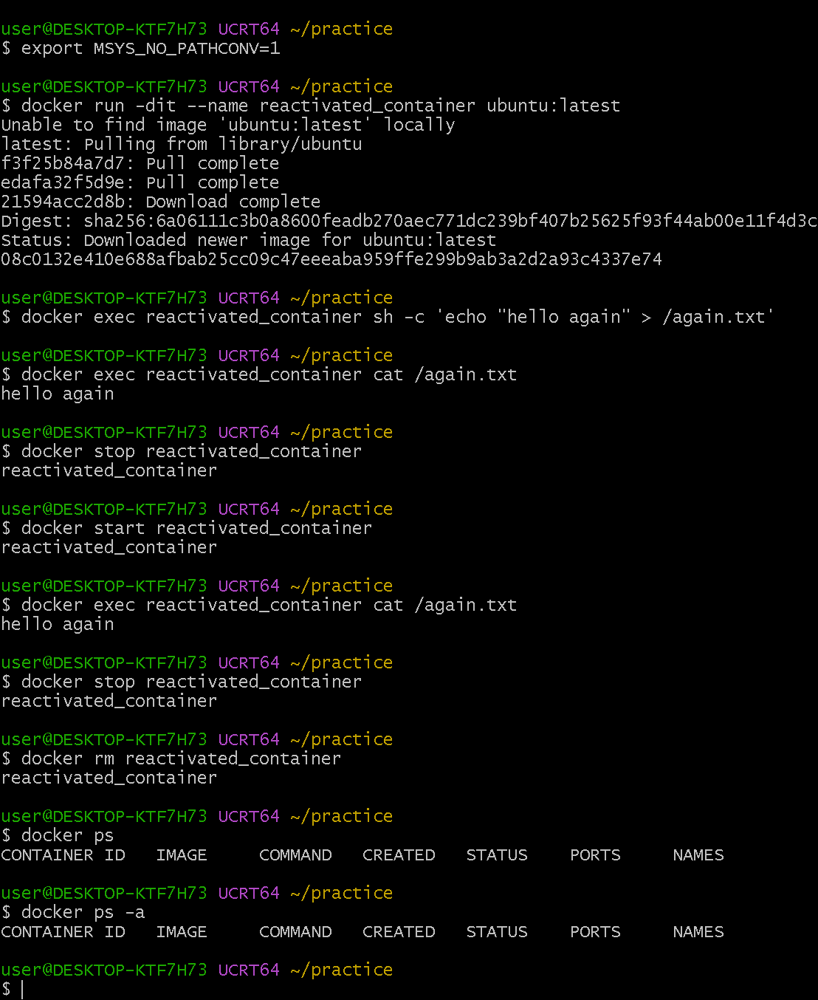


| 구분 | 이미지 (Image) | 컨테이너 (Container) |
| :--- | :--- | :--- |
| **개념 정의** | 애플리케이션 실행에 필요한 모든 파일과 설정이 합쳐진 **읽기 전용(Read-Only) 템플릿** | 이미지를 실행하여 메모리에 올린 **독립된 격리 프로세스** (살아 움직이는 실행 환경) |
| **1. 빌드 (Build)** | `Dockerfile`을 기반으로 새롭게 생성됨 (정적 상태) | 빌드 단계 없음 (이미 완성된 이미지를 실체화함) |
| **2. 실행 원리** | `docker run`의 원본 소스 (자체 실행 불가) | 원본 이미지 레이어 위에 **쓰기 가능한 레이어(Writable Layer)**를 얹어 실행 |
| **3. 변경 가능성** | **불변성(Immutable)**: 수정하려면 새 버전으로 다시 빌드해야 함 | **가변성(Mutable)**: 실행 중 파일 수정이 가능하나, 컨테이너 삭제 시 변경분은 소멸됨 |
| **4. 생명주기 상태** | 존재함(Stored) / 삭제됨(Deleted) | 생성됨(Created) → 실행 중(Running) → 정지(Stopped) → 삭제(Deleted) |
| **5. 주요 명령어** | `build`, `push`, `pull`, `rmi`, `images` | `create`, `start`, `stop`, `rm`, `ps` |
| **비유하자면** | 붕어빵 틀, 건축 설계도, 게임 설치 CD | 실제 붕어빵, 완공된 건물, 실행 중인 게임 프로세스 |


### 7-3. docker run -it와 docker exec -it의 차이

| 명령어 | 의미 | `exit` 실행 시 |
|---|---|---|
| `docker run -it` | 새 컨테이너를 실행하고 메인 프로세스에 연결 | 메인 프로세스가 종료되면서 컨테이너 중지 |
| `docker exec -it` | 실행 중인 컨테이너에 별도 프로세스를 실행 | 해당 프로세스만 종료되고 컨테이너는 계속 실행 |
| `docker attach` | 기존 컨테이너의 메인 프로세스에 터미널 연결 | 메인 프로세스 상태에 영향을 줄 수 있음 |


#### 7-3-1 docker run -it (포그라운드 진입 및 일체화)
```bash
#ubuntu 이미지로 test_ubuntu라는 이름의 컨테이너 실행하고 ubuntu 터미널 내에서 리눅스 명령어 입력
User@4F-16 UCRT64 ~/practice
$ docker run -it --name test_ubuntu ubuntu bash  #test_ubuntu를 attach 상태로 실행

root@1bf29bfb546f:/# ls   #목록 확인
bin  boot  dev  etc  home  lib  lib64  media  mnt  opt  proc  root  run  sbin  srv  sys  tmp  usr  var
root@1bf29bfb546f:/# touch a.txt   #a.txt 생성
root@1bf29bfb546f:/# echo "Hello from ubuntu" > a.txt  #"hello from ubunt"라는 문자열을 생성하여 a.txt에 출력
root@1bf29bfb546f:/# cat a.txt #a.txt의 문자열을 출력
Hello from ubuntu
root@1bf29bfb546f:/# ps
    PID TTY          TIME CMD
      1 pts/0    00:00:00 bash
     11 pts/0    00:00:00 ps
root@1bf29bfb546f:/# exit
exit
#exit를 실행했을 때 attach 상태로 실행해서 해당 컨테이너가 중지됨

User@4F-16 UCRT64 ~/practice  
$ docker ps  # 실행중인 컨테이너는 없음
CONTAINER ID   IMAGE     COMMAND   CREATED   STATUS    PORTS     NAMES

User@4F-16 UCRT64 ~/practice  #test_ubuntu 컨테이너가 수초 전에 중지되었음을 확인
$ docker ps -a
CONTAINER ID   IMAGE     COMMAND       CREATED              STATUS                       PORTS     NAMES
1bf29bfb546f   ubuntu    "bash"        About a minute ago   Exited (0) 15 seconds ago              test_ubuntu
1b9d4f8febb2   ubuntu    "/bin/bash"   8 minutes ago        Exited (137) 3 minutes ago             blissful_fermat
```


#### 7-3-2. docker exec -it (컨테이너 안의 서브프로세스로 구동)
> #### 백그라운드로 실행 중인 컨테이너에 exec -it로 진입하면, 메인 프로세스(PID 1)와 별개로 새로운 프로세스 단위의 터미널 실행이 가능하다. 따라서 여기서 exit해도 컨테이너가 죽지 않고 진입했던 서브 프로세스만 종료된다
##### 실행결과
```bash
User@4F-16 UCRT64 ~/practice
$ docker ps -a   #중지된 컨테이너 중 이름이 test_ubuntu가 존재
CONTAINER ID   IMAGE     COMMAND       CREATED          STATUS                       PORTS     NAMES
1bf29bfb546f   ubuntu    "bash"        40 minutes ago   Exited (0) 5 minutes ago               test_ubuntu
1b9d4f8febb2   ubuntu    "/bin/bash"   47 minutes ago   Exited (137) 7 minutes ago             blissful_fermat

User@4F-16 UCRT64 ~/practice  #test_ubuntu를 up 상태로 바꾼다.
$ docker start test_ubuntu
test_ubuntu

User@4F-16 UCRT64 ~/practice
$ docker exec -it test_ubuntu bash  # docker exec 명령어를 이용하여 test_ubuntu를 실행 컨테이너 안의 하나의 PID로서 실행됨.
root@1bf29bfb546f:/# ls  #중지 전에 만들었던 a.txt가 존재.
a.txt  boot  etc   lib    media  opt   root  sbin  sys  usr
bin    dev   home  lib64  mnt    proc  run   srv   tmp  var
root@1bf29bfb546f:/# cat a.txt  # a.txt의 내용을 확인
Hello from ubuntu
root@1bf29bfb546f:/# exit  #exit로 ubuntu 환경에서 나온다.
exit

User@4F-16 UCRT64 ~/practice
$ docker ps  #실행 중인 컨테이너를 확인, 이번에는 PID만 정지시켰기 때문에 컨테이너 test_ubuntu는 실행 중.
CONTAINER ID   IMAGE     COMMAND   CREATED          STATUS          PORTS     NAMES
1bf29bfb546f   ubuntu    "bash"    44 minutes ago   Up 54 seconds             test_ubuntu

User@4F-16 UCRT64 ~/practice
$
```
##### 스크린샷


#### 정리명령
```bash
docker stop test_ubuntu
docker rm test_ubuntu
```

#### 7-3-3 docker Images vs docker ps && docker ps -a
```bash
docker images
docker ps
docker ps -a
docker stop <컨테이너명>
docker container prune
docker image prune -a
```
##### 실행결과
```text
user@DESKTOP-KTF7H73 UCRT64 ~
$ docker images
                                                                                                                                                                                                                                                          i Info →   U  In Use
IMAGE                ID             DISK USAGE   CONTENT SIZE   EXTRA
hello-world:latest   c567b231f656       25.9kB         9.49kB    U
my-web:1.0           e94718a13fd2       93.9MB         26.4MB
nginx:alpine         713fc2ebfd92       94.5MB         27.3MB
nginx:latest         165ddde8751e        243MB         66.8MB    U
ubuntu:latest        6a06111c3b0a        163MB         45.9MB    U

user@DESKTOP-KTF7H73 UCRT64 ~
$ docker ps
CONTAINER ID   IMAGE           COMMAND                   CREATED         STATUS          PORTS     NAMES
33aa810e2130   ubuntu:latest   "/bin/bash"               2 minutes ago   Up 54 seconds             reactivated_container
c9c6156cd851   nginx           "/docker-entrypoint.…"   2 hours ago     Up 2 hours      80/tcp    nginx_log_test

user@DESKTOP-KTF7H73 UCRT64 ~
$ docker ps -a
CONTAINER ID   IMAGE           COMMAND                   CREATED          STATUS                       PORTS     NAMES
33aa810e2130   ubuntu:latest   "/bin/bash"               2 minutes ago    Up About a minute                      reactivated_container
a09d25040952   ubuntu:latest   "cat /hello.txt"          4 minutes ago    Exited (1) 4 minutes ago               new_container
b21f2bcc04b7   ubuntu:latest   "/bin/bash"               8 minutes ago    Exited (137) 4 minutes ago             my_container
47590f1b8ceb   hello-world     "/hello"                  10 minutes ago   Exited (0) 10 minutes ago              test_hollo
c9c6156cd851   nginx           "/docker-entrypoint.…"   2 hours ago      Up 2 hours                   80/tcp    nginx_log_test

user@DESKTOP-KTF7H73 UCRT64 ~
$ docker stop reactivated_container nginx_log_test
reactivated_container
nginx_log_test

user@DESKTOP-KTF7H73 UCRT64 ~
$ docker ps
CONTAINER ID   IMAGE     COMMAND   CREATED   STATUS    PORTS     NAMES

user@DESKTOP-KTF7H73 UCRT64 ~
$ docker ps -a
CONTAINER ID   IMAGE           COMMAND                   CREATED          STATUS                        PORTS     NAMES
33aa810e2130   ubuntu:latest   "/bin/bash"               5 minutes ago    Exited (137) 18 seconds ago             reactivated_container
a09d25040952   ubuntu:latest   "cat /hello.txt"          7 minutes ago    Exited (1) 7 minutes ago                new_container
b21f2bcc04b7   ubuntu:latest   "/bin/bash"               11 minutes ago   Exited (137) 6 minutes ago              my_container
47590f1b8ceb   hello-world     "/hello"                  12 minutes ago   Exited (0) 12 minutes ago               test_hollo
c9c6156cd851   nginx           "/docker-entrypoint.…"   2 hours ago      Exited (0) 21 seconds ago               nginx_log_test

user@DESKTOP-KTF7H73 UCRT64 ~
$ docker container prune
WARNING! This will remove all stopped containers.
Are you sure you want to continue? [y/N] y
Deleted Containers:
33aa810e2130f3d09afe7c88fbf1af48ac86bf7dc6603d94f762dbdccaaad8e3
a09d25040952c23e597673eb6f91c9f641c775449b98a05f3e76a633c909e944
b21f2bcc04b76d55f61b400319ded68740032ed2a967d2025fa7f72fea423ba3
47590f1b8cebc663285562d9d6fad78304559e49cbbb50078a378ff49c46df3a
c9c6156cd85102ba619faf835ecdd2cd5732345e8502707f2a39b64425bf2270

Total reclaimed space: 110.6kB

user@DESKTOP-KTF7H73 UCRT64 ~
$ docker ps -a
CONTAINER ID   IMAGE     COMMAND   CREATED   STATUS    PORTS     NAMES

user@DESKTOP-KTF7H73 UCRT64 ~
$ docker images
                                                                                                                                                                                                                                                          i Info →   U  In Use
IMAGE                ID             DISK USAGE   CONTENT SIZE   EXTRA
hello-world:latest   c567b231f656       25.9kB         9.49kB
my-web:1.0           e94718a13fd2       93.9MB         26.4MB
nginx:alpine         713fc2ebfd92       94.5MB         27.3MB
nginx:latest         165ddde8751e        243MB         66.8MB
ubuntu:latest        6a06111c3b0a        163MB         45.9MB

user@DESKTOP-KTF7H73 UCRT64 ~
$ docker image prune -a
WARNING! This will remove all images without at least one container associated to them.
Are you sure you want to continue? [y/N] y
Deleted Images:
untagged: my-web:1.0
deleted: sha256:e94718a13fd2c5006efa000617e3e3737d120cd003e56a0019562bc9924464ec
deleted: sha256:fc4127fbe650e17aa156d260b9264591cb084201b6b7c9364bc4778082d0a303
deleted: sha256:eacdba4cf1d16d8355001288a6de97d1b75d4c7599f6aeacd1ad164f53e74147
untagged: nginx:alpine
deleted: sha256:34f345bd05eb2408a6ed75a9e09fa316fa8ead301d1ddf48c807c3d452a3637d
untagged: nginx:latest
deleted: sha256:165ddde8751e75a1c907d24ef10d9f6deb08b57e0fe56caf67512486aff76d82
deleted: sha256:5cb45c65713151f856f6b64f6a9b6a96b74d6a10709a7aa18919a444fd00bffa
deleted: sha256:3da6f2d7175b7c4bbb26e1e1922b47651b499e8a6f6493699a88dded7a16e5f1
untagged: ubuntu:latest
deleted: sha256:6a06111c3b0a8600feadb270aec771dc239bf407b25625f93f44ab00e11f4d3c
deleted: sha256:157dc3d6e4a3e4f2c68d12df9df9ed6e808b59af6d4c3757b432b4f519916725
deleted: sha256:278e4f3cf7eca2bbeeb54397b52f7db90183ec6441c8fdf75ff4a9a239f3edec
untagged: hello-world:latest
deleted: sha256:c567b231f65614688711a75f31518a064258a51d442117a3e771a3a8fdba78ef
deleted: sha256:d1a8d0a4eeb63aff09f5f34d4d80505e0ba81905f36158cc3970d8e07179e59e
deleted: sha256:8e752a1cddeafc02597e756f4a0ec96e29f63ac4bc4af87682daf3f1de843bb7

Total reclaimed space: 474.5MB

user@DESKTOP-KTF7H73 UCRT64 ~
$ docker images
                                                                                                                                                                                                                                                          i Info →   U  In Use
IMAGE   ID             DISK USAGE   CONTENT SIZE   EXTRA

```
##### 스크린샷
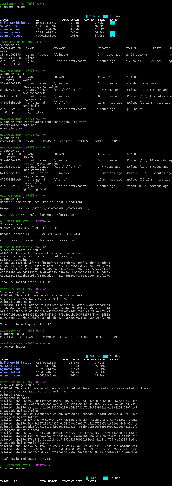

---
## 8. Dockerfile 커스텀 이미지
> **실습 유형: 웹서버 기반 (Nginx)**
>
> **커스텀 목적:** Nginx 기본 이미지를 바탕으로 사용자 정의 웹 페이지를 제공하는 커스텀 이미지 제작
>
> **커스텀 포인트:**
> - `nginx:alpine`을 베이스 이미지로 사용
> - `index.html`을 컨테이너의 웹 루트 디렉터리에 복사하여 기본 페이지 교체
> - `nginx.conf`를 적용하여 웹서버 실행 환경 구성

```dockerfile
FROM nginx:alpine

LABEL org.opencontainers.image.title="my-custom-nginx"
LABEL org.opencontainers.image.version="1.0"
LABEL org.opencontainers.image.description="Custom nginx server"


RUN apk add --no-cache curl

COPY nginx.conf /etc/nginx/nginx.conf
COPY index.html /usr/share/nginx/html/index.html

EXPOSE 80

CMD ["nginx", "-g", "daemon off;"]
```
```bash
cd ~/practice/Mission-1-1-Codyssey-all-in-one
```

```bash
$ docker build -t my-web:1.0 .
$ docker run -d -p 8080:80 --name my-web-8080 my-web:1.0
$ docker rm -f my-web-8080
```
##### 실행결과
```text
User@4F-16 UCRT64 ~/practice
$ docker build -t my-web:1.0 .
[+] Building 8.2s (9/9) FINISHED                                                       docker:desktop-linux
 => [internal] load build definition from Dockerfile                                                   0.0s
 => => transferring dockerfile: 388B                                                                   0.0s
 => [internal] load metadata for docker.io/library/nginx:alpine                                        2.7s
 => [internal] load .dockerignore                                                                      0.0s
 => => transferring context: 2B                                                                        0.0s
 => [1/4] FROM docker.io/library/nginx:alpine@sha256:785835ea65db4bba6f021acc0f3be91b0fef76a53fe41f85  3.2s
 => => resolve docker.io/library/nginx:alpine@sha256:785835ea65db4bba6f021acc0f3be91b0fef76a53fe41f85  0.0s
 => => sha256:b9b388a21ecfde6ac80505f23f527146a2129dfb104e79b029bbd00d4cc1a919 20.53MB / 20.53MB       2.5s
 => => sha256:9b0f7dfe35b2711a17f60dadd6d4035dc0cdee152538cc5c0987029e94679548 1.40kB / 1.40kB         0.5s
 => => sha256:2ec5fb117ffa9a78b15fb6a78745ffc569c8da0aee9f36ace4cd67a44b1fef79 1.21kB / 1.21kB         0.7s
 => => sha256:26185d08a3ec318dd85a6c9f2172e714ec13cececd7f33c533b40b1689f9fedb 404B / 404B             0.6s
 => => sha256:7cc330898115ce55acccb0cc1e7dd091df4410c8c5f3c540710ee0ac689f5fcb 964B / 964B             0.2s
 => => sha256:657023555a2a19dc6036468198bb350d2c7feaac7f2d0a3901b4dd3cb25e40c5 629B / 629B             0.4s
 => => sha256:12b85cff06fd7d383d36a9c96503fe049c9d4bf3dfda5cbb9ffa6ae99b9c07a6 1.94MB / 1.94MB         0.6s
 => => sha256:7b229517ed222597277036d94892173207d01a731ab3a88eeb1de2e963a2c788 3.85MB / 3.85MB         0.9s
 => => extracting sha256:7b229517ed222597277036d94892173207d01a731ab3a88eeb1de2e963a2c788              0.2s
 => => extracting sha256:12b85cff06fd7d383d36a9c96503fe049c9d4bf3dfda5cbb9ffa6ae99b9c07a6              0.2s
 => => extracting sha256:657023555a2a19dc6036468198bb350d2c7feaac7f2d0a3901b4dd3cb25e40c5              0.0s
 => => extracting sha256:7cc330898115ce55acccb0cc1e7dd091df4410c8c5f3c540710ee0ac689f5fcb              0.0s
 => => extracting sha256:26185d08a3ec318dd85a6c9f2172e714ec13cececd7f33c533b40b1689f9fedb              0.0s
 => => extracting sha256:2ec5fb117ffa9a78b15fb6a78745ffc569c8da0aee9f36ace4cd67a44b1fef79              0.0s
 => => extracting sha256:9b0f7dfe35b2711a17f60dadd6d4035dc0cdee152538cc5c0987029e94679548              0.0s
 => => extracting sha256:b9b388a21ecfde6ac80505f23f527146a2129dfb104e79b029bbd00d4cc1a919              0.4s
 => [internal] load build context                                                                      0.1s
 => => transferring context: 2.55kB                                                                    0.0s
 => [2/4] RUN apk add --no-cache curl                                                                  0.8s
 => [3/4] COPY nginx.conf /etc/nginx/nginx.conf                                                        0.1s
 => [4/4] COPY index.html /usr/share/nginx/html/index.html                                             0.1s
 => exporting to image                                                                                 1.1s
 => => exporting layers                                                                                0.2s
 => => exporting manifest sha256:a5bf9bb1c2f9ed28e461fcb754f18ff33bf6b7fc1bd15885ef54b1b08a4a104d      0.0s
 => => exporting config sha256:edd356159466f617a718ec769124b0f90025d99ab6109468ee84b0a08d00e2b4        0.0s
 => => exporting attestation manifest sha256:e919fdad122e1ebab283868b06d2b995068b0132ae07e352d290f3a6  0.0s
 => => exporting manifest list sha256:0818751b074b7d8744a0161e6fafabf6f3cc7e9b0d00d2d020b3fcfb46c64a1  0.0s
 => => naming to docker.io/library/my-web:1.0                                                          0.0s
 => => unpacking to docker.io/library/my-web:1.0                                                       0.7s
User@4F-16 UCRT64 ~/practice
$ docker rm -f my-web-8080
my-web-8080
```
##### 스크린샷
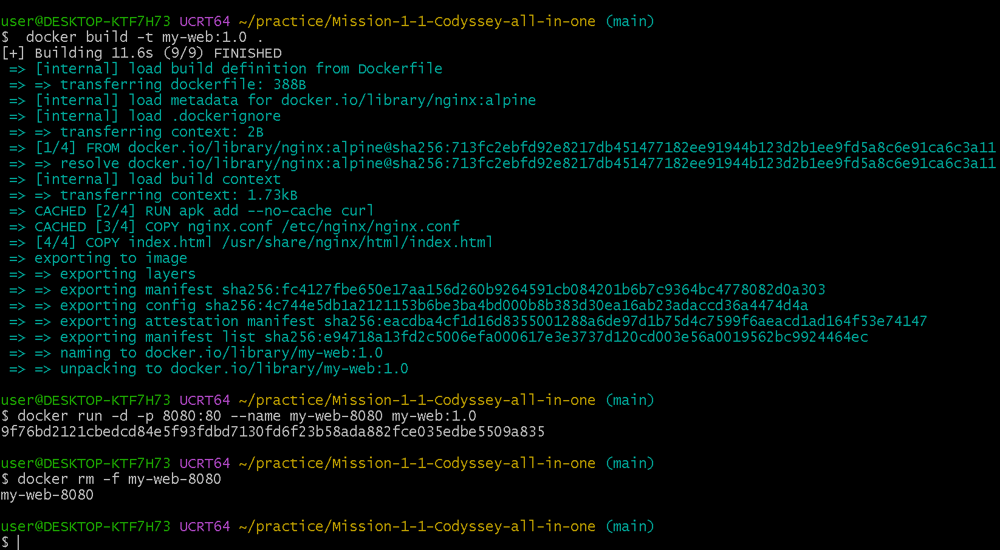
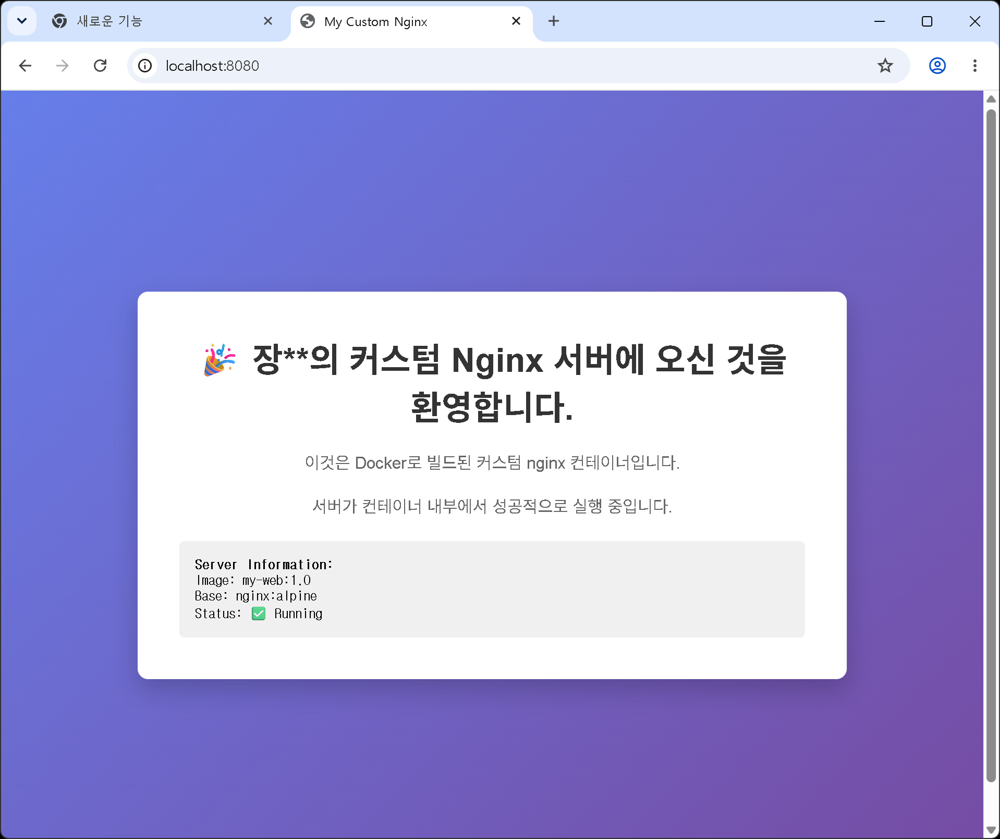

---

## 9. 포트 매핑 접속 증거
### 9-1. 네트워크 네임스페이스와 포트 매핑 원리

#### ① 네트워크 네임스페이스(Network Namespace)

Docker 컨테이너는 호스트와 분리된 독립적인 네트워크 환경인 네트워크 네임스페이스를 사용한다.

각 컨테이너는 독립적인 네트워크 인터페이스와 IP 주소, 포트 공간 등을 가지므로 호스트와 구분되는 네트워크 환경에서 실행된다.

#### ② 포트 매핑(Port Mapping)

호스트와 구분되는 네트워크 환경을 갖는 컨테이너 내부의 서비스에 호스트에서 접근하려면 포트 매핑이 필요하다.

Docker의 `-p` 옵션은 호스트의 포트와 컨테이너의 포트를 연결하여 외부 요청이 컨테이너 내부 서비스에 전달되도록 설정한다.

**포트 매핑 형식**

```bash
docker run -d -p 호스트포트:컨테이너포트 <이미지명>
```

**실습 적용 예시**

```bash
docker run -d -p 8080:80 --name my-web-8080 my-web:1.0
```

| 구분 | 포트 | 역할 |
|---|---:|---|
| 호스트 포트 | 8080 | 호스트에서 접속하는 포트 |
| 컨테이너 포트 | 80 | 컨테이너 내부 Nginx가 사용하는 포트 |

**요청 전달 과정**

```text
[호스트 PC]
브라우저 또는 curl
http://localhost:8080
        |
        ▼
[Docker 포트 게시 설정]
호스트 8080 → 컨테이너 80
        |
        ▼
[컨테이너 네트워크 네임스페이스]
Nginx 웹서버 (80번 포트)
        |
        ▼
웹페이지 응답 반환
```

#### ③ EXPOSE와 -p 옵션의 차이

| 구분 | 기능 |
|---|---|
| `EXPOSE 80` | 이미지에서 사용하는 포트를 문서화 |
| `-p 8080:80` | 호스트 8080 포트를 컨테이너 80 포트에 실제 게시 |

`EXPOSE`만으로는 호스트에서 컨테이너에 접속할 수 있도록 포트가 자동으로 게시되지 않는다.

  ### 9-2. 포트 매핑 실행 및 접속 확인
  >8절 실습에서 컨테이너 `my-web-8080`을 삭제했으므로, 9절에서도 8080 포트를 사용할 수 있다.
```bash
$ docker run -d -p 8080:80 --name my-web-8080 my-web:1.0
$ curl http://localhost:8080
$ docker rm -f my-web-8080
```

### 9-3. 실행 결과 및 검증
##### 실행 결과
```text
User@4F-16 UCRT64 ~/practice
$ docker run -d -p 8080:80 --name my-web-8080 my-web:1.0
e891e89a646871362bd102150881f22bcc18f7a53da0e61cb29710bd3cdcc43f

User@4F-16 UCRT64 ~/practice
$ curl http://localhost:8080
<!DOCTYPE html>
<html lang="ko">
<head>
    <meta charset="UTF-8">
    <meta name="viewport" content="width=device-width, initial-scale=1.0">
    <title>My Custom Nginx</title>
    <style>
        body {
            font-family: Arial, sans-serif;
            margin: 0;
            padding: 20px;
            background: linear-gradient(135deg, #667eea 0%, #764ba2 100%);
            min-height: 100vh;
            display: flex;
            justify-content: center;
            align-items: center;
        }
        .container {
            background: white;
            padding: 40px;
            border-radius: 10px;
            box-shadow: 0 10px 25px rgba(0,0,0,0.2);
            text-align: center;
            max-width: 600px;
        }
        h1 {
            color: #333;
            margin: 0 0 20px 0;
        }
        p {
            color: #666;
            line-height: 1.6;
        }
        .info {
            background: #f0f0f0;
            padding: 15px;
            border-radius: 5px;
            margin-top: 20px;
            font-family: monospace;
            text-align: left;
        }
    </style>
</head>
<body>
    <div class="container">
        <h1>🎉 장**의 커스텀 Nginx 서버에 오신 것을 환영합니다.</h1>
        <p>이것은 Docker로 빌드된 커스텀 nginx 컨테이너입니다.</p>
        <p>서버가 컨테이너 내부에서 성공적으로 실행 중입니다.</p>

        <div class="info">
            <strong>Server Information:</strong><br>
            Image: my-web:1.0<br>
            Base: nginx:alpine<br>
            Status: ✅ Running
        </div>
    </div>
</body>
</html>

User@4F-16 UCRT64 ~/practice
$ docker rm -f my-web-8080
my-web-8080
```
##### 스크린샷
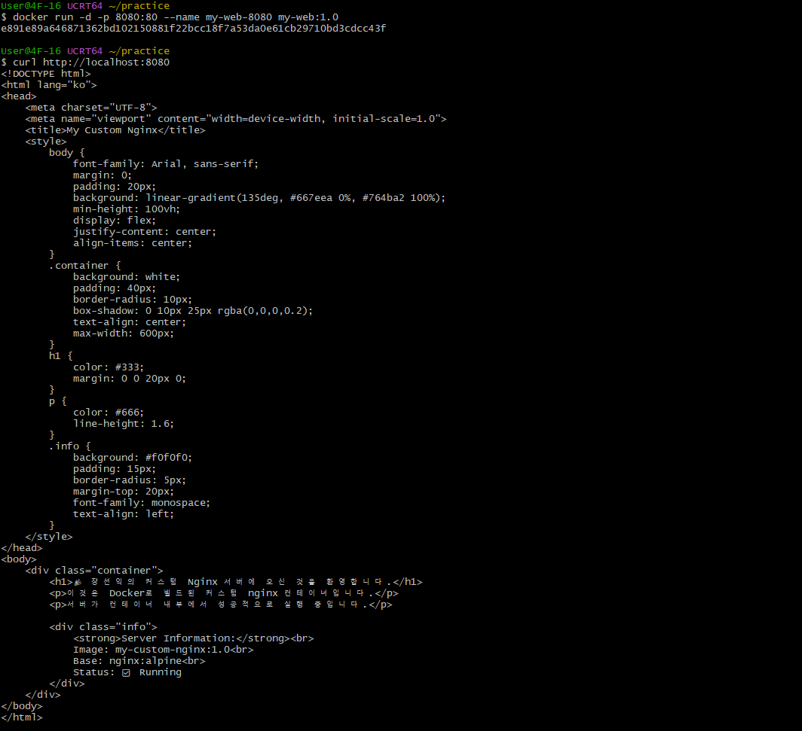


### 9-4 포트 충돌시 대처방법
#### 스탭1. 포트 충돌 상황 발생
```bash
# 1. 기존 컨테이너가 8080 포트를 먼저 점유
docker run -d --name old-web -p 8080:80 nginx:alpine

# 2. 동일 포트로 새 컨테이너 실행 시 충돌 에러 발생 확인 (증빙용 에러 로그)
docker run -d --name new-web -p 8080:80 nginx:alpine
```
##### 스탭1의 실행결과
```text

user@DESKTOP-KTF7H73 UCRT64 ~/practice
$ docker run -d --name old-web -p 8080:80 nginx:alpine
Unable to find image 'nginx:alpine' locally
alpine: Pulling from library/nginx
Digest: sha256:713fc2ebfd92e8217db451477182ee91944b123d2b1ee9fd5a8c6e91ca6c3a11
Status: Downloaded newer image for nginx:alpine
1c9b686786b83d200cb4dbabb06a4cdaab8cf685bb6e6932c70aa66e24fb0baa

user@DESKTOP-KTF7H73 UCRT64 ~/practice
$ docker run -d --name new-web -p 8080:80 nginx:alpine
75d9ba5e086fc55256128748864c8af40a5b8df63a66607bda44927237f3cdb0
docker: Error response from daemon: failed to set up container networking: driver failed programming external connectivity on endpoint new-web (2b5bb4b006ca91d24e0395fdc483cac80bc04d71a26d6ba615a64a9eeaf57a50): Bind for 0.0.0.0:8080 failed: port is already allocated

```
##### 스탭1의 스크린샷
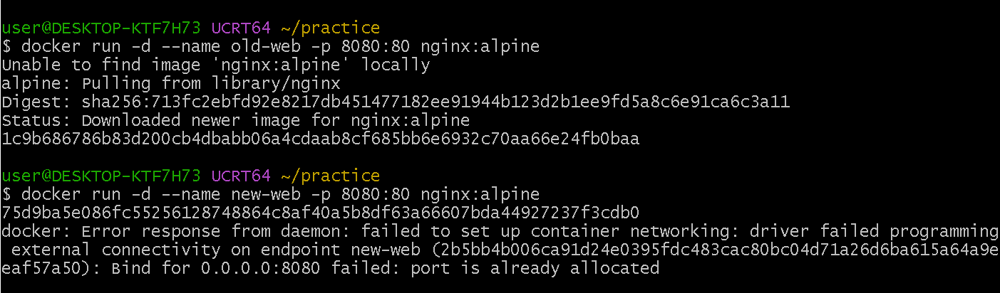

#### 스탭2. 포트 점유 프로세스 및 컨테이너 진단
```bash
# 3. OS 레벨에서 8080 포트 점유 PID 확인 (com.docker.backend.exe 확인)
netstat -ano | grep :8080
tasklist | grep <조회된_PID>

# 4. Docker 레벨에서 8080 포트를 바인딩한 컨테이너 식별
docker ps --filter "publish=8080"
```
#### 스탭2의 실행결과
```text
# OS 레벨에서 8080 포트 점유 PID 확인
user@DESKTOP-KTF7H73 UCRT64 ~/practice
$ netstat -ano | grep :8080
  TCP    0.0.0.0:8080           0.0.0.0:0              LISTENING       30660
  TCP    127.0.0.1:8080         0.0.0.0:0              LISTENING       23884
  TCP    [::]:8080              [::]:0                 LISTENING       30660
  TCP    [::1]:8080             [::]:0                 LISTENING       23884


# Docker 레벨에서 8080 포트를 바인딩한 컨테이너 식별
user@DESKTOP-KTF7H73 UCRT64 ~/practice
$ docker ps --filter "publish=8080"
CONTAINER ID   IMAGE          COMMAND                   CREATED          STATUS          PORTS                                     NAMES
1c9b686786b8   nginx:alpine   "/docker-entrypoint.…"   12 minutes ago   Up 12 minutes   0.0.0.0:8080->80/tcp, [::]:8080->80/tcp   old-web


user@DESKTOP-KTF7H73 UCRT64 ~/practice
$ docker port old-web
80/tcp -> 0.0.0.0:8080
80/tcp -> [::]:8080

# git bash의 자동 경로 확정에 따른 오류
user@DESKTOP-KTF7H73 UCRT64 ~/practice
$ tasklist.exe /FI "PID eq 30660"
오류: 잘못된 인수/옵션 - 'C:/Program Files/Git/FI'.
사용법을 보려면 "TASKLIST /?"를 입력하십시오.

# Git Bash의 자동 경로 변환 방지
user@DESKTOP-KTF7H73 UCRT64 ~/practice
$ export MSYS_NO_PATHCONV=1

# OS 레벨에서 8080 포트 점유 PID 확인
user@DESKTOP-KTF7H73 UCRT64 ~/practice
$ tasklist.exe /FI "PID eq 30660"

이미지 이름                    PID 세션 이름              세션#  메모리 사용
========================= ======== ================ =========== ============
com.docker.backend.exe       30660 Console                    2    182,524 K

# OS 레벨에서 8080 포트 점유 PID 확인
user@DESKTOP-KTF7H73 UCRT64 ~/practice
$ tasklist.exe /FI "PID eq 23884"

이미지 이름                    PID 세션 이름              세션#  메모리 사용
========================= ======== ================ =========== ============
wslrelay.exe                 23884 Console                    2     11,996 K
```
##### 스탭2의 스크린샷
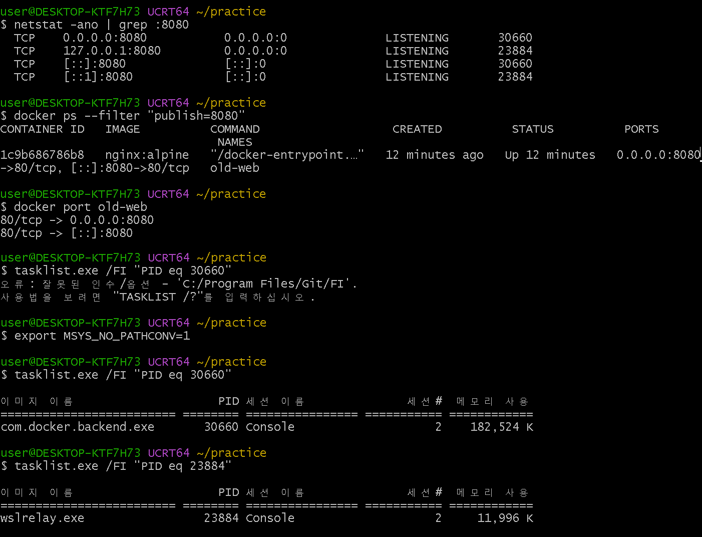

```text
Windows 호스트
    │
    ├── PID 30660: com.docker.backend.exe
    │
    └── PID 23884: wslrelay.exe
             │
             ▼
       Docker 포트 게시
       8080 → 80
             │
             ▼
       old-web 컨테이너
       nginx:alpine
```

```bash
user@DESKTOP-KTF7H73 UCRT64 ~/practice
$ docker ps -a --filter "name=^/new-web$"
CONTAINER ID   IMAGE          COMMAND                   CREATED          STATUS    PORTS     NAMES
75d9ba5e086f   nginx:alpine   "/docker-entrypoint.…"   51 minutes ago   Created             new-web
```
##### 충돌 상태 확인
해석: 현재 new-web은 Created 상태.
이는 Docker가 컨테이너 생성 단계까지 진행했지만, 8080 포트 게시에 실패하여 실행 상태인 Up으로 전환되지 못한 상황과 일치함.


#### 스탭3. 컨테이너 중지(포트 해제) 및 신규 컨테이너 정상 기동
```bash
# 5. 기존 점유 컨테이너 중지 및 삭제
docker stop old-web && docker rm old-web

# 6. 포트 해제 확인
netstat -ano | grep :8080
```
##### 스탭3의 실행결과
```text
#기존 점유 컨테이너 중지 및 삭제
user@DESKTOP-KTF7H73 UCRT64 ~/practice
$ docker stop old-web && docker rm old-web
old-web
old-web

user@DESKTOP-KTF7H73 UCRT64 ~/practice
$ docker ps --filter "publish=8080"
CONTAINER ID   IMAGE     COMMAND   CREATED   STATUS    PORTS     NAMES

# 포트 해제 확인
user@DESKTOP-KTF7H73 UCRT64 ~/practice
$ netstat -ano | grep :8080
```
##### 스탭3의 스크린샷
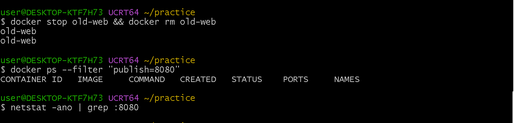
> 포트를 점유 중이던 컨테이너가 삭제되고 port8080이 해제 되었음을 확인
#### 스텝4 충돌시 생성된 컨데이너 재구동 
```bash
$ docker ps
$ docker ps -a
$ docker start new-web
$ docker ps -a
$ docker exec -it new-web sh
쉘 내 구동 확인
```
```text
user@DESKTOP-KTF7H73 UCRT64 ~/practice
$  docker ps
CONTAINER ID   IMAGE     COMMAND   CREATED   STATUS    PORTS     NAMES

user@DESKTOP-KTF7H73 UCRT64 ~/practice
$ docker ps -a
CONTAINER ID   IMAGE          COMMAND                   CREATED        STATUS                        PORTS     NAMES
75d9ba5e086f   nginx:alpine   "/docker-entrypoint.…"   21 hours ago   Exited (255) 44 seconds ago             new-web

user@DESKTOP-KTF7H73 UCRT64 ~/practice
$ docker start new-web
new-web

user@DESKTOP-KTF7H73 UCRT64 ~/practice
$ docker ps -a
CONTAINER ID   IMAGE          COMMAND                   CREATED        STATUS          PORTS     NAMES
75d9ba5e086f   nginx:alpine   "/docker-entrypoint.…"   21 hours ago   Up 33 seconds   80/tcp    new-web

user@DESKTOP-KTF7H73 UCRT64 ~/practice
$ docker exec -it new-web sh
/ # pwd
/
/ # nginx -t
nginx: the configuration file /etc/nginx/nginx.conf syntax is ok
nginx: configuration file /etc/nginx/nginx.conf test is successful
/ # ps
PID   USER     TIME  COMMAND
    1 root      0:00 nginx: master process nginx -g daemon off;
   22 nginx     0:00 nginx: worker process
   23 nginx     0:00 nginx: worker process
   24 nginx     0:00 nginx: worker process
   25 nginx     0:00 nginx: worker process
   26 nginx     0:00 nginx: worker process
   27 nginx     0:00 nginx: worker process
   28 nginx     0:00 nginx: worker process
   29 nginx     0:00 nginx: worker process
   30 nginx     0:00 nginx: worker process
   31 nginx     0:00 nginx: worker process
   32 nginx     0:00 nginx: worker process
   33 nginx     0:00 nginx: worker process
   34 nginx     0:00 nginx: worker process
   35 nginx     0:00 nginx: worker process
   36 nginx     0:00 nginx: worker process
   37 nginx     0:00 nginx: worker process
   38 nginx     0:00 nginx: worker process
   39 nginx     0:00 nginx: worker process
   40 nginx     0:00 nginx: worker process
   41 nginx     0:00 nginx: worker process
   42 root      0:00 sh
   49 root      0:00 ps
/ # exit

What's next:
    Try Docker Debug for seamless, persistent debugging tools in any container or image → docker debug new-web
    Learn more at https://docs.docker.com/go/debug-cli/
```
##### 스크린샷
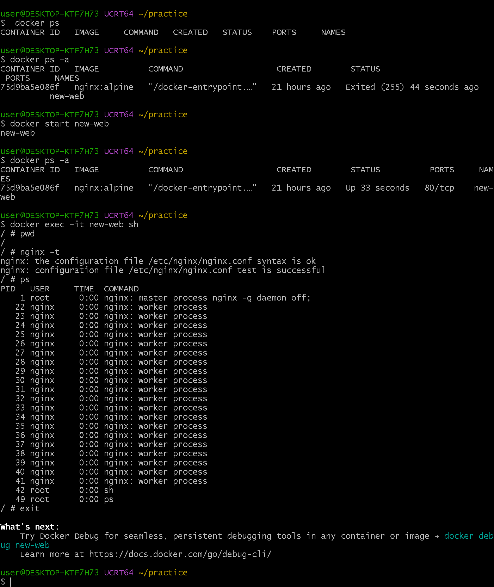

> 재구동된 컨테이너로 내부 쉘을 열어서 config 파일 등이 정상적으로 생성되어있음을 확인.

| 단계 | 컨테이너 상태 | 설명 |
|---|---|---|
| `docker run` 실행 전 | 없음 | 컨테이너가 생성되지 않은 상태 |
| 포트 충돌 발생 | `Created` | 컨테이너는 생성되었으나 포트 게시 실패로 실행되지 못함 |
| `docker start new-web` | `Running` | 기존에 생성된 컨테이너의 실행 성공 |
| `docker exec new-web sh` | `Running` | 실행 중인 컨테이너 내부에 별도 프로세스로 셸 진입 |

#### 스텝5 재구동한 컨테이너와 8080port 연결
```text
user@DESKTOP-KTF7H73 UCRT64 ~/practice
$ curl -I http://localhost:8080
curl: (7) Failed to connect to localhost:8080 after 1 ms: Could not connect to server

user@DESKTOP-KTF7H73 UCRT64 ~/practice
$ docker port new-web

user@DESKTOP-KTF7H73 UCRT64 ~/practice
$ docker inspect new-web --format 'PortBindings={{json .HostConfig.PortBindings}}'
PortBindings={"80/tcp":[{"HostIp":"","HostPort":"8080"}]}
```
##### 스크린샷
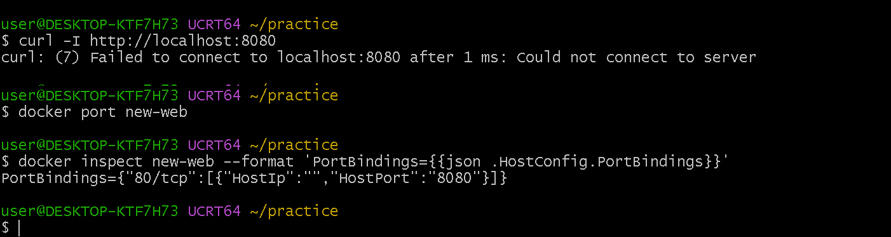

> 재구동한 컨테이너로 8080 포트 연결 실패.

| 항목 | 결과 | 의미 |
|---|---|---|
| `Configured` | 8080 설정 존재 | 컨테이너 생성 당시 포트 매핑을 요청함 |
| `Active` | 빈 배열 (`[]`) | 실제 호스트 포트 연결이 활성화되지 않음 |
| `docker port new-web` | 출력 없음 | 활성화된 포트 게시가 없음 |

>##### Start로 재구동한 new web 컨테이너는 생성당시 포트 매핑을 요청하였으나 당시 old web 컨테이너의 포트 선점유가 원인으로 실제 호스트 포트와 연결이 활성화 되지 않았을 가능성이 높고, 재구동된 컨테이너에는 활성화된 포트 게시가 없으므로 Start 재구동만으로는 8080포트와 연결이 불가능할 것으로 판단되어 포트 선점유가 없는 상태에서 docker run으로 컨테이너를 새로 생성하는 것이 타당하다고 판단함.
```text
user@DESKTOP-KTF7H73 UCRT64 ~/practice/Mission-1-1-Codyssey-all-in-one (main)
$ docker build -t my-web:1.0 .
[+] Building 8.3s (9/9) FINISHED                                               docker:desktop-linux
 => [internal] load build definition from Dockerfile                                           0.6s
 => => transferring dockerfile: 388B                                                           0.1s
 => [internal] load metadata for docker.io/library/nginx:alpine                                0.9s
 => [internal] load .dockerignore                                                              0.4s
 => => transferring context: 2B                                                                0.0s
 => [1/4] FROM docker.io/library/nginx:alpine@sha256:713fc2ebfd92e8217db451477182ee91944b123d  0.6s
 => => resolve docker.io/library/nginx:alpine@sha256:713fc2ebfd92e8217db451477182ee91944b123d  0.5s
 => [internal] load build context                                                              0.3s
 => => transferring context: 62B                                                               0.0s
 => CACHED [2/4] RUN apk add --no-cache curl                                                   0.0s
 => CACHED [3/4] COPY nginx.conf /etc/nginx/nginx.conf                                         0.0s
 => CACHED [4/4] COPY index.html /usr/share/nginx/html/index.html                              0.0s
 => exporting to image                                                                         3.4s
 => => exporting layers                                                                        0.0s
 => => exporting manifest sha256:fc4127fbe650e17aa156d260b9264591cb084201b6b7c9364bc4778082d0  0.2s
 => => exporting config sha256:4c744e5db1a2121153b6be3ba4bd000b8b383d30ea16ab23adaccd36a4474d  0.1s
 => => exporting attestation manifest sha256:a44ff1a04b06abec08729bead70d807844b797e2d172c100  0.5s
 => => exporting manifest list sha256:cbda215519c8a86e18fd5982bdb5ac319fa494f66c84b7bda3c8f6a  0.4s
 => => naming to docker.io/library/my-web:1.0                                                  0.1s
 => => unpacking to docker.io/library/my-web:1.0                                               1.6s

user@DESKTOP-KTF7H73 UCRT64 ~/practice/Mission-1-1-Codyssey-all-in-one (main)
$ docker images my-web:1.0
                                                                               i Info →   U  In Use
IMAGE        ID             DISK USAGE   CONTENT SIZE   EXTRA
my-web:1.0   cbda215519c8       93.9MB         26.4MB

user@DESKTOP-KTF7H73 UCRT64 ~/practice/Mission-1-1-Codyssey-all-in-one (main)
$ docker rm -f new-web
new-web

user@DESKTOP-KTF7H73 UCRT64 ~/practice/Mission-1-1-Codyssey-all-in-one (main)
$ docker run -d --name new-web -p 8080:80 my-web:1.0
36236409ecab2004f560b4634c6775358c1657c6dc0dcb296bbea8ede941d2d5

user@DESKTOP-KTF7H73 UCRT64 ~/practice/Mission-1-1-Codyssey-all-in-one (main)
$ docker ps --filter "publish=8080"
CONTAINER ID   IMAGE        COMMAND                   CREATED          STATUS          PORTS                                     NAMES
36236409ecab   my-web:1.0   "/docker-entrypoint.…"   24 seconds ago   Up 22 seconds   0.0.0.0:8080->80/tcp, [::]:8080->80/tcp   new-web

user@DESKTOP-KTF7H73 UCRT64 ~/practice/Mission-1-1-Codyssey-all-in-one (main)
$ docker port new-web
80/tcp -> 0.0.0.0:8080
80/tcp -> [::]:8080

user@DESKTOP-KTF7H73 UCRT64 ~/practice/Mission-1-1-Codyssey-all-in-one (main)
$ curl -I http://localhost:8080
HTTP/1.1 200 OK
Server: nginx/1.31.8
Date: Sun, 08 Nov 2026 05:35:26 GMT
Content-Type: text/html
Content-Length: 1659
Last-Modified: Fri, 06 Nov 2026 23:15:22 GMT
Connection: keep-alive
ETag: "6aee5f8a-67b"
Accept-Ranges: bytes


user@DESKTOP-KTF7H73 UCRT64 ~/practice/Mission-1-1-Codyssey-all-in-one (main)
$ curl http://localhost:8080
<!DOCTYPE html>
<html lang="ko">
<head>
    <meta charset="UTF-8">
    <meta name="viewport" content="width=device-width, initial-scale=1.0">
    <title>My Custom Nginx</title>
    <style>
        body {
            font-family: Arial, sans-serif;
            margin: 0;
            padding: 20px;
            background: linear-gradient(135deg, #667eea 0%, #764ba2 100%);
            min-height: 100vh;
            display: flex;
            justify-content: center;
            align-items: center;
        }
        .container {
            background: white;
            padding: 40px;
            border-radius: 10px;
            box-shadow: 0 10px 25px rgba(0,0,0,0.2);
            text-align: center;
            max-width: 600px;
        }
        h1 {
            color: #333;
            margin: 0 0 20px 0;
        }
        p {
            color: #666;
            line-height: 1.6;
        }
        .info {
            background: #f0f0f0;
            padding: 15px;
            border-radius: 5px;
            margin-top: 20px;
            font-family: monospace;
            text-align: left;
        }
    </style>
</head>
<body>
    <div class="container">
        <h1>🎉 장**의 커스텀 Nginx 서버에 오신 것을 환영합니다.</h1>
        <p>이것은 Docker로 빌드된 커스텀 nginx 컨테이너입니다.</p>
        <p>서버가 컨테이너 내부에서 성공적으로 실행 중입니다.</p>

        <div class="info">
            <strong>Server Information:</strong><br>
            Image: my-web:1.0<br>
            Base: nginx:alpine<br>
            Status: ✅ Running
        </div>
    </div>
</body>
</html>
```
##### 스크린샷
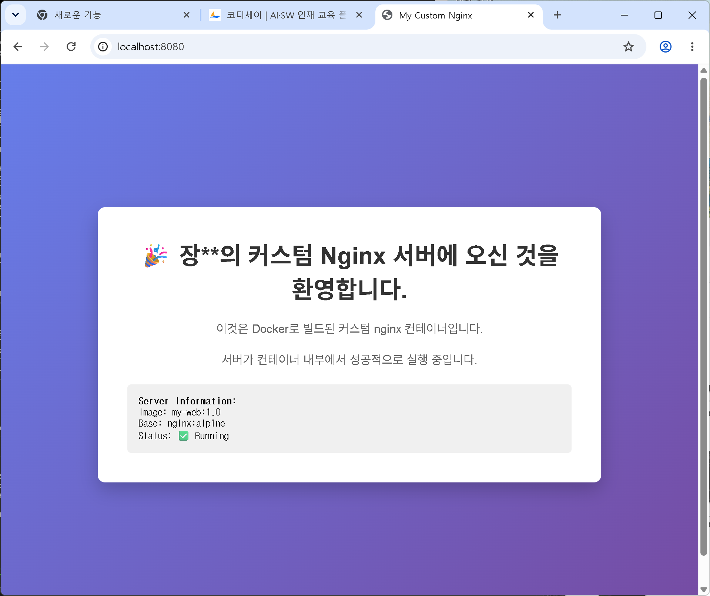


```bash

# (테스트 완료 후 정리)
docker stop new-web && docker rm new-web
```
---
## 10. 바인드 마운트 반영

>호스트 파일 변경 → 컨테이너 내부 반영 전/후 비교

### 10-1. 바인드 마운트 실행 및 호스트 파일 연결
```bash
#### Git Bash의 자동 경로 변환 방지
export MSYS_NO_PATHCONV=1

#### 호스트에 바인드 마운트용 폴더 및 HTML 파일 생성
mkdir -p site
echo "<h1>Test</h1>" > site/index.html

#### Windows 호스트 경로와 컨테이너 내부 경로 연결
docker run -d --name bind-test \
  -p 8080:80 \
  -v "$(pwd -W)/site:/usr/share/nginx/html" \
  nginx:alpine
```
```text
-p 8080:80: 호스트의 8080 포트와 컨테이너의 80 포트 연결
-v: 호스트 폴더와 컨테이너 내부 폴더를 바인드 마운트 방식으로 연결
$(pwd -W)/site: Windows 호스트의 site 폴더
/usr/share/nginx/html: 컨테이너 내부 Nginx 웹페이지 폴더
```

### 10-2. 호스트 파일 변경 전후 비교
```bash
#### 변경 전: 호스트의 index.html 내용을 컨테이너 웹서버에서 확인
curl http://localhost:8080

#### 호스트에서 index.html 내용 변경
echo "<h1>Updated!</h1>" > site/index.html

#### 변경 후: 수정된 내용이 컨테이너에 반영되었는지 확인
curl http://localhost:8080
```

### 10-3. 실행 결과
```bash
User@4F-16 UCRT64 ~/practice
$ mkdir site

User@4F-16 UCRT64 ~/practice
$ echo "<h1>Test</h1>" > site/index.html

User@4F-16 UCRT64 ~/practice
$ export MSYS_NO_PATHCONV=1

User@4F-16 UCRT64 ~/practice
$ docker run -d --name bind-test -p 8080:80 -v "$(pwd -W)/site:/usr/share/nginx/html" nginx:alpine
9683a0599bfb77f8296543c2fabb837badc63a25248f07401706ac214f8f6ccc

User@4F-16 UCRT64 ~/practice
$ curl http://localhost:8080
<h1>Test</h1>

User@4F-16 UCRT64 ~/practice
$ echo "<h1>Updated!</h1>" > site/index.html

User@4F-16 UCRT64 ~/practice
$ curl http://localhost:8080
<h1>Updated!</h1>

docker rm -f bind-test
```

```text
User@4F-16 UCRT64 ~/practice
$ mkdir site

User@4F-16 UCRT64 ~/practice
$ echo "<h1>Test</h1>" > site/index.html  #index.html 생성 내용은 Test

User@4F-16 UCRT64 ~/practice   #경로와 경로를 직접 잇는 바인드 마운트 형태
$ docker run -d --name bind-test -p 8080:80 -v "$(pwd -W)/site:/usr/share/nginx/html" nginx:alpine
9683a0599bfb77f8296543c2fabb837badc63a25248f07401706ac214f8f6ccc

User@4F-16 UCRT64 ~/practice
$ curl http://localhost:8080
<h1>Test</h1>

User@4F-16 UCRT64 ~/practice   #호스트의 내용을 직접 변경하여 사이트의 index의 내용을 변경
$ echo "<h1>Updated!</h1>" > site/index.html

User@4F-16 UCRT64 ~/practice
$ curl http://localhost:8080
<h1>Updated!</h1>

User@4F-16 UCRT64 ~/practice
$ docker rm -f bind-test
bind-test
```
### 10-4. 호스트와 컨테이너의 경로 선택 기준
| 상황 | 경로 방식 | 핵심 이유 |
| :--- | :--- | :--- |
| **CLI (`docker run`)** | 절대 경로 우선, `$(pwd)` 활용 가능 | 상대 경로는 의도와 다르게 해석되거나 에러를 유발할 수 있음 |
| **Compose** | 상대 경로 (`./`) 유효 | `docker-compose.yml` 위치 기준 자동 변환 → 협업 및 프로젝트 이식성 극대화 |
| **컨테이너 내부** | 절대 경로 원칙 | 컨테이너 루트 (`/`)를 기준으로 파일이 마운트될 위치를 명확화해야 함 |
---


## 11. 볼륨 영속성 검증

> 볼륨 생성 및 컨테이너 연결 → 데이터 저장 → 컨테이너 삭제 → 데이터 유지 확인

### 11-1. 실습 목적

- Docker 볼륨(mydata)을 생성하고 컨테이너의 `/data`에 연결
- 컨테이너 내부에 파일 작성 및 내용 확인
- 컨테이너 삭제 후에도 볼륨 데이터가 유지되는지 검증

### 11-2. 명령어 및 실행 결과

```text
User@DESKTOP-V6OTICP UCRT64 ~/practice
$ export MSYS_NO_PATHCONV=1

User@DESKTOP-V6OTICP UCRT64 ~/practice  #docker 볼륨을 생성
$ docker volume create mydata
mydata

User@DESKTOP-V6OTICP UCRT64 ~/practice  #docker 볼륨 생성 확인
$ docker volume ls
DRIVER    VOLUME NAME
local     mydata

User@DESKTOP-V6OTICP UCRT64 ~/practice  
#docker 볼륨과 컨테이너 내 data 폴더를 연결하는 컨테이너 vol-test를 백그라운드에서 생성
$ docker run -d --name vol-test -v mydata:/data alpine sleep 6000
Unable to find image 'alpine:latest' locally
latest: Pulling from library/alpine
881fc932939e: Pull complete
86ff264fe568: Download complete
c35a7d82b8fa: Download complete
Digest: sha256:3f4d6b32e26703c6082839234f43769d5046b3ac7c910033911d1e71d8cd630a
Status: Downloaded newer image for alpine:latest
fb37d821b08feea6f3490a3d608edf55217e012c750085e260bb2632d014eb24

#docker 컨테이너 vol-test의 루트폴더 아래에 data/test.txt를 생성하고 persist me를 입력
User@DESKTOP-V6OTICP UCRT64 ~/practice
$ docker exec vol-test sh -c 'echo "persist me" > /data/test.txt'

#docker 컨테이너 vol-test의  data/test.txt의 내용을 읽어 화면에 출력
User@DESKTOP-V6OTICP UCRT64 ~/practice
$ docker exec vol-test sh -c 'cat /data/test.txt'
persist me

User@DESKTOP-V6OTICP UCRT64 ~/practice  # 컨테이너 vol-test를 삭제
$ docker rm -f vol-test
vol-test

User@DESKTOP-V6OTICP UCRT64 ~/practice  #컨테이너 삭제 후에도 볼륨 mydata는 건재
$ docker volume ls --filter name=mydata
DRIVER    VOLUME NAME
local     mydata

User@DESKTOP-V6OTICP UCRT64 ~/practice  
# 컨테이너를 새로 생성하여 컨테이너의 data폴더와 볼륨 mydata를 연결. 
# data/test.txt가 볼륨에서 새 컨테이너로 동기화됨.
# 새 컨테이너의 data폴더 안의 test.txt 파일을 읽어서 화면에 출력 
$ docker run --rm -v mydata:/data alpine cat /data/test.txt
persist me
```

### 11-3. 실행 결과 해석

- 볼륨 생성: `mydata` 생성 완료
- 데이터 저장: 컨테이너 내부 `/data/test.txt`에 `persist me` 기록
- 컨테이너 삭제: `vol-test` 삭제 완료
- 데이터 확인: 새로운 컨테이너에서 기존 파일 내용 `persist me` 확인

**검증 결과:** 컨테이너를 삭제해도 Docker 볼륨에 저장된 데이터는 유지됨.

**참고**
- `docker rm -f vol-test`는 컨테이너만 삭제하며 연결된 볼륨은 삭제하지 않음.
- `docker run --rm`은 데이터 확인용 임시 컨테이너를 종료 후 자동 삭제함.
- `MSYS_NO_PATHCONV=1`은 UCRT64/Git Bash의 경로 자동 변환을 방지하기 위한 설정임.

### 11-4. 실행 증거

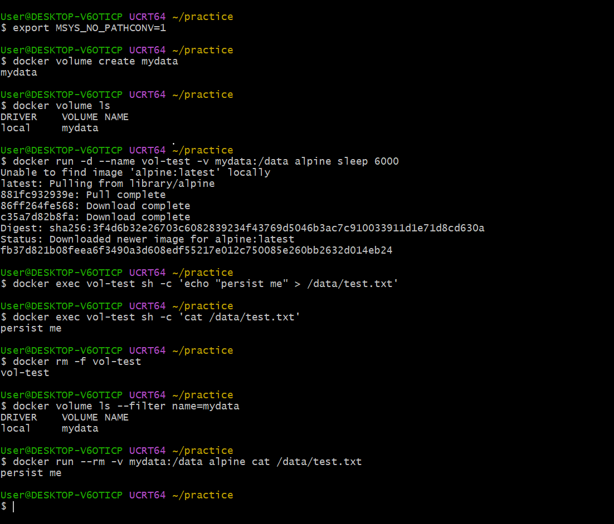


---

## 12. Git설정 및 GitHub연동
### 12-1 Git 사용자 설정
```bash
$ git config --global user.name "본인이름"
$ git config --global user.email "abc@example.com"   # 공개 저장소면 마스킹 권장
$ git config --list
```
```text

user@DESKTOP-KTF7H73 UCRT64 ~/practice
$ git config --global user.name "Se**** J***"

user@DESKTOP-KTF7H73 UCRT64 ~/practice
$ git config --global user.email "a**@e******.com"

user@DESKTOP-KTF7H73 UCRT64 ~/practice
$ git config --list
diff.astextplain.textconv=astextplain
filter.lfs.clean=git-lfs clean -- %f
filter.lfs.smudge=git-lfs smudge -- %f
filter.lfs.process=git-lfs filter-process
filter.lfs.required=true
http.sslbackend=schannel
core.autocrlf=true
core.fscache=true
core.symlinks=false
pull.rebase=false
credential.helper=manager
credential.https://dev.azure.com.usehttppath=true
init.defaultbranch=master
user.email=a**@e******.com
user.name=Se**** J***
```
### 12-2 원격 저장소 연결 확인 (git remote add origin, git remote -v)
```bash
$ git remote add origin https://github.com/<user>/<repo>.git
$ git add -u
$ git commit -m "feat:  과제수행 "
$ git push -u origin main
```

```text
user@DESKTOP-KTF7H73 UCRT64 ~/practice/Mission-1-1-Codyssey-all-in-one (main)
$ git remote add origin https://github.com/L011235/Mission-1-1-Codyssey-all-in-one

user@DESKTOP-KTF7H73 UCRT64 ~/practice/Mission-1-1-Codyssey-all-in-one (main)
$ git remote -v
origin  https://github.com/L011235/Mission-1-1-Codyssey-all-in-one (fetch)
origin  https://github.com/L011235/Mission-1-1-Codyssey-all-in-one (push)

user@DESKTOP-KTF7H73 UCRT64 ~/practice/Mission-1-1-Codyssey-all-in-one (main)
$ git status
On branch main
nothing to commit, working tree clean

user@DESKTOP-KTF7H73 UCRT64 ~/practice/Mission-1-1-Codyssey-all-in-one (main)
$ git status
On branch main
Changes not staged for commit:
  (use "git add <file>..." to update what will be committed)
  (use "git restore <file>..." to discard changes in working directory)
        modified:   README.md

no changes added to commit (use "git add" and/or "git commit -a")

user@DESKTOP-KTF7H73 UCRT64 ~/practice/Mission-1-1-Codyssey-all-in-one (main)
$ git add -u

user@DESKTOP-KTF7H73 UCRT64 ~/practice/Mission-1-1-Codyssey-all-in-one (main)
$ git commit -m "미션 1-1 과제수행"
[main 805a1a8] 미션 1-1 과제수행
 1 file changed, 88 insertions(+), 3 deletions(-)
```

> push 성공 로그 첨부
##### push 성공 로그 (git push)
```text
user@DESKTOP-KTF7H73 UCRT64 ~/practice/Mission-1-1-Codyssey-all-in-one (main)
$ git push -u origin main
Enumerating objects: 5, done.
Counting objects: 100% (5/5), done.
Delta compression using up to 20 threads
Compressing objects: 100% (3/3), done.
Writing objects: 100% (3/3), 1.26 KiB | 1.26 MiB/s, done.
Total 3 (delta 1), reused 0 (delta 0), pack-reused 0 (from 0)
remote: Resolving deltas: 100% (1/1), completed with 1 local object.
To https://github.com/L011235/Mission-1-1-Codyssey-all-in-one
   2e95954..805a1a8  main -> main
branch 'main' set up to track 'origin/main'.
```
##### 스크린샷
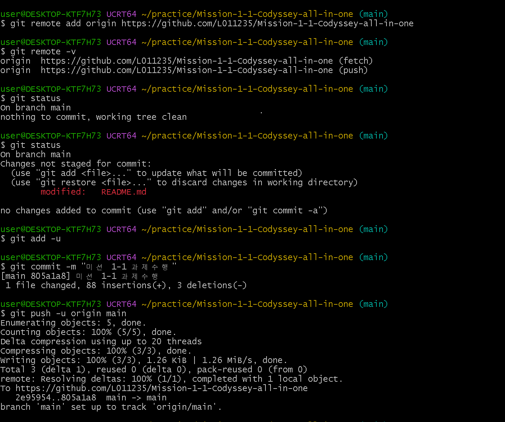

##### push 성공 로그 (git log)
```text
user@DESKTOP-KTF7H73 UCRT64 ~/practice/Mission-1-1-Codyssey-all-in-one (main)
$ git log -20 --oneline
bc54c7b (HEAD -> main, origin/main) 개인정보 보호/재현성 등
2ff2075 개인정보 보호/재현성 등
662c25f 개인정보 보호/재현성 등
57893e1 개인정보 보호/재현성 등
b8d6c79 번호조정
0d5b854 트러블 슈팅
7bb0d60 트러블 슈팅
b0d4eb0 번호조정
48b27da 번호조정
e2c802f 8080포트 관련 업데이트
aac12c5 8080포트 관련 업데이트
d68a96d 8080포트 관련 업데이트
d1fa313 8080포트 관련 업데이트
fb191d8 8080포트 관련 업데이트
b8857d8 7-2-4이미지의 불변성 업데이트
46e640d docker run -it와 docker exec -it의 차이
8b00b3d Docker파일관련 업데이트
97602d3 Docker파일관련 업데이트
f5c4c2e Docker파일관련 업데이트
28d8d67 바인드 마운트 관련  업데이트

```
##### 스크린샷
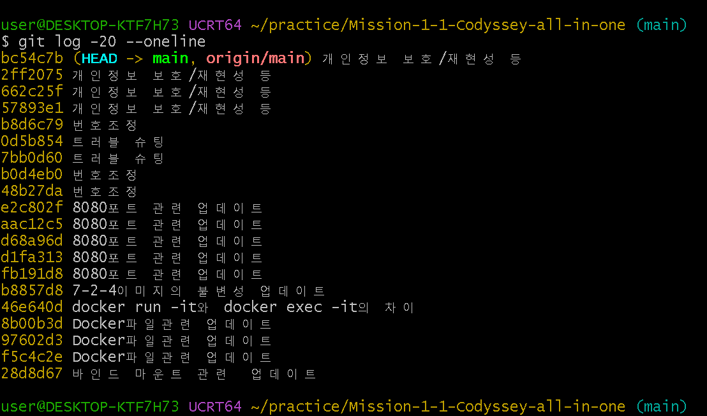
---

## 13. 트러블슈팅
> 최소 2건 이상. 형식: 문제 → 원인 가설 → 확인 방법 → 해결

### 사례 1. Git Bash의 경로 자동 변환으로 컨테이너 파일 접근 실패
#### 1-1. 문제 재현 및 오류 확인
컨테이너 내부에 파일을 생성합니다.
docker run -dit --name path_test ubuntu

docker exec -it path_test bash
echo "Hello Docker" > /hello.txt
cat /hello.txt
exit

이후 Git Bash에서 다음 명령을 실행합니다.
docker exec -it path_test cat /hello.txt

기존 실습에서는 다음 오류가 발생했습니다.
cat: 'C:/Program Files/Git/hello.txt': No such file or directory

설명: 컨테이너 내부 경로 /hello.txt가 Docker에 전달되기 전에 Git Bash의 MSYS 경로 자동 변환 기능에 의해 Windows 경로로 변경된 것입니다.

#### 실행결과 (오류재현)
```text
user@DESKTOP-KTF7H73 UCRT64 ~/practice/Mission-1-1-Codyssey-all-in-one (main)
$ docker run -dit --name path_test ubuntu
Unable to find image 'ubuntu:latest' locally
latest: Pulling from library/ubuntu
f3f25b84a7d7: Pull complete
edafa32f5d9e: Pull complete
21594acc2d8b: Download complete
Digest: sha256:6a06111c3b0a8600feadb270aec771dc239bf407b25625f93f44ab00e11f4d3c
Status: Downloaded newer image for ubuntu:latest
c145658a02ff55c730b6245e9726f1d129f89477edffc5f14a244c48d4b5e5af

user@DESKTOP-KTF7H73 UCRT64 ~/practice/Mission-1-1-Codyssey-all-in-one (main)
$ docker exec -it path_test bash
root@c145658a02ff:/# echo "Hello Docker" > /hello.txt
root@c145658a02ff:/# cat hello.txt
Hello Docker
root@c145658a02ff:/# exit
exit

user@DESKTOP-KTF7H73 UCRT64 ~/practice/Mission-1-1-Codyssey-all-in-one (main)
$ docker exec -it path_test cat /hello.txt
cat: 'C:/Program Files/Git/hello.txt': No such file or directory
```
#### 스크린샷 (오류재현)
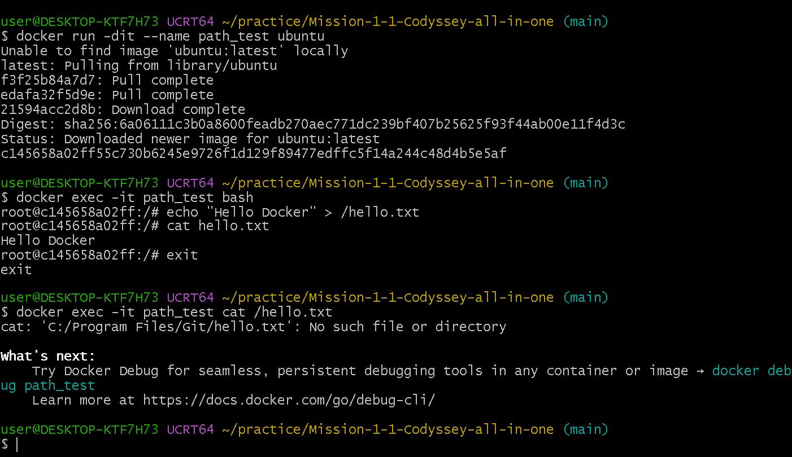

> 컨테이너 내부 경로 /hello.txt가 Docker에 전달되기 전에 Git Bash의 MSYS 경로 자동 변환 기능에 의해 Windows 경로(c:/Program Files/Git/hell.txt)로 변경된 것입니다.

#### 1-2. 해결 방법 적용
```bash
export MSYS_NO_PATHCONV=1

docker exec -it path_test cat /hello.txt
```
#### 실행결과 (해결)
```text
user@DESKTOP-KTF7H73 UCRT64 ~/practice/Mission-1-1-Codyssey-all-in-one (main)
$ export MSYS_NO_PATHCONV=1

user@DESKTOP-KTF7H73 UCRT64 ~/practice/Mission-1-1-Codyssey-all-in-one (main)
$ docker exec -it path_test cat /hello.txt
Hello Docker
```
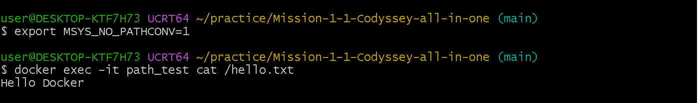

>MSYS_NO_PATHCONV=1은 Git Bash의 자동 경로 변환을 비활성화하여 Linux 경로가 Docker 명령에 그대로 전달되도록 합니다.

### 사례 2. docker exec에서 출력 리다이렉션 위치 오류


#### 2-1. 문제 재현 및 오류 확인
실행 중인 Ubuntu 컨테이너를 준비
##### 실행 결과
```text
user@DESKTOP-KTF7H73 UCRT64 ~/practice/Mission-1-1-Codyssey-all-in-one (main)
$ docker run -dit --name redirect-test ubuntu
07fb859d29aa1f74920cdf4f49b31218f32a5aaa92a47c9aa1c1580a89b0a74d

user@DESKTOP-KTF7H73 UCRT64 ~/practice/Mission-1-1-Codyssey-all-in-one (main)
$ docker exec -it redirect-test echo "hello again" > /again.txt
bash: /again.txt: Permission denied
```
##### 스크린샷
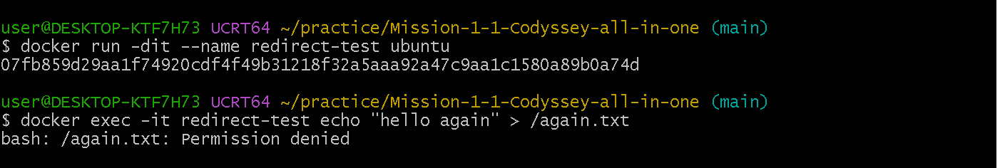
> docker exec` 명령에 포함된 `>` 리다이렉션은 Docker가 아니라 호스트 Git Bash에서 처리된다. 따라서 컨테이너 내부의 `/again.txt`에 쓰는 것이 아니라 호스트 경로에 파일을 쓰려고 시도한 것이다.

### 2-2. 원인 확인

리다이렉션이 어디에서 해석되는지 비교하면 다음과 같다.

| 명령 형태 | `>` 처리 주체 | 결과 |
|---|---|---|
| `docker exec ... echo "hello" > /again.txt` | 호스트 Git Bash | 호스트에 파일 쓰기 시도 |
| `docker exec ... sh -c 'echo "hello" > /again.txt'` | 컨테이너 내부 셸 | 컨테이너 내부에 파일 생성 |


### 2-3. 해결 방법 적용
컨테이너 내부에서 셸을 실행하고, 그 셸이 리다이렉션을 처리하도록 변경 후 확인.
```bash
docker exec redirect-test sh -c 'echo "hello again" > /again.txt'
docker exec redirect-test cat /again.txt
```
#### 실행결과
```text
user@DESKTOP-KTF7H73 UCRT64 ~/practice/Mission-1-1-Codyssey-all-in-one (main)
$ docker exec redirect-test sh -c 'echo "hello again" > /again.txt'

user@DESKTOP-KTF7H73 UCRT64 ~/practice/Mission-1-1-Codyssey-all-in-one (main)
$ docker exec redirect-test cat /again.txt
hello again
```
#### 스크린샷
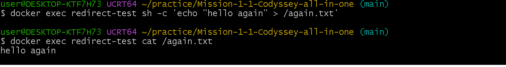

---
### 사례 3. 포트 충돌 이후 컨테이너 재시작 시 호스트 포트 게시 실패

#### 3-1. 문제 상황

호스트의 8080 포트를 old-web 컨테이너가 점유한 상태에서 동일한 포트를 사용하는 new-web 컨테이너를 실행하여 포트 충돌이 발생하였다.

두 번째 컨테이너는 생성되었으나 실행에 실패하여 Created 상태로 남았다.

#### 3-2. 원인 확인

① Docker 컨테이너의 포트 점유 확인

docker ps --filter "publish=8080"
docker port old-web

확인 결과 old-web이 호스트의 8080 포트를 컨테이너 내부 80번 포트에 연결하여 사용 중이었다.

② Windows 호스트의 포트 점유 프로세스 확인

netstat -ano | grep :8080

실행 결과:

TCP    0.0.0.0:8080     0.0.0.0:0     LISTENING     30660
TCP    127.0.0.1:8080   0.0.0.0:0     LISTENING     23884
TCP    [::]:8080        [::]:0        LISTENING     30660
TCP    [::1]:8080       [::]:0        LISTENING     23884

PID별 프로세스를 확인한 결과:

PID 30660 : com.docker.backend.exe
PID 23884 : wslrelay.exe

Docker Desktop 백엔드 및 WSL 네트워크 릴레이 프로세스가 포트 게시와 관련되어 있음을 확인하였다.

#### 3-3. 기존 점유 컨테이너 제거 및 재시작 검증

기존 포트 점유 컨테이너 old-web을 중지하고 삭제하였다.

docker stop old-web
docker rm old-web

이후 기존에 생성된 new-web을 삭제하지 않고 재시작하였다.

docker start new-web
docker ps -a --filter "name=^/new-web$"

확인 결과 new-web은 Up 상태로 전환되었다.

컨테이너 내부 진입 및 Nginx 설정 검사를 수행하였다.

docker exec -it new-web sh

nginx -t
ps
exit

검증 결과: 컨테이너 내부 진입과 Nginx 설정 검사는 성공했으며, Nginx 프로세스도 정상 실행 중이었다. 그러나 호스트에서 curl -I http://localhost:8080을 실행했을 때 접속에 실패하였다.

#### 3-4. 포트 설정과 실제 활성 상태 비교

컨테이너의 포트 설정 및 실제 네트워크 연결 상태를 확인하였다.

| 항목 | 결과 | 의미 |
| :--- | :--- | :--- |
| **Configured** | `{"80/tcp":[{"HostIp":"","HostPort":"8080"}]}` | 컨테이너 생성 당시 요청한 포트 매핑 설정이 보존됨 |
| **Active** | `{"80/tcp":[]}` | 실제 활성화된 호스트 포트 연결이 없음 |
| **docker port new-web** | 출력 없음 | 활성화된 포트 게시가 확인되지 않음 |

**원인 분석:** `HostConfig.PortBindings`에는 생성 당시의 포트 매핑 설정이 남아 있었으나, `NetworkSettings.Ports`에는 실제 활성 연결이 표시되지 않았다. 즉, 포트 설정의 보존과 실제 포트 게시의 활성화가 서로 다른 상태임을 확인하였다.

이번 실습 환경에서는 `docker start`로 컨테이너를 재시작하고 내부 Nginx를 정상 구동하는 데는 성공했지만, 호스트 8080 포트 연결은 복구되지 않았다.

#### 3-5. 포트 해제 확인

docker ps --filter "publish=8080"
netstat -ano | grep :8080

확인 결과 두 명령 모두 출력이 없어 Docker 컨테이너와 Windows 호스트에서 8080 포트가 더 이상 수신 대기 상태가 아님을 확인하였다.

#### 3-6. 해결 방향

기존 컨테이너의 실행 상태만 복구하는 것으로는 호스트 포트 접속 문제가 해결되지 않았다.

따라서 기존 new-web을 제거한 후, 커스텀 이미지 my-web:1.0을 이용하여 포트 게시 설정을 새로 적용한 컨테이너를 생성하는 방식으로 해결을 진행한다.

docker rm -f new-web

docker run -d --name new-web -p 8080:80 my-web:1.0

docker ps --filter "publish=8080"
docker port new-web
curl -I http://localhost:8080
curl http://localhost:8080

##### 실행결과
```text
user@DESKTOP-KTF7H73 UCRT64 ~/practice/Mission-1-1-Codyssey-all-in-one (main)
$ docker build -t my-web:1.0 .
[+] Building 8.3s (9/9) FINISHED                                               docker:desktop-linux
 => [internal] load build definition from Dockerfile                                           0.6s
 => => transferring dockerfile: 388B                                                           0.1s
 => [internal] load metadata for docker.io/library/nginx:alpine                                0.9s
 => [internal] load .dockerignore                                                              0.4s
 => => transferring context: 2B                                                                0.0s
 => [1/4] FROM docker.io/library/nginx:alpine@sha256:713fc2ebfd92e8217db451477182ee91944b123d  0.6s
 => => resolve docker.io/library/nginx:alpine@sha256:713fc2ebfd92e8217db451477182ee91944b123d  0.5s
 => [internal] load build context                                                              0.3s
 => => transferring context: 62B                                                               0.0s
 => CACHED [2/4] RUN apk add --no-cache curl                                                   0.0s
 => CACHED [3/4] COPY nginx.conf /etc/nginx/nginx.conf                                         0.0s
 => CACHED [4/4] COPY index.html /usr/share/nginx/html/index.html                              0.0s
 => exporting to image                                                                         3.4s
 => => exporting layers                                                                        0.0s
 => => exporting manifest sha256:fc4127fbe650e17aa156d260b9264591cb084201b6b7c9364bc4778082d0  0.2s
 => => exporting config sha256:4c744e5db1a2121153b6be3ba4bd000b8b383d30ea16ab23adaccd36a4474d  0.1s
 => => exporting attestation manifest sha256:a44ff1a04b06abec08729bead70d807844b797e2d172c100  0.5s
 => => exporting manifest list sha256:cbda215519c8a86e18fd5982bdb5ac319fa494f66c84b7bda3c8f6a  0.4s
 => => naming to docker.io/library/my-web:1.0                                                  0.1s
 => => unpacking to docker.io/library/my-web:1.0                                               1.6s

user@DESKTOP-KTF7H73 UCRT64 ~/practice/Mission-1-1-Codyssey-all-in-one (main)
$ docker images my-web:1.0
                                                                               i Info →   U  In Use
IMAGE        ID             DISK USAGE   CONTENT SIZE   EXTRA
my-web:1.0   cbda215519c8       93.9MB         26.4MB

user@DESKTOP-KTF7H73 UCRT64 ~/practice/Mission-1-1-Codyssey-all-in-one (main)
$ docker rm -f new-web
new-web

user@DESKTOP-KTF7H73 UCRT64 ~/practice/Mission-1-1-Codyssey-all-in-one (main)
$ docker run -d --name new-web -p 8080:80 my-web:1.0
36236409ecab2004f560b4634c6775358c1657c6dc0dcb296bbea8ede941d2d5

user@DESKTOP-KTF7H73 UCRT64 ~/practice/Mission-1-1-Codyssey-all-in-one (main)
$ docker ps --filter "publish=8080"
CONTAINER ID   IMAGE        COMMAND                   CREATED          STATUS          PORTS                                     NAMES
36236409ecab   my-web:1.0   "/docker-entrypoint.…"   24 seconds ago   Up 22 seconds   0.0.0.0:8080->80/tcp, [::]:8080->80/tcp   new-web

user@DESKTOP-KTF7H73 UCRT64 ~/practice/Mission-1-1-Codyssey-all-in-one (main)
$ docker port new-web
80/tcp -> 0.0.0.0:8080
80/tcp -> [::]:8080

user@DESKTOP-KTF7H73 UCRT64 ~/practice/Mission-1-1-Codyssey-all-in-one (main)
$ curl -I http://localhost:8080
HTTP/1.1 200 OK
Server: nginx/1.31.8
Date: Sun, 08 Nov 2026 05:35:26 GMT
Content-Type: text/html
Content-Length: 1659
Last-Modified: Fri, 06 Nov 2026 23:15:22 GMT
Connection: keep-alive
ETag: "6aee5f8a-67b"
Accept-Ranges: bytes


user@DESKTOP-KTF7H73 UCRT64 ~/practice/Mission-1-1-Codyssey-all-in-one (main)
$ curl http://localhost:8080
<!DOCTYPE html>
<html lang="ko">
<head>
    <meta charset="UTF-8">
    <meta name="viewport" content="width=device-width, initial-scale=1.0">
    <title>My Custom Nginx</title>
    <style>
        body {
            font-family: Arial, sans-serif;
            margin: 0;
            padding: 20px;
            background: linear-gradient(135deg, #667eea 0%, #764ba2 100%);
            min-height: 100vh;
            display: flex;
            justify-content: center;
            align-items: center;
        }
        .container {
            background: white;
            padding: 40px;
            border-radius: 10px;
            box-shadow: 0 10px 25px rgba(0,0,0,0.2);
            text-align: center;
            max-width: 600px;
        }
        h1 {
            color: #333;
            margin: 0 0 20px 0;
        }
        p {
            color: #666;
            line-height: 1.6;
        }
        .info {
            background: #f0f0f0;
            padding: 15px;
            border-radius: 5px;
            margin-top: 20px;
            font-family: monospace;
            text-align: left;
        }
    </style>
</head>
<body>
    <div class="container">
        <h1>🎉 장**의 커스텀 Nginx 서버에 오신 것을 환영합니다.</h1>
        <p>이것은 Docker로 빌드된 커스텀 nginx 컨테이너입니다.</p>
        <p>서버가 컨테이너 내부에서 성공적으로 실행 중입니다.</p>

        <div class="info">
            <strong>Server Information:</strong><br>
            Image: my-web:1.0<br>
            Base: nginx:alpine<br>
            Status: ✅ Running
        </div>
    </div>
</body>
</html>
```
##### 스크린샷


##### 배운 것들

포트 충돌이 발생하면 컨테이너가 Created 상태로 남을 수 있음을 확인하였다.

docker start로 컨테이너를 실행할 수 있어도 호스트 포트 게시까지 정상화되었다고 단정할 수 없음을 확인하였다.

docker exec와 nginx -t를 통해 컨테이너 내부 서비스 상태를 독립적으로 검증하였다.

docker inspect의 HostConfig.PortBindings와 NetworkSettings.Ports를 비교하여 설정 정보와 실제 네트워크 연결 상태를 구분하였다.

Docker 명령과 Windows의 netstat, tasklist를 함께 사용하여 포트 점유 원인을 진단하였다.


## 14. 재현환경 및 실행 시 주의사항

본 과제는 **Windows 11 + Git Bash + Docker Desktop(WSL2 기반 Linux 컨테이너)** 환경에서 수행하였다.

각 실습 항목에는 실행 명령어, 실행 결과 및 검증 증거를 함께 기록하였다. 다른 환경에서 재현할 때는 다음 공통 조건을 확인한다.

- **Docker 실행 상태:** 실습 전에 Docker Desktop이 실행 중이고 Docker daemon에 접근 가능한지 확인한다. (2절)
- **작업 디렉터리:** Dockerfile을 사용하는 빌드 명령은 Dockerfile, `nginx.conf`, `index.html`이 있는 프로젝트 루트에서 실행한다. (8절)
- **Git Bash 경로:** 컨테이너 내부 Linux 경로를 명령 인자로 전달할 때는 필요한 경우 `MSYS_NO_PATHCONV=1`을 설정한다. Windows 호스트 경로를 바인드 마운트할 때는 `$(pwd -W)`를 사용한다. (7절, 10절)
- **포트 사용:** 호스트의 8080 포트가 사용 중이면 다른 포트로 변경하고, 접속 확인 URL도 동일하게 변경한다. (9절, 10절)
- **기존 리소스:** 같은 이름의 컨테이너가 이미 존재하면 실행 전에 상태를 확인하고 필요한 경우 정리한다. 볼륨은 컨테이너와 달리 별도로 유지되므로 삭제 여부를 확인한다. (7절, 10절, 11절)

각 실습의 구체적인 실행 순서와 결과는 해당 절의 명령어 및 실행 로그를 기준으로 재현할 수 있다.

- Windows Git Bash: 바인드 마운트 호스트 경로에 `$(pwd -W)` 사용
- Git Bash의 Linux 경로 인자: 필요한 경우 `MSYS_NO_PATHCONV=1` 설정
- Linux/WSL 터미널: 일반적으로 호스트 경로에 `$(pwd)` 사용
---

## 15. 보안 및 개인정보 보호
- 제출물 전체에서 다음을 **마스킹**했음을 확인한다.
  - [x] GitHub 토큰 / Personal Access Token → `ghp_****`
  - [x] 이메일 → `me@****.com` (필요 시)
  - [x] 비밀번호 / 인증코드 → `******` (비번 인증코드 없음)
  - [x] 기타 민감정보 (주민등록번호 등은 애초에 포함하지 않음)
- 커밋 히스토리에도 토큰이 남지 않았는지 확인한다.

```bash
# 현재 파일에서 토큰 형태 검색
grep -RInE --exclude-dir=.git '(gh[pousr]_[A-Za-z0-9]{20,}|github_pat_[A-Za-z0-9_]{20,})' .

# Git 커밋 이력의 변경 내용에서도 검색
git log --all -p --pretty=format: |
  grep -nE '(gh[pousr]_[A-Za-z0-9]{20,}|github_pat_[A-Za-z0-9_]{20,})'
```
```text
user@DESKTOP-KTF7H73 UCRT64 ~/practice/Mission-1-1-Codyssey-all-in-one (main)
$ git log --all -p --pretty=format: |   grep -nE '(gh[pousr]_[A-Za-z0-9]{20,}|github_pat_[A-Za-z0-9_]{20,})'

user@DESKTOP-KTF7H73 UCRT64 ~/practice/Mission-1-1-Codyssey-all-in-one (main)
$ grep -RInE --exclude-dir=.git '(gh[pousr]_[A-Za-z0-9]{20,}|github_pat_[A-Za-z0-9_]{20,})'
```
##### 스크린샷
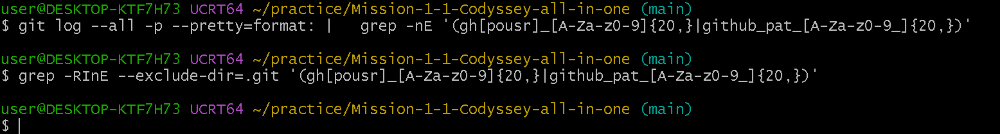

> 본 문서의 모든 실행 결과는 작성자가 직접 수행한 것이며,
> 민감정보는 마스킹 처리되었습니다.
```

---