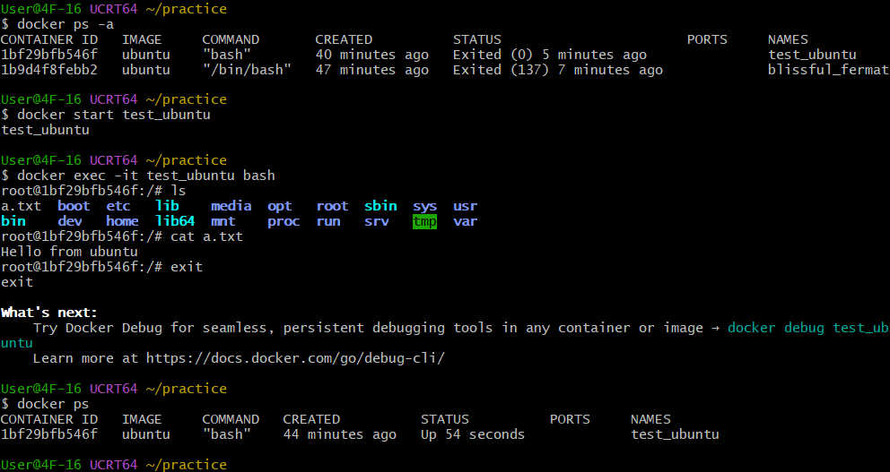

아래 전체(1~16절)를 통째로 드립니다. 코드 블록 안을 **전부 복사 → `README.md`로 저장**하면 됩니다. 😊

> ⚠️ 중요: `(여기에 실제 실행 결과 붙여넣기)` 부분은 **본인 터미널 출력**으로 교체하세요. 제가 결과를 지어낼 수는 없습니다.


# 과제 1-1 — 리눅스 커널 기반 개발 워크스테이션 구축

> 모든 수행 결과는 본 문서(README.md)에서 확인할 수 있다.
> 실행 로그·스크린샷은 "명령어 입력 + 출력 결과"를 함께 포함한다.
> 민감정보(토큰/비밀번호/인증코드 등)는 모두 마스킹한다.

## 목차
1. [프로젝트 개요](#1-프로젝트-개요)
2. [실행 환경](#2-실행-환경)
3. [수행 체크리스트](#3-수행-체크리스트)
4. [터미널 조작 명령어](#4-터미널-조작-명령어)
5. [파일 권한 실습](#5-파일-권한-실습)
6. [Docker 설치 및 기본 점검](#6-docker-설치-및-기본-점검)
7. [Docker 기본 운영 명령](#7-docker-기본-운영-명령)
8. [컨테이너 실행 실습](#8-컨테이너-실행-실습)
9. [Dockerfile 커스텀 이미지](#9-dockerfile-커스텀-이미지)
10. [포트 매핑 접속 증거](#10-포트-매핑-접속-증거)
11. [바인드 마운트 반영](#11-바인드-마운트-반영)
12. [볼륨 영속성 검증](#12-볼륨-영속성-검증)
13. [Git 설정 및 GitHub 연동](#13-git-설정-및-github-연동)
14. [트러블슈팅](#14-트러블슈팅)
15. [재현성](#15-재현성)
16. [보안 및 개인정보 보호](#16-보안-및-개인정보-보호)

---

## 1. 프로젝트 개요
- 리눅스 커널 기반(우분투 컨테이너) 개발 워크스테이션을 구축하고,
  터미널·권한·Docker·포트·마운트·볼륨·Git/GitHub 전 과정을 수행·검증한다.
- 실행 순서: **① 호스트 준비 → ② 우분투 컨테이너 진입 → ③ 우분투 내부 작업**

---

## 2. 실행 환경
- OS: Windows 11 pro 버전 26H2 (OS 빌드 26300.9711 ) / Ubuntu 26.04.1 LTS (Resolute Raccoon)
- Shell: Git Bash
- Docker: version 29.9.2, build a82e528
- Git: version 2.56.0.windows.4

```text
$ docker --version
Docker version 29.9.2, build a82e528

$ git --version
git version 2.56.0.windows.4


$ docker run -it ubuntu bash
root@3453497ada18:/# cat /etc/os-release
PRETTY_NAME="Ubuntu 26.04.1 LTS"
NAME="Ubuntu"
VERSION_ID="26.04"
VERSION="26.04.1 LTS (Resolute Raccoon)"
VERSION_CODENAME=resolute
ID=ubuntu
ID_LIKE=debian
HOME_URL="https://www.ubuntu.com/"
SUPPORT_URL="https://help.ubuntu.com/"
BUG_REPORT_URL="https://bugs.launchpad.net/ubuntu/"
PRIVACY_POLICY_URL="https://www.ubuntu.com/legal/terms-and-policies/privacy-policy"
UBUNTU_CODENAME=resolute
LOGO=ubuntu-logo
root@3453497ada18:/# exit
exit

$ winver
# GUI 창으로 OS 버전 표시 (스크린샷 참고)
```

#### 1 Docker 실행환경 체크


```bash
if docker info >/dev/null 2>&1; then
  echo "Docker daemon: active"
  docker info --format '=== Docker 이미지 및 컨테이너 개수 ===
Containers: {{.Containers}}
 Running: {{.ContainersRunning}}
 Paused: {{.ContainersPaused}}
 Stopped: {{.ContainersStopped}}
Images: {{.Images}}'
else
  echo "Docker daemon: inactive"
fi
```

```text
Docker daemon: active
=== Docker 이미지 및 컨테이너 개수 ===
Containers: 2
 Running: 1
 Paused: 0
 Stopped: 1
Images: 1
```

#### 2 Docker info 정보추출


---

## 3. 수행 체크리스트

> 번호는 과제 「4. 기능 요구 사항」의 1~11과 1:1로 대응한다.
> (바인드 마운트는 요구사항 9번(볼륨 영속성)에 포함하여 함께 검증한다.)

### 1. 제출 저장소 및 기술 문서
- [ ] 1-1. GitHub 저장소 링크로 제출 + 개요/환경/체크리스트/검증방법 포함
- [ ] 1-2. 구성 → [1. 프로젝트 개요](#1-프로젝트-개요) / [15. 재현성](#15-재현성)

### 2. 터미널 조작 명령어
- [ ] 2-1. pwd / ls -la(숨김 포함) / mkdir / cp / mv / 이름변경 / rm / cat / touch 수행
- [ ] 2-2. 실행결과 → [4. 터미널 조작 명령어](#4-터미널-조작-명령어)

### 3. 권한 실습 및 증거 기록
- [ ] 3-1. 파일 1개 + 디렉터리 1개 권한 변경 전/후 비교
- [ ] 3-2. 실행결과 → [5. 파일 권한 실습](#5-파일-권한-실습)

### 4. Docker 설치 및 기본 점검
- [ ] 4-1. docker --version / docker info(또는 동등 점검) 확인
- [ ] 4-2. 실행결과 → [6. Docker 설치 및 기본 점검](#6-docker-설치-및-기본-점검)

### 5. Docker 기본 운영 명령 수행
- [ ] 5-1. docker images / ps / ps -a / logs / stats 실행
- [ ] 5-2. 실행결과 → [7. Docker 기본 운영 명령](#7-docker-기본-운영-명령)

### 6. 컨테이너 실행 실습
- [ ] 6-1. hello-world 성공 + ubuntu 진입 후 ls/echo + attach/exec 차이 관찰
- [ ] 6-2. 실행결과 → [8. 컨테이너 실행 실습](#8-컨테이너-실행-실습)

### 7. 기존 Dockerfile 기반 커스텀 이미지 제작
- [ ] 7-1. 베이스 선택(A/B) + 커스텀 포인트 목적 + 빌드·실행 성공
- [ ] 7-2. 실행결과 → [9. Dockerfile 커스텀 이미지](#9-dockerfile-커스텀-이미지)

### 8. 포트 매핑 및 접속 증거
- [ ] 8-1. -p <host>:<container> 실행 + 브라우저(주소창+포트) 또는 curl 응답 확인
- [ ] 8-2. 실행결과 → [10. 포트 매핑 접속 증거](#10-포트-매핑-접속-증거)

### 9. Docker 볼륨 영속성 검증 (+ 바인드 마운트)
- [ ] 9-1. (바인드) 호스트 변경 → 컨테이너 반영 전/후 비교
- [ ] 9-2. 바인드 실행결과 → [11. 바인드 마운트 반영](#11-바인드-마운트-반영)
- [ ] 9-3. (볼륨) 생성/연결 후 컨테이너 삭제 전/후 데이터 유지 증명
- [ ] 9-4. 볼륨 실행결과 → [12. 볼륨 영속성 검증](#12-볼륨-영속성-검증)

### 10. Git 설정 및 GitHub 연동
- [ ] 10-1. git config --list + GitHub 로그인·VSCode 저장소 연동 완료
- [ ] 10-2. 실행결과 → [13. Git 설정 및 GitHub 연동](#13-git-설정-및-github-연동)

### 11. 보안 및 개인정보 보호
- [ ] 11-1. 토큰/이메일/비밀번호/인증코드 마스킹 확인
- [ ] 11-2. 실행결과 → [16. 보안 및 개인정보 보호](#16-보안-및-개인정보-보호)

---

## 4. 터미널 조작 명령어
> 작업: 현재 위치 / 목록(숨김 포함) / 폴더 이동 / 폴더 생성 / 파일 복사 / 이동·이름변경 / 삭제 / 내용 확인 / 빈 파일 생성

```bash
#git bash에서 ubuntu 터미널을 띄운 후 입력
$ pwd    
$ ls -la
$ mkdir practice && cd practice
$ touch a.txt
$ cp a.txt b.txt
$ mv b.txt c.txt
$ cat c.txt
$ rm c.txt
```

### 1~4 출력결과 [pwd(위치확인), ls(목록 확인), ls -1a(숨긴목록), mkdir(폴더생성), cd(폴더이동)]
```text
# 1. pwd (현재 위치 확인)
root@cb89cdd469fc:/# pwd
/

# 2. ls -la (목록(숨김 포함))
root@cb89cdd469fc:/# ls -la
total 60
drwxr-xr-x   1 root root 4096 Oct 31 07:52 .
drwxr-xr-x   1 root root 4096 Oct 31 07:52 ..
-rwxr-xr-x   1 root root    0 Oct 31 07:52 .dockerenv
drwxr-xr-x   2 root root 4096 Oct 25 10:26 .rock
lrwxrwxrwx   1 root root    7 Apr 20  2026 bin -> usr/bin
drwxr-xr-x   2 root root 4096 Apr 20  2026 boot
drwxr-xr-x   5 root root  360 Oct 31 07:52 dev
drwxr-xr-x   1 root root 4096 Oct 31 07:52 etc
drwxr-xr-x   3 root root 4096 Oct 25 10:26 home
lrwxrwxrwx   1 root root    7 Apr 20  2026 lib -> usr/lib
lrwxrwxrwx   1 root root    9 Apr 20  2026 lib64 -> usr/lib64
drwxr-xr-x   2 root root 4096 Oct 25 10:25 media
drwxr-xr-x   2 root root 4096 Oct 25 10:25 mnt
drwxr-xr-x   2 root root 4096 Oct 25 10:25 opt
dr-xr-xr-x 176 root root    0 Oct 31 07:52 proc
drwx------   2 root root 4096 Oct 25 10:26 root
drwxr-xr-x   4 root root 4096 Oct 25 10:26 run
lrwxrwxrwx   1 root root    8 Apr 20  2026 sbin -> usr/sbin
drwxr-xr-x   2 root root 4096 Oct 25 10:25 srv
dr-xr-xr-x  12 root root    0 Oct 31 07:34 sys
drwxrwxrwt   2 root root 4096 Oct 25 10:25 tmp
root@cb89cdd469fc:/# ls
bin   dev  home  lib64  mnt  proc  run   srv  tmp  var
boot  etc  lib   media  opt  root  sbin  sys  usr


# 3. mkdir (폴더 생성)
# 현재 폴더 상황 확인 (하위폴더 중 practice 폴더 없음)
root@cb89cdd469fc:/# ls   
bin   dev  home  lib64  mnt  proc  run   srv  tmp  var
boot  etc  lib   media  opt  root  sbin  sys  usr

root@cb89cdd469fc:/# mkdir practice #폴더 생성

#하위에 practice폴더가 생성된 것을 확인
root@cb89cdd469fc:/# ls 
bin   dev  home  lib64  mnt  practice  root  sbin  sys  usr
boot  etc  lib   media  opt  proc      run   srv   tmp  var

# 4. cd (폴더 이동)
root@cb89cdd469fc:/# pwd  #현위치 확인
/

root@cb89cdd469fc:/# cd practice  # 폴더 이동

root@cb89cdd469fc:/practice# pwd  #현위치 변동 확인
/practice
```

### 1~4. 스크린샷 [pwd(위치확인), ls(목록 확인), ls -1a(숨긴목록), mkdir(폴더생성), cd(폴더이동)]
.png)

### 5-1. touch(빈파일 생성) 실행 결과
```text
# 5. touch (빈 파일 생성)
root@cb89cdd469fc:/practice# ls  #현폴더에 파일이 없음을 확인
root@cb89cdd469fc:/practice# touch file1.txt file2.txt  #텍스트파일 2개 생성
root@cb89cdd469fc:/practice# ls  #현폴더에 파일이 2개 생성된 것을 확인
file1.txt  file2.txt
```

### 5-2. touch(빈파일 생성) 스크린샷 
.png)

### 6-1. echo(문자열 생성), > (파이프), cat(문자열 출력) 실행결과
```text
# 6. echo (문자열 생성)
# 문자열 Hello Linux 생성 후 file1.txt에 써넣기 
root@cb89cdd469fc:/practice# echo "Hello Linux" > file1.txt
# 문자열 backup file 생성 후 file2.txt에 써넣기
root@cb89cdd469fc:/practice# echo "Backup file" > file2.txt

# 6. cat (문자열 출력)
# file1.txt의 내용을 출력 
root@cb89cdd469fc:/practice# cat file1.txt
Hello Linux
# file2.txt의 내용을 출력
root@cb89cdd469fc:/practice# cat file2.txt
Backup file
```

### 6-2. echo(문자열 생성), > (파이프), cat(문자열 출력) 스크린샷
.png)

### 7-1. cp (파일 복사) 실행결과
```text
# 7. cp (복사)

root@cb89cdd469fc:/practice# ls  # 현폴더 목록 확인. text파일 2개.
file1.txt  file2.txt

#file1.txt의 내용을 file1_backup.txt에 복사
root@cb89cdd469fc:/practice# cp file1.txt file1_backup.txt

root@cb89cdd469fc:/practice# ls #현폴더 목록 변경 확인. text파일 3개
file1.txt  file1_backup.txt  file2.txt

root@cb89cdd469fc:/practice# cat file1.txt #복사 원본 file1.txt의 내용확인
Hello Linux

#복사된 파일 file1_backup.txt이 동일함을 확인
root@cb89cdd469fc:/practice# cat file1_backup.txt 
Hello Linux

```

### 7-2. cp (파일 복사) 스크린샷
.png)

### 8-1. mv (파일명 변경) 실행결과
```text
# 8. mv (파일명 변경)
# 파일명 변경 후보 file1_backup.txt의 내용 확인
root@bfe91c61e6ed:/practice# cat file1_backup.txt
Hello Linux

# 현폴더 목록 확인 3개 파일 (file1_backup.txt 포함)
root@bfe91c61e6ed:/practice# ls
file1.txt  file1_backup.txt  file2.txt

# file1_backup.txt를 backup.txt로 파일이름 변경
root@bfe91c61e6ed:/practice# mv file1_backup.txt backup.txt

# 현폴더 목록 변경 확인 (3개 파일 중 file_backup.txt는 없어지고 backup.txt가 생김)
root@bfe91c61e6ed:/practice# ls
backup.txt  file1.txt  file2.txt

#backup.txt의 내용이 file1_backup.txt와 동일함을 확인
root@bfe91c61e6ed:/practice# cat backup.txt 
Hello Linux
```

### 8-2. mv (파일명 변경) 스크린샷
.png)

### 9-1. rm (파일 삭제) 실행결과
```text
# 9. rm (파일 삭제)
root@bfe91c61e6ed:/practice# ls  #현폴더 목록 확인. 텍스트 파일 3개
backup.txt  file1.txt  file2.txt
root@bfe91c61e6ed:/practice# rm file2.txt # 파일 하나 삭제
root@bfe91c61e6ed:/practice# ls  #현폴더 목록 확인. 텍스트 파일 2개
backup.txt  file1.txt             
```

#### 9-2. rm (파일 삭제)
.png)

### 10-1. cd .. (상위폴더로 이동) 실행결과
```text
# 10. cd .. (상위 디렉토리로 이동)
root@bfe91c61e6ed:/practice# pwd  #현위치 확인. 기준폴더 아래의 practice폴더
/practice
root@bfe91c61e6ed:/practice# cd ..  #상위 폴더로 이동
root@bfe91c61e6ed:/# pwd            #현위치 폴더. 기준폴더로 이동했음을 확인
/
```

### 10-2. cd .. (상위폴더로 이동) 스크린샷
.png)

### 11-1. rm -r (파일 있는 폴더도 삭제) 실행결과
```text
# 11. rm -r (폴더 삭제)
root@bfe91c61e6ed:/# ls  #현폴더 목록확인
bin  boot  dev  etc  home  lib  lib64  media  mnt  opt  practice  proc  root  run  sbin  srv  sys  tmp  usr  var
root@bfe91c61e6ed:/# rm -r practice  #현폴더의 하위폴더 중 하나인 practice폴더를 삭제
root@bfe91c61e6ed:/# ls  #현폴더 목록확인. pracitce폴더가 없어진 것을 확인
bin  boot  dev  etc  home  lib  lib64  media  mnt  opt  proc  root  run  sbin  srv  sys  tmp  usr  var
root@bfe91c61e6ed:/#
```

### 11-2. rm -r (파일 있는 폴더도 삭제) 스크린샷
.png)

---

## 5. 파일 권한 실습
> 파일 1개 + 디렉터리 1개에 대해 권한 변경 전/후 비교

```bash
$ ls -l a.txt          # 변경 전
$ chmod 640 a.txt      # 보안상 기타 인원의 권한을 없앰
$ ls -l a.txt          # 변경 후

$ ls -ld practice      # 변경 전
$ chmod 750 practice   # 보안상 기타 인원의 권한을 없앰
$ ls -ld practice      # 변경 후
```
```text
# 1. 디렉터리 권한 변경 (755-->750)
root@bfe91c61e6ed:/# mkdir practice
#변경 전
root@bfe91c61e6ed:/# ls -ld practice
drwxr-xr-x 2 root root 4096 Oct 31 10:11 practice
root@bfe91c61e6ed:/# chmod 750 practice
#변경 후
root@bfe91c61e6ed:/# ls -ld practice
drwxr-x--- 2 root root 4096 Oct 31 10:11 practice


# 2. 파일 권한 변경 (644-->640)
root@bfe91c61e6ed:/# cd practice
root@bfe91c61e6ed:/practice# touch a.txt
root@bfe91c61e6ed:/practice# ls
a.txt
# 변경 전
root@bfe91c61e6ed:/practice# ls -l a.txt
-rw-r--r-- 1 root root 0 Oct 31 10:12 a.txt
root@bfe91c61e6ed:/practice# chmod 640 a.txt
# 변경 후
root@bfe91c61e6ed:/practice# ls -l a.txt
-rw-r----- 1 root root 0 Oct 31 10:12 a.txt

```
> 해석: 
>  #### 변경 전 
>  #### 755 = 소유자 rwx(111(2),7) / 그룹 r-x(101(2),5) / 기타 r-x(101(2),5), 
>  #### 644 = 소유자 rw-(110(2),6) / 그룹 r--(100(2),4) / 기타 r--(100(2),4)

> 변경 이유 :    
>#### 보안상 소유자와 그룹원 이외에 권한을 줄 이유가 없기 때문에 기타(other)의 권한을 읽기 없앰

> 변경 후: 750, 640, 기타에 해당하는 권한을 0으로 만들어 권한을 없앰. 
>  #### 폴더 진입을 위해 eXcute(실행)권한이 필요함.(즉, 홀수) 
>  #### 일반적으로 폴더 권한은 755, 문서 파일 권한은 644가 디폴트 

---

## 6. Docker 설치 및 기본 점검
```bash
$ docker --version
$ docker info
```
```text
User@4F-75 UCRT64 ~
$ docker --version
Docker version 29.9.2, build a82e528

User@4F-75 UCRT64 ~
$ docker -v
Docker version 29.9.2, build a82e528

User@4F-75 UCRT64 ~
$ docker info
Client:
 Version:    29.9.2
 Context:    desktop-linux
 Debug Mode: false
 Plugins:
  agent: Docker AI Agent Runner (Docker Inc.)
    Version:  v1.152.0
    Path:     C:\Users\User\.docker\cli-plugins\docker-agent.exe
  ai: Docker AI Agent - Ask Gordon (Docker Inc.)
    Version:  v1.33.0
    Path:     C:\Users\User\.docker\cli-plugins\docker-ai.exe
  buildx: Docker Buildx (Docker Inc.)
    Version:  v0.38.1
    Path:     C:\Users\User\.docker\cli-plugins\docker-buildx.exe
  compose: Docker Compose (Docker Inc.)
    Version:  v5.6.1
    Path:     C:\Users\User\.docker\cli-plugins\docker-compose.exe
  debug: Get a shell into any image or container (Docker Inc.)
    Version:  0.49.0
    Path:     C:\Users\User\.docker\cli-plugins\docker-debug.exe
  desktop: Docker Desktop commands (Docker Inc.)
    Version:  4.97.0
    Path:     C:\Users\User\.docker\cli-plugins\docker-desktop.exe
  dhi: CLI for managing Docker Hardened Images (Docker Inc.)
    Version:  v0.0.9
    Path:     C:\Users\User\.docker\cli-plugins\docker-dhi.exe
  extension: Manages Docker extensions (Docker Inc.)
    Version:  v0.2.32
    Path:     C:\Users\User\.docker\cli-plugins\docker-extension.exe
  init: Creates Docker-related starter files for your project (Docker Inc.)
    Version:  v1.4.1
    Path:     C:\Users\User\.docker\cli-plugins\docker-init.exe
  mcp: Docker MCP Plugin (Docker Inc.)
    Version:  v0.44.2
    Path:     C:\Users\User\.docker\cli-plugins\docker-mcp.exe
  model: Docker Model Runner (Docker Inc.)
    Version:  v1.2.9
    Path:     C:\Users\User\.docker\cli-plugins\docker-model.exe
  offload: Docker Offload (Docker Inc.)
    Version:  v0.7.21
    Path:     C:\Users\User\.docker\cli-plugins\docker-offload.exe
  pass: Docker Pass Secrets Manager Plugin (beta) (Docker Inc.)
    Version:  v0.3.2
    Path:     C:\Users\User\.docker\cli-plugins\docker-pass.exe
  sandbox: "docker sandbox" is deprecated, use Docker Sandboxes instead (Docker Inc.)
    Version:  v0.13.0
    Path:     C:\Users\User\.docker\cli-plugins\docker-sandbox.exe
  scout: Docker Scout (Docker Inc.)
    Version:  v1.27.0
    Path:     C:\Users\User\.docker\cli-plugins\docker-scout.exe

Server:
 Containers: 20
  Running: 3
  Paused: 0
  Stopped: 17
 Images: 5
 Server Version: 29.9.2
 Storage Driver: overlayfs
  driver-type: io.containerd.snapshotter.v1
 Logging Driver: local
 Cgroup Driver: cgroupfs
 Cgroup Version: 2
 Plugins:
  Volume: local
  Network: bridge host ipvlan macvlan null overlay
  Log: awslogs fluentd gcplogs gelf journald json-file local splunk syslog
 CDI spec directories:
  /etc/cdi
  /var/run/cdi
 Discovered Devices:
  cdi: docker.com/gpu=webgpu
 Swarm: inactive
 Runtimes: io.containerd.runc.v2 nvidia runc
 Default Runtime: runc
 Init Binary: docker-init
 containerd version: b7a25261e029d68978bbf290df0a62fc819b3c51
 runc version: v1.5.2-0-g29dd3dc2
 init version: de40ad0
 Security Options:
  seccomp
   Profile: builtin
  cgroupns
 Kernel Version: 6.18.54.1-microsoft-standard-WSL2
 Operating System: Docker Desktop
 OSType: linux
 Architecture: x86_64
 CPUs: 8
 Total Memory: 7.605GiB
 Name: docker-desktop
 ID: 5a52089e-1d18-4ba6-9f4b-ae3202c985f0
 Docker Root Dir: /var/lib/docker
 Debug Mode: false
 HTTP Proxy: http.docker.internal:3128
 HTTPS Proxy: http.docker.internal:3128
 No Proxy: hubproxy.docker.internal
 Labels:
  com.docker.desktop.address=npipe://\\.\pipe\docker_cli
 Experimental: false
 Insecure Registries:
  hubproxy.docker.internal:5555
  127.0.0.0/8
  ::1/128
 Live Restore Enabled: false
 Firewall Backend: iptables
```


---

## 7. Docker 기본 운영 명령
```bash
$ docker images
$ docker ps
$ docker ps -a
$ docker logs <container>
$ docker stats --no-stream
```
# 1. 이미지 다운로드/목록 확인
```bash
User@4F-75 UCRT64 ~/practice
$ docker images  #다운로드 되어있는 이미지 목록 표시 (없음)
                                                                                         i Info →   U  In Use
IMAGE   ID             DISK USAGE   CONTENT SIZE   EXTRA

User@4F-75 UCRT64 ~/practice
$ docker pull hello-world  #hello-world 이미지를 다운로드
Using default tag: latest
latest: Pulling from library/hello-world
4f55086f7dd0: Pull complete
d5e71e642bf5: Download complete
Digest: sha256:c567b231f65614688711a75f31518a064258a51d442117a3e771a3a8fdba78ef
Status: Downloaded newer image for hello-world:latest
docker.io/library/hello-world:latest

User@4F-75 UCRT64 ~/practice # 다운로드 되어있는 이미지 목록 표시 (hello-world이미지가 latest 태그가 붙은채로 다운로드됨)
$ docker images
                                                                                         i Info →   U  In Use
IMAGE                ID             DISK USAGE   CONTENT SIZE   EXTRA
hello-world:latest   c567b231f656       25.9kB         9.49kB
```

# 2.컨테이너 실행/중지/목록확인
```bash
User@4F-75 UCRT64 ~/practice
$ docker run -d --name test_nginx nginx     #run nginx 백그라운드, 컨테이너이름:test_nginx
Unable to find image 'nginx:latest' locally
latest: Pulling from library/nginx
a670537bed70: Pull complete
a071113ac575: Pull complete
6fc242d221a6: Pull complete
6e2ab1f3ef4e: Pull complete
c139fe92686d: Pull complete
d322f1bf41d8: Pull complete
9f604dae09b2: Pull complete
ca81da665177: Download complete
05a7d8870b4b: Download complete
Digest: sha256:5ab5b0b01097420873a3f3330f44248e34a3c2a3e8d5ee30658aeae8cb7435da
Status: Downloaded newer image for nginx:latest
a1961e48957b48e3181cf598a08fcbc696a064d60e64525be3a523324424639f

User@4F-75 UCRT64 ~/practice
$ docker ps     #실행 중인 컨테이너 목록 표시
CONTAINER ID   IMAGE     COMMAND                   CREATED          STATUS          PORTS     NAMES
a1961e48957b   nginx     "/docker-entrypoint.…"   48 seconds ago   Up 47 seconds   80/tcp    test_nginx

User@4F-75 UCRT64 ~/practice
$ docker ps -a  # 실행중이거나 중지된 컨테이너 목록 표시
CONTAINER ID   IMAGE     COMMAND                   CREATED          STATUS          PORTS     NAMES
a1961e48957b   nginx     "/docker-entrypoint.…"   59 seconds ago   Up 58 seconds   80/tcp    test_nginx

User@4F-75 UCRT64 ~/practice
$ docker stop test_nginx  # 컨테이너 test_nginx 중지
test_nginx

User@4F-75 UCRT64 ~/practice
$ docker ps        # 실행 중인 컨테이너 목록 표시 (test_ngnix는 중지하였으므로 사라짐)
CONTAINER ID   IMAGE     COMMAND   CREATED   STATUS    PORTS     NAMES

User@4F-75 UCRT64 ~/practice
$ docker ps -a    # 실행 중이거나 중지된 컨테이너 목록 표시 (test_ngnix가 표시되는데 14초 전에 exited 되었다고 STATUS에 표시됨)
CONTAINER ID   IMAGE     COMMAND                   CREATED              STATUS                      PORTS     NAMES
a1961e48957b   nginx     "/docker-entrypoint.…"   About a minute ago   Exited (0) 14 seconds ago             test_nginx

User@4F-75 UCRT64 ~/practice
$

```
# 3.운영 / 로그 확인 / 리소스 확인 
```bash

User@4F-75 UCRT64 ~/practice
$ docker run -d nginx  # 이미지 nginx를 실행. 다운로드 안되어있으면 다운로드 받아 실행. 
Unable to find image 'nginx:latest' locally
latest: Pulling from library/nginx
a670537bed70: Pull complete
6e2ab1f3ef4e: Pull complete
d322f1bf41d8: Pull complete
c139fe92686d: Pull complete
6fc242d221a6: Pull complete
9f604dae09b2: Pull complete
a071113ac575: Pull complete
05a7d8870b4b: Download complete
ca81da665177: Download complete
Digest: sha256:5ab5b0b01097420873a3f3330f44248e34a3c2a3e8d5ee30658aeae8cb7435da
Status: Downloaded newer image for nginx:latest
4e6abed26f7477280b07ffc08d0d787cb485458e8a7d34d74713099847fd1788

User@4F-75 UCRT64 ~/practice  
$ docker ps #실행 중인 컨테이너 목록 표시 (nginx가 mystifying_poitras라는 컨테이너명으로 실행 중임)
CONTAINER ID   IMAGE     COMMAND                   CREATED         STATUS         PORTS     NAMES
4e6abed26f74   nginx     "/docker-entrypoint.…"   8 seconds ago   Up 7 seconds   80/tcp    mystifying_poitras

User@4F-75 UCRT64 ~/practice 
$ docker ps -a   #실행 중이거나 중지된 컨테이너 목록 표시 (nginx가 mystifying_poitras라는 컨테이너명으로 실행 중임) 
CONTAINER ID   IMAGE     COMMAND                   CREATED          STATUS          PORTS     NAMES
4e6abed26f74   nginx     "/docker-entrypoint.…"   15 seconds ago   Up 14 seconds   80/tcp    mystifying_poitras

User@4F-75 UCRT64 ~/practice
$ docker logs mystifying_poitras      # 컨테이너명 mystifying_poitras인 컨테이너의 로그 표시
/docker-entrypoint.sh: /docker-entrypoint.d/ is not empty, will attempt to perform configuration
/docker-entrypoint.sh: Looking for shell scripts in /docker-entrypoint.d/
/docker-entrypoint.sh: Launching /docker-entrypoint.d/10-listen-on-ipv6-by-default.sh
10-listen-on-ipv6-by-default.sh: info: Getting the checksum of /etc/nginx/conf.d/default.conf
10-listen-on-ipv6-by-default.sh: info: Enabled listen on IPv6 in /etc/nginx/conf.d/default.conf
/docker-entrypoint.sh: Sourcing /docker-entrypoint.d/15-local-resolvers.envsh
/docker-entrypoint.sh: Launching /docker-entrypoint.d/20-envsubst-on-templates.sh
/docker-entrypoint.sh: Launching /docker-entrypoint.d/30-tune-worker-processes.sh
/docker-entrypoint.sh: Configuration complete; ready for start up
2026/11/02 23:33:51 [notice] 1#1: using the "epoll" event method
2026/11/02 23:33:51 [notice] 1#1: nginx/1.31.8
2026/11/02 23:33:51 [notice] 1#1: built by gcc 14.2.0 (Debian 14.2.0-19)
2026/11/02 23:33:51 [notice] 1#1: OS: Linux 6.18.54.1-microsoft-standard-WSL2
2026/11/02 23:33:51 [notice] 1#1: getrlimit(RLIMIT_NOFILE): 1048576:1048576
2026/11/02 23:33:51 [notice] 1#1: start worker processes
2026/11/02 23:33:51 [notice] 1#1: start worker process 29
2026/11/02 23:33:51 [notice] 1#1: start worker process 30
2026/11/02 23:33:51 [notice] 1#1: start worker process 31
2026/11/02 23:33:51 [notice] 1#1: start worker process 32
2026/11/02 23:33:51 [notice] 1#1: start worker process 33
2026/11/02 23:33:51 [notice] 1#1: start worker process 34
2026/11/02 23:33:51 [notice] 1#1: start worker process 35
2026/11/02 23:33:51 [notice] 1#1: start worker process 36

User@4F-75 UCRT64 ~/practice
$ docker stats --no-stream     #실행 중인 컨테이너의 리소스 사용현황을 스냅샷으로 출력 후 종료
CONTAINER ID   NAME                 CPU %     MEM USAGE / LIMIT     MEM %     NET I/O         BLOCK I/O     PIDS
4e6abed26f74   mystifying_poitras   0.00%     8.805MiB / 7.605GiB   0.11%     1.17kB / 126B   0B / 12.3kB   9

```


---

## 8. 컨테이너 실행 실습 
```bash
$ docker run hello-world
$ docker run -it ubuntu bash
#(컨테이너 내부)
root@xxxx:/# ls
root@xxxx:/# echo "hello from ubuntu"
```
### 8-1. Hello Wolrd 실행결과
```text
# hello-world 이미지를 test_hollo라는 이름의 컨테이너로 실행
User@4F-75 UCRT64 ~/practice
$ docker run --name test_hollo hello-world
Unable to find image 'hello-world:latest' locally
latest: Pulling from library/hello-world
4f55086f7dd0: Pull complete
d5e71e642bf5: Download complete
Digest: sha256:c567b231f65614688711a75f31518a064258a51d442117a3e771a3a8fdba78ef
Status: Downloaded newer image for hello-world:latest

Hello from Docker!
This message shows that your installation appears to be working correctly.

To generate this message, Docker took the following steps:
 1. The Docker client contacted the Docker daemon.
 2. The Docker daemon pulled the "hello-world" image from the Docker Hub.
    (amd64)
 3. The Docker daemon created a new container from that image which runs the
    executable that produces the output you are currently reading.
 4. The Docker daemon streamed that output to the Docker client, which sent it
    to your terminal.

To try something more ambitious, you can run an Ubuntu container with:
 $ docker run -it ubuntu bash

Share images, automate workflows, and more with a free Docker ID:
 https://hub.docker.com/

For more examples and ideas, visit:
 https://docs.docker.com/get-started/
```
### 8-1 Hello Wolrd 스크린샷


### 8-2 생명주기에 따른 이미지와 컨테이너의 차이
#아래 명령어들을 Git Bash에 차례대로 입력하며 정적인 '이미지'와 동적인 '컨테이너'의 차이를 직접 검증할 수 있습니다.

#### 8-2-1. 원본 이미지 준비 및 확인 (정적 상태)
```bash
# 공식 우분투(Ubuntu) 이미지 다운로드 (생명주기: Stored)
docker pull ubuntu:latest

# 다운로드된 이미지 목록 확인 (자체 실행 불가한 템플릿 상태)
docker images
```
##### 실행결과
```text
user@DESKTOP-KTF7H73 UCRT64 ~/practice
$ docker pull ubuntu:latest
latest: Pulling from library/ubuntu
f3f25b84a7d7: Pull complete
edafa32f5d9e: Pull complete
21594acc2d8b: Download complete
Digest: sha256:6a06111c3b0a8600feadb270aec771dc239bf407b25625f93f44ab00e11f4d3c
Status: Downloaded newer image for ubuntu:latest
docker.io/library/ubuntu:latest

user@DESKTOP-KTF7H73 UCRT64 ~/practice
$ docker images
                                                                               i Info →   U  In Use
IMAGE           ID             DISK USAGE   CONTENT SIZE   EXTRA
ubuntu:latest   6a06111c3b0a        163MB         45.9MB
```
##### 스크린샷


#### 8-2-2. 컨테이너 생성 및 실행 (실체화 및 상태 변화)
```bash
# 이미지를 기반으로 'my_container'라는 이름의 가동 중인 컨테이너 생성
# (생명주기: Created -> Running)
docker run -dit --name my_container ubuntu:latest

# 현재 실행 중인 컨테이너 프로세스 상태 확인
docker ps
```
##### 실행결과
```text
user@DESKTOP-KTF7H73 UCRT64 ~/practice
$ docker run -dit --name my_container ubuntu:latest
d7a7b8974b4abb6db9264ca28754d303ae2f1466e7e2406400c2f7f5c6c6d7d0

user@DESKTOP-KTF7H73 UCRT64 ~/practice
$ docker ps
CONTAINER ID   IMAGE           COMMAND       CREATED          STATUS          PORTS     NAMES
d7a7b8974b4a   ubuntu:latest   "/bin/bash"   41 seconds ago   Up 37 seconds             my_container
```
##### 스크린샷


#### 8-2-3. 컨테이너 내부 변경 (쓰기 가능한 레이어 검증)
```bash
# 실행 중인 컨테이너 내부의 Bash 셸로 접속
docker exec -it my_container bash

# [컨테이너 내부셸] 내부에서 새로운 파일 생성 (가변성 확인)
echo "Hello Docker" > /hello.txt
cat /hello.txt

# [컨테이너 내부셸] exit 입력하여 호스트(Git Bash)로 복귀
exit
```
##### 실행결과
```text
# 실행 중인 컨테이너 내부의 Bash 셸로 접속
user@DESKTOP-KTF7H73 UCRT64 ~/practice

$ docker exec -it my_container bash
# [컨테이너 내부셸] 내부에서 새로운 파일 생성 (가변성 확인)
root@ffdeaba3f356:/# echo "Hello Docker" > /Hello.txt
root@ffdeaba3f356:/# cat /Hello.txt
root@ffdeaba3f356:/# ls
Hello.txt  boot  etc   lib    media  opt   root  sbin  sys  usr
bin        dev   home  lib64  mnt    proc  run   srv   tmp  var
# [컨테이너 내부셸] exit 입력하여 호스트(Git Bash)로 복귀
root@ffdeaba3f356:/# exit
exit

```
##### 스크린샷


#### 8-2-4. 이미지의 불변성 확인 (원본은 변하지 않음)
```bash
# 디렉토리 경로를 Docker가 임의로 해석하지 않도록 함.
export MSYS_NO_PATHCONV=1
# 동일한 원본 이미지로 새로운 두 번째 컨테이너 실행
docker run -it --name new_container ubuntu:latest cat /hello.txt
# ❌ 결과: "No such file or directory" 에러 발생 
# 원본 이미지(설계도)는 전혀 수정되지 않았음을 증명 (불변성)
```
##### 실행결과
```text
user@DESKTOP-KTF7H73 UCRT64 ~/practice
$ export MSYS_NO_PATHCONV=1

user@DESKTOP-KTF7H73 UCRT64 ~/practice
$ docker run -it --name new_container ubuntu:latest cat /hello.txt
cat: /hello.txt: No such file or directory
# 위 에러 문구가 원본 이미지(설계도)는 전혀 수정되지 않았음을 증명 (불변성)


```
##### 스크린샷


#### 8-2-5. 컨테이너 삭제 및 데이터 소멸 확인 (생명주기 종료)
```bash
# 디렉토리 경로를 Docker가 임의로 해석하지 않도록 함.
$ export MSYS_NO_PATHCONV=1
# 첫 번째 컨테이너 정지 및 삭제 (Running -> Stopped -> Deleted)
docker stop my_container
docker rm my_container

# 동일한 이름으로 다시 컨테이너를 만들어 파일이 남아있는지 확인
docker run -it --name my_container ubuntu:latest cat /hello.txt
# ❌ 결과: "No such file or directory" 에러 발생
# 쓰기 가능 레이어에 적힌 데이터는 컨테이너 삭제 시 함께 소멸됨을 증명


#### (마무리) 실습 환경 정리

# 검증용으로 재생성된 컨테이너와 4단계의 new_container 모두 삭제
docker rm my_container new_container

# 원본 이미지까지 삭제하여 완전 초기화
docker rmi ubuntu:latest
```
##### 실행결과
```text
user@DESKTOP-KTF7H73 UCRT64 ~/practice
$ export MSYS_NO_PATHCONV=1

user@DESKTOP-KTF7H73 UCRT64 ~/practice
$ docker stop my_container
my_container

user@DESKTOP-KTF7H73 UCRT64 ~/practice
$ docker rm my_container
my_container

user@DESKTOP-KTF7H73 UCRT64 ~/practice
$ docker run -it --name new_container ubuntu:latest cat /Hello.txt
cat: /Hello.txt: No such file or directory

```
##### 스크린샷


#### 2-2-6 재시작한 컨테이너의 보존성
```bash
$ export MSYS_NO_PATHCONV=1  # docker가 디렉토리 경로를 임의로 바꾸지 못하게 한다.
$ docker run -dit --name reactivated_container ubuntu:latest  # 우분투 이미지를 백그라운드로 실행
$ docker exec -it reactivated_container echo "hello again" > /again.txt  #컨테이너 내부 루트폴더에 again.txt 생성
$ docker exec -it reactivated_container cat /again.txt                   #컨테이너 내부 파일 안의 문자를 읽어서 출력
$ docker stop reactivated_container                                      #컨테이너를 중지시킨다.
$ docker start reactivated_container                                     #그 컨테이너를 재시작한다.
$ docker exec -it cat /again.txt                                         #중지되기 전에 존재했던 파일에 대해서 읽기 시도를 한다.
```

##### 실행결과
```text
user@DESKTOP-KTF7H73 UCRT64 ~/practice
$ export MSYS_NO_PATHCONV=1

user@DESKTOP-KTF7H73 UCRT64 ~/practice
$ docker run -dit --name reactivated_container ubuntu:latest
Unable to find image 'ubuntu:latest' locally
latest: Pulling from library/ubuntu
f3f25b84a7d7: Pull complete
edafa32f5d9e: Pull complete
21594acc2d8b: Download complete
Digest: sha256:6a06111c3b0a8600feadb270aec771dc239bf407b25625f93f44ab00e11f4d3c
Status: Downloaded newer image for ubuntu:latest
08c0132e410e688afbab25cc09c47eeeaba959ffe299b9ab3a2d2a93c4337e74

user@DESKTOP-KTF7H73 UCRT64 ~/practice
$ docker exec reactivated_container sh -c 'echo "hello again" > /again.txt'

user@DESKTOP-KTF7H73 UCRT64 ~/practice
$ docker exec reactivated_container cat /again.txt
hello again

user@DESKTOP-KTF7H73 UCRT64 ~/practice
$ docker stop reactivated_container
reactivated_container

user@DESKTOP-KTF7H73 UCRT64 ~/practice
$ docker start reactivated_container
reactivated_container

user@DESKTOP-KTF7H73 UCRT64 ~/practice
$ docker exec reactivated_container cat /again.txt
hello again

user@DESKTOP-KTF7H73 UCRT64 ~/practice
$ docker stop reactivated_container
reactivated_container

user@DESKTOP-KTF7H73 UCRT64 ~/practice
$ docker rm reactivated_container
reactivated_container

user@DESKTOP-KTF7H73 UCRT64 ~/practice
$ docker ps
CONTAINER ID   IMAGE     COMMAND   CREATED   STATUS    PORTS     NAMES

user@DESKTOP-KTF7H73 UCRT64 ~/practice
$ docker ps -a
CONTAINER ID   IMAGE     COMMAND   CREATED   STATUS    PORTS     NAMES
```

##### 스크린샷


| 구분 | 이미지 (Image) | 컨테이너 (Container) |
| :--- | :--- | :--- |
| **개념 정의** | 애플리케이션 실행에 필요한 모든 파일과 설정이 합쳐진 **읽기 전용(Read-Only) 템플릿** | 이미지를 실행하여 메모리에 올린 **독립된 격리 프로세스** (살아 움직이는 실행 환경) |
| **1. 빌드 (Build)** | `Dockerfile`을 기반으로 새롭게 생성됨 (정적 상태) | 빌드 단계 없음 (이미 완성된 이미지를 실체화함) |
| **2. 실행 원리** | `docker run`의 원본 소스 (자체 실행 불가) | 원본 이미지 레이어 위에 **쓰기 가능한 레이어(Writable Layer)**를 얹어 실행 |
| **3. 변경 가능성** | **불변성(Immutable)**: 수정하려면 새 버전으로 다시 빌드해야 함 | **가변성(Mutable)**: 실행 중 파일 수정이 가능하나, 컨테이너 삭제 시 변경분은 소멸됨 |
| **4. 생명주기 상태** | 존재함(Stored) / 삭제됨(Deleted) | 생성됨(Created) → 실행 중(Running) → 정지(Stopped) → 삭제(Deleted) |
| **5. 주요 명령어** | `build`, `push`, `pull`, `rmi`, `images` | `create`, `start`, `stop`, `rm`, `ps` |
| **비유하자면** | 붕어빵 틀, 건축 설계도, 게임 설치 CD | 실제 붕어빵, 완공된 건물, 실행 중인 게임 프로세스 |


### 8-3. attach(docker run) vs. detach(docker exec)

> attach vs exec 차이: (관찰한 내용을 한~두 줄로 직접 정리)
> #### • 포그라운드 방식 (run -it): 컨테이너를 켜면서 메인 프로세스(PID 1)와 내 터미널을 일체화한다. 메인 터미널을 직접 제어하므로 종료 시 컨테이너도 함께 꺼진다.
> #### 백그라운드 방식 (run -dit 구동 후 exec -it): 컨테이너를 백그라운드로 띄워두고 필요할 때만 별도의 서브 프로세스로 진입한다. 진입 후 exit로 빠져나와도 새로 띄운 프로세스만 죽을 뿐 컨테이너는 안정적으로 유지된다.


#### 8-3-1 docker run -it (포그라운드 진입 및 일체화)
```bash
#ubuntu 이미지로 test_ubuntu라는 이름의 컨테이너 실행하고 ubuntu 터미널 내에서 리눅스 명령어 입력
User@4F-16 UCRT64 ~/practice
$ docker run -it --name test_ubuntu ubuntu bash  #test_ubuntu를 attach 상태로 실행

root@1bf29bfb546f:/# ls   #목록 확인
bin  boot  dev  etc  home  lib  lib64  media  mnt  opt  proc  root  run  sbin  srv  sys  tmp  usr  var
root@1bf29bfb546f:/# touch a.txt   #a.txt 생성
root@1bf29bfb546f:/# echo "Hello from ubuntu" > a.txt  #"hello from ubunt"라는 문자열을 생성하여 a.txt에 출력
root@1bf29bfb546f:/# cat a.txt #a.txt의 문자열을 출력
Hello from ubuntu
root@1bf29bfb546f:/# ps
    PID TTY          TIME CMD
      1 pts/0    00:00:00 bash
     11 pts/0    00:00:00 ps
root@1bf29bfb546f:/# exit
exit
#exit를 실행했을 때 attach 상태로 실행해서 해당 컨테이너가 중지됨

User@4F-16 UCRT64 ~/practice  
$ docker ps  # 실행중인 컨테이너는 없음
CONTAINER ID   IMAGE     COMMAND   CREATED   STATUS    PORTS     NAMES

User@4F-16 UCRT64 ~/practice  #test_ubuntu 컨테이너가 수초 전에 중지되었음을 확인
$ docker ps -a
CONTAINER ID   IMAGE     COMMAND       CREATED              STATUS                       PORTS     NAMES
1bf29bfb546f   ubuntu    "bash"        About a minute ago   Exited (0) 15 seconds ago              test_ubuntu
1b9d4f8febb2   ubuntu    "/bin/bash"   8 minutes ago        Exited (137) 3 minutes ago             blissful_fermat
```


#### 8-3-2. docker exec -it (컨테이너 안의 서브프로세스로 구동)
> #### 백그라운드로 실행 중인 컨테이너에 exec -it로 진입하면, 메인 프로세스(PID 1)와 별개로 새로운 프로세스 단위의 터미널 실행이 가능하다. 따라서 여기서 exit해도 컨테이너가 죽지 않고 진입했던 서브 프로세스만 종료된다
##### 실행결과
```bash
User@4F-16 UCRT64 ~/practice
$ docker ps -a   #중지된 컨테이너 중 이름이 test_ubuntu가 존재
CONTAINER ID   IMAGE     COMMAND       CREATED          STATUS                       PORTS     NAMES
1bf29bfb546f   ubuntu    "bash"        40 minutes ago   Exited (0) 5 minutes ago               test_ubuntu
1b9d4f8febb2   ubuntu    "/bin/bash"   47 minutes ago   Exited (137) 7 minutes ago             blissful_fermat

User@4F-16 UCRT64 ~/practice  #test_ubuntu를 up 상태로 바꾼다.
$ docker start test_ubuntu
test_ubuntu

User@4F-16 UCRT64 ~/practice
$ docker exec -it test_ubuntu bash  # docker exec 명령어를 이용하여 test_ubuntu를 실행 컨테이너 안의 하나의 PID로서 실행됨.
root@1bf29bfb546f:/# ls  #중지 전에 만들었던 a.txt가 존재.
a.txt  boot  etc   lib    media  opt   root  sbin  sys  usr
bin    dev   home  lib64  mnt    proc  run   srv   tmp  var
root@1bf29bfb546f:/# cat a.txt  # a.txt의 내용을 확인
Hello from ubuntu
root@1bf29bfb546f:/# exit  #exit로 ubuntu 환경에서 나온다.
exit

User@4F-16 UCRT64 ~/practice
$ docker ps  #실행 중인 컨테이너를 확인, 이번에는 PID만 정지시켰기 때문에 컨테이너 test_ubuntu는 실행 중.
CONTAINER ID   IMAGE     COMMAND   CREATED          STATUS          PORTS     NAMES
1bf29bfb546f   ubuntu    "bash"    44 minutes ago   Up 54 seconds             test_ubuntu

User@4F-16 UCRT64 ~/practice
$
```
##### 스크린샷

---

## 9. Dockerfile 커스텀 이미지
> 선택한 베이스: (A) 웹서버 기반 / (B) Linux 기반 — **택1 명시**
> 커스텀 포인트와 목적: (예: 정적 콘텐츠 교체 → 접속 시 커스텀 페이지 노출)

```dockerfile
FROM nginx:alpine

LABEL org.opencontainers.image.title="my-custom-nginx"
LABEL org.opencontainers.image.version="1.0"
LABEL org.opencontainers.image.description="Custom nginx server"


RUN apk add --no-cache curl

COPY nginx.conf /etc/nginx/nginx.conf
COPY index.html /usr/share/nginx/html/index.html

EXPOSE 80

CMD ["nginx", "-g", "daemon off;"]

```

```bash
$ docker build -t my-web:1.0 .
$ docker run -d -p 8080:80 --name my-web-8080 my-web:1.0
```
```bash
# 빌드 결과
User@4F-16 UCRT64 ~/practice
$ docker build -t my-web:1.0 .
[+] Building 8.2s (9/9) FINISHED                                                       docker:desktop-linux
 => [internal] load build definition from Dockerfile                                                   0.0s
 => => transferring dockerfile: 388B                                                                   0.0s
 => [internal] load metadata for docker.io/library/nginx:alpine                                        2.7s
 => [internal] load .dockerignore                                                                      0.0s
 => => transferring context: 2B                                                                        0.0s
 => [1/4] FROM docker.io/library/nginx:alpine@sha256:785835ea65db4bba6f021acc0f3be91b0fef76a53fe41f85  3.2s
 => => resolve docker.io/library/nginx:alpine@sha256:785835ea65db4bba6f021acc0f3be91b0fef76a53fe41f85  0.0s
 => => sha256:b9b388a21ecfde6ac80505f23f527146a2129dfb104e79b029bbd00d4cc1a919 20.53MB / 20.53MB       2.5s
 => => sha256:9b0f7dfe35b2711a17f60dadd6d4035dc0cdee152538cc5c0987029e94679548 1.40kB / 1.40kB         0.5s
 => => sha256:2ec5fb117ffa9a78b15fb6a78745ffc569c8da0aee9f36ace4cd67a44b1fef79 1.21kB / 1.21kB         0.7s
 => => sha256:26185d08a3ec318dd85a6c9f2172e714ec13cececd7f33c533b40b1689f9fedb 404B / 404B             0.6s
 => => sha256:7cc330898115ce55acccb0cc1e7dd091df4410c8c5f3c540710ee0ac689f5fcb 964B / 964B             0.2s
 => => sha256:657023555a2a19dc6036468198bb350d2c7feaac7f2d0a3901b4dd3cb25e40c5 629B / 629B             0.4s
 => => sha256:12b85cff06fd7d383d36a9c96503fe049c9d4bf3dfda5cbb9ffa6ae99b9c07a6 1.94MB / 1.94MB         0.6s
 => => sha256:7b229517ed222597277036d94892173207d01a731ab3a88eeb1de2e963a2c788 3.85MB / 3.85MB         0.9s
 => => extracting sha256:7b229517ed222597277036d94892173207d01a731ab3a88eeb1de2e963a2c788              0.2s
 => => extracting sha256:12b85cff06fd7d383d36a9c96503fe049c9d4bf3dfda5cbb9ffa6ae99b9c07a6              0.2s
 => => extracting sha256:657023555a2a19dc6036468198bb350d2c7feaac7f2d0a3901b4dd3cb25e40c5              0.0s
 => => extracting sha256:7cc330898115ce55acccb0cc1e7dd091df4410c8c5f3c540710ee0ac689f5fcb              0.0s
 => => extracting sha256:26185d08a3ec318dd85a6c9f2172e714ec13cececd7f33c533b40b1689f9fedb              0.0s
 => => extracting sha256:2ec5fb117ffa9a78b15fb6a78745ffc569c8da0aee9f36ace4cd67a44b1fef79              0.0s
 => => extracting sha256:9b0f7dfe35b2711a17f60dadd6d4035dc0cdee152538cc5c0987029e94679548              0.0s
 => => extracting sha256:b9b388a21ecfde6ac80505f23f527146a2129dfb104e79b029bbd00d4cc1a919              0.4s
 => [internal] load build context                                                                      0.1s
 => => transferring context: 2.55kB                                                                    0.0s
 => [2/4] RUN apk add --no-cache curl                                                                  0.8s
 => [3/4] COPY nginx.conf /etc/nginx/nginx.conf                                                        0.1s
 => [4/4] COPY index.html /usr/share/nginx/html/index.html                                             0.1s
 => exporting to image                                                                                 1.1s
 => => exporting layers                                                                                0.2s
 => => exporting manifest sha256:a5bf9bb1c2f9ed28e461fcb754f18ff33bf6b7fc1bd15885ef54b1b08a4a104d      0.0s
 => => exporting config sha256:edd356159466f617a718ec769124b0f90025d99ab6109468ee84b0a08d00e2b4        0.0s
 => => exporting attestation manifest sha256:e919fdad122e1ebab283868b06d2b995068b0132ae07e352d290f3a6  0.0s
 => => exporting manifest list sha256:0818751b074b7d8744a0161e6fafabf6f3cc7e9b0d00d2d020b3fcfb46c64a1  0.0s
 => => naming to docker.io/library/my-web:1.0                                                          0.0s
 => => unpacking to docker.io/library/my-web:1.0                                                       0.7s

```bash
User@4F-16 UCRT64 ~/practice
$ docker run -d -p 8080:80 --name my-web-8080 my-web:1.0
af369df8d36567a5c9f36800a54d59365d97ec31bb845860b7cb5f967cdb7d22
```
---

## 10. 포트 매핑 접속 증거
```bash
$ docker run -d -p 8080:80 --name my-web-8080 my-web:1.0
$ curl http://localhost:8080
```
```bash
User@4F-16 UCRT64 ~/practice
$ docker run -d -p 8080:80 --name my-web-8080 my-web:1.0
e891e89a646871362bd102150881f22bcc18f7a53da0e61cb29710bd3cdcc43f

User@4F-16 UCRT64 ~/practice
$ curl http://localhost:8080
<!DOCTYPE html>
<html lang="ko">
<head>
    <meta charset="UTF-8">
    <meta name="viewport" content="width=device-width, initial-scale=1.0">
    <title>My Custom Nginx</title>
    <style>
        body {
            font-family: Arial, sans-serif;
            margin: 0;
            padding: 20px;
            background: linear-gradient(135deg, #667eea 0%, #764ba2 100%);
            min-height: 100vh;
            display: flex;
            justify-content: center;
            align-items: center;
        }
        .container {
            background: white;
            padding: 40px;
            border-radius: 10px;
            box-shadow: 0 10px 25px rgba(0,0,0,0.2);
            text-align: center;
            max-width: 600px;
        }
        h1 {
            color: #333;
            margin: 0 0 20px 0;
        }
        p {
            color: #666;
            line-height: 1.6;
        }
        .info {
            background: #f0f0f0;
            padding: 15px;
            border-radius: 5px;
            margin-top: 20px;
            font-family: monospace;
            text-align: left;
        }
    </style>
</head>
<body>
    <div class="container">
        <h1>🎉 장선익의 커스텀 Nginx 서버에 오신 것을 환영합니다.</h1>
        <p>이것은 Docker로 빌드된 커스텀 nginx 컨테이너입니다.</p>
        <p>서버가 컨테이너 내부에서 성공적으로 실행 중입니다.</p>

        <div class="info">
            <strong>Server Information:</strong><br>
            Image: my-custom-nginx:1.0<br>
            Base: nginx:alpine<br>
            Status: ✅ Running
        </div>
    </div>
</body>
</html>

```

---

## 11. 바인드 마운트 반영
> 호스트 파일 변경 → 컨테이너 내부 반영 전/후 비교

```bash
$ docker run -d --name bind-test -v $(pwd -W)/site://usr/share/nginx/html nginx:alpine
$ curl http://localhost:8080          # 변경 전
$ echo "updated!" >> site/index.html   # 호스트에서 변경
$ curl http://localhost:8080          # 변경 후
```
```text
User@4F-16 UCRT64 ~/practice
$ mkdir site

User@4F-16 UCRT64 ~/practice
$ echo "<h1>Test</h1>" > site/index.html  #index.html 생성 내용은 Test

User@4F-16 UCRT64 ~/practice   #경로와 경로를 직접 잇는 바인드 마운트 형태
$ docker run -d --name bind-test -p 8080:80 -v "$(pwd -W)/site://usr/share/nginx/html" nginx:alpine
9683a0599bfb77f8296543c2fabb837badc63a25248f07401706ac214f8f6ccc

User@4F-16 UCRT64 ~/practice
$ curl http://localhost:8080
<h1>Test</h1>

User@4F-16 UCRT64 ~/practice   #호스트의 내용을 직접 변경하여 사이트의 index의 내용을 변경
$ echo "<h1>Updated!</h1>" > site/index.html

User@4F-16 UCRT64 ~/practice
$ curl http://localhost:8080
<h1>Updated!</h1>

```
| 상황 | 경로 방식 | 핵심 이유 |
| :--- | :--- | :--- |
| **CLI (`docker run`)** | 절대 경로 우선, `$(pwd)` 활용 가능 | 상대 경로는 의도와 다르게 해석되거나 에러를 유발할 수 있음 |
| **Compose** | 상대 경로 (`./`) 유효 | `docker-compose.yml` 위치 기준 자동 변환 → 협업 및 프로젝트 이식성 극대화 |
| **컨테이너 내부** | 절대 경로 원칙 | 컨테이너 루트 (`/`)를 기준으로 파일이 마운트될 위치를 명확화해야 함 |
---


## 12. 볼륨 영속성 검증
> 볼륨 생성/연결 → 컨테이너 삭제 전/후에도 데이터가 유지됨을 증명

```bash

$ export MSYS_NO_PATHCONV=1

$ docker volume create mydata

$ docker run -d --name vol-test -v mydata:/data alpine sleep 6000

$ docker exec vol-test sh -c 'echo "persist me" > /data/test.txt'

$ docker exec vol-test sh -c 'cat /data/test.txt'  # 삭제 전 확인

$ docker rm -f vol-test                             # 컨테이너 삭제

$ docker run --rm -v mydata:/data alpine cat /data/test.txt  # 삭제 후 유지 확인
```


```bash

User@4F-103 UCRT64 ~/practice
$ export MSYS_NO_PATHCONV=1

User@4F-103 UCRT64 ~/practice
$ docker volume create mydata
mydata

User@4F-103 UCRT64 ~/practice
$ docker run -d --name vol-test -v mydata:/data alpine sleep 6000
ce57272fdf391527ee9fd672aeaf096776efb01732aa4369d55a43c99d3f7d71

User@4F-103 UCRT64 ~/practice
$ docker exec vol-test sh -c 'echo "persist me" > /data/test.txt'

User@4F-103 UCRT64 ~/practice
$ ls

User@4F-103 UCRT64 ~/practice
$ docker exec vol-test sh -c 'cat /data/test.txt'    # 삭제 전 확인
persist me

User@4F-103 UCRT64 ~/practice
$ docker rm -f vol-test                               # 컨테이너 삭제
vol-test

User@4F-103 UCRT64 ~/practice
$ docker run --rm -v mydata:/data alpine cat /data/test.txt   # 삭제 후 유지 확인
persist me

User@4F-103 UCRT64 ~/practice
$

```
> 해석: 컨테이너를 삭제해도 볼륨(mydata)에 저장된 데이터는 그대로 유지된다.

---

## 13. Git 설정 및 GitHub 연동
```bash
$ git config --global user.name "본인이름"
$ git config --global user.email "abc@example.com"   # 공개 저장소면 마스킹 권장
$ git config --list

$ git init
$ git remote add origin https://github.com/<user>/<repo>.git
$ git add .
$ git commit -m "feat:  과제 수행 "
$ git push -u origin main
```
```
(여기에 실제 실행 결과 붙여넣기 — 토큰/비밀번호는 절대 포함 금지)
```
> VSCode ↔ GitHub 연동 완료 스크린샷 또는 push 성공 로그 첨부

---

## 14. 트러블슈팅
> 최소 2건 이상. 형식: 문제 → 원인 가설 → 확인 방법 → 해결

### 사례 1. (예: 포트 충돌로 컨테이너 실행 실패)
- **문제**: `docker run -p 8080:80` 실행 시 `port is already allocated` 발생
- **원인 가설**: 8080 포트를 다른 컨테이너/프로세스가 선점
- **확인 방법**: `docker ps` / `lsof -i:8080` 로 점유 프로세스 확인
- **해결**: 기존 컨테이너 중지(`docker stop`) 또는 다른 포트(`-p 8081:80`) 사용

### 사례 2. (예: 바인드 마운트 변경이 반영되지 않음)
- **문제**: 호스트 파일을 수정해도 컨테이너에 반영 안 됨
- **원인 가설**: 마운트 경로 오타 / 상대경로 문제
- **확인 방법**: `docker inspect <container>` 의 Mounts 항목 확인
- **해결**: 절대경로(`$(pwd)/site`)로 재지정 후 재실행

> ⚠️ 위는 형식 예시입니다. **실제로 겪은 문제 2건**으로 교체하세요.

---

## 15. 재현성
- 다른 환경에서도 동일 결과를 얻을 수 있도록 전제 조건을 명시한다.
- **개인 PC에 종속된 경로/값이 있으면 대체 방법을 함께 기록한다.**

| 항목 | 본 과제 값 | 대체 방법 |
| --- | --- | --- |
| 작업 경로 | (예) `/home/user/practice` | 임의 디렉터리에서 `mkdir practice` 후 동일 수행 |
| 바인드 경로 | `$(pwd)/site` | 본인 프로젝트 경로로 치환 |
| 포트 | 8080 | 점유 시 8081 등으로 변경 |
| 이미지 태그 | `my-web:1.0` | 자유 지정 가능 |

재현 절차 요약:
1. 저장소 클론 → `git clone <repo>`
2. `docker build -t my-web:1.0 .`
3. `docker run -d -p 8080:80 my-web:1.0`
4. `curl http://localhost:8080` 로 확인

---

## 16. 보안 및 개인정보 보호
- 제출물 전체에서 다음을 **마스킹**했음을 확인한다.
  - [ ] GitHub 토큰 / Personal Access Token → `ghp_****`
  - [ ] 이메일 → `me@****.com` (필요 시)
  - [ ] 비밀번호 / 인증코드 → `******`
  - [ ] 기타 민감정보 (주민등록번호 등은 애초에 포함하지 않음)
- 커밋 히스토리에도 토큰이 남지 않았는지 확인한다.

```bash
$ git log --oneline            # 커밋 메시지에 민감정보 없는지 확인
$ grep -r "ghp_" .             # 토큰 흔적 검색 (결과 없어야 정상)
```
```
(검색 결과 없음 = 정상. 실제 확인 결과 붙여넣기)
```


> 본 문서의 모든 실행 결과는 작성자가 직접 수행한 것이며,
> 민감정보는 마스킹 처리되었습니다.
```

---